# Smart Test Components: Platform Design (v2)

Version 2. This document replaces the v1 design (one backend, modular monolith). v2 is event-driven and made of five microservices. Source: the architect's v2 sketch (2026-10-27) and its factsheet.

## 1. What the Platform Is

- **Smart test components.** The platform is a set of interactive puzzles that test a real skill: SQL, git, hashing, RSA, TLS, or a plain answer such as a login or a door code. Each puzzle is built from a **Component Template**: a versioned piece of content that says which engine runs it, what input it accepts, what is forbidden, what solves it, and what must never break.
- **Headless.** The backend is the judge. It holds the sandboxes, the answers, the clock and the rules, and it decides every outcome. It never draws a screen. The React frontend only presents state and collects input, so a player cannot cheat by editing the page.
- **Scripts are content, not code.** A **Script** is a list in the database: which puzzles, in which rooms, in what order, and the starting state of each. The engine runs any Script as a state machine. Changing the order, the rooms or the puzzles is a new Script version, not a code change. Only a brand-new kind of engine needs code.
- **The escape room is one Script on the platform.** It is the demo content (section 13). A later game is another Script and another skin over the same services. There is no second backend.
- **Five microservices.** Each is its own NestJS app, its own deployable, with its own database (the gateway has none). They talk through Azure Service Bus, plus exactly four direct internal HTTP calls.
- **A mistake never ends the game.** If a player's command breaks ("ruins") a puzzle, the puzzle or the whole room resets to a fresh copy and the player keeps going while the clock keeps running (decision D1).

## 2. Technology Stack

| Area | Choice |
| --- | --- |
| Services | NestJS + TypeScript for every service. REST is documented in OpenAPI (Swagger). No Java. |
| Frontend | React + TypeScript. Presents state and collects input only. Never touches Postgres, Redis or Service Bus. |
| Sign-in | Microsoft Entra ID. No passwords stored. Roles (player, admin) are enforced on the server. |
| Database | PostgreSQL via TypeORM, with migrations. Each service has its own database. |
| Messaging | Azure Service Bus with sessions enabled (one player session = one ordered stream). |
| Reliable messaging | Outbox and inbox tables in each service database. |
| Cache and locks | Redis, for caching and distributed locks only. Never the source of truth. |
| Live updates | Server-Sent Events (SSE) from the projection service to the browser. |
| Sandboxes | Docker containers with the gVisor runtime (`runsc`), on a separate sandbox node pool. |
| Terminal view | xterm.js, line by line (decision D2). |
| SQL view | Thin: one command box and one result grid. |
| Crypto puzzles | Node crypto, on a worker_threads pool inside game-engine. |
| Skin images | Blob Storage + CDN, read only by the browser. |
| Configuration | `.env.example` lists every variable. No secrets in git: Azure Key Vault + managed identity. |

## 3. The Five Services

| Service | What it does | Database | Public? |
| --- | --- | --- | --- |
| **gateway-api** | The public front door. Validates the Entra token, checks the role and that the player owns the session. Validates the command, puts it on Service Bus and replies 202 ("received") at once. | none | yes |
| **game-engine** | The brain. Runs the Script state machine, owns sessions and puzzle progress, builds puzzles with the Component Factory, checks crypto answers, runs the inbox, outbox and the stuck-session janitor. | engine_db | no |
| **sandbox-manager** | The only service with access to the Docker API. Creates, health-checks, times out and destroys containers, runs sandbox commands, and reaps leftovers. Runs on the sandbox node pool. | sandbox_db | no |
| **script-catalog** | The library of Script versions and Component Templates: authoring, validation, publish. Clears the cache on publish. | catalog_db | no |
| **projection** | The read model. Listens to game events, keeps a ready-to-show copy of each session, and pushes it to the browser over SSE. | projection_db | yes |

Modules inside game-engine (one process, not separate services): state machine, Component Factory, crypto checks, inbox + outbox, janitor.

Why each piece is separate:

- **gateway-api:** auth and intake in one place; the player gets an instant reply even if the engine is busy. Without it every service would do auth itself and be public.
- **game-engine:** the only place that decides what a move means. Everything else serves it.
- **sandbox-manager:** running player commands is dangerous. Keeping Docker access in one service on separate machines limits the damage of a container escape.
- **script-catalog:** authoring and publishing are rare admin work and must not affect running games. A running session keeps the Script version it started with.
- **projection:** reading the screen state never loads the engine. Many viewers, one writer. On reconnect it sends a full snapshot.

### Service Rules

- A service reads and writes only its own database. No joins across services; data moves by events.
- Cross-service traffic goes over Service Bus, or over the four internal HTTP calls in section 5, and no others.
- Internal HTTP uses a private network plus managed-identity tokens.
- Only gateway-api and projection are publicly routed (ingress).

## 4. Architecture

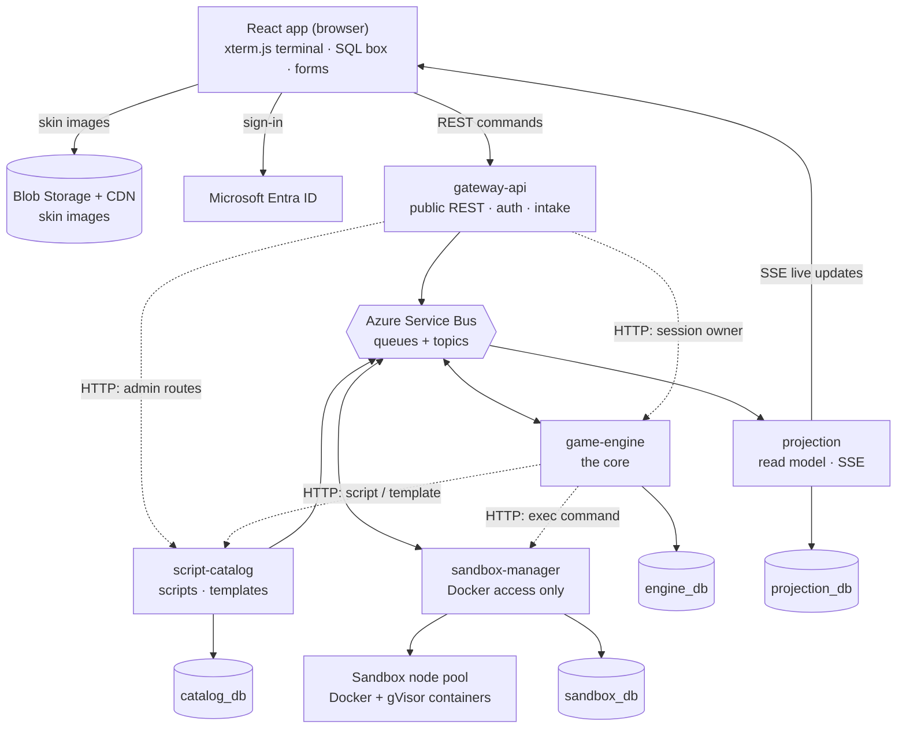

- Solid arrows are REST, SSE, Service Bus and database traffic. Dotted arrows are the four direct HTTP calls.
- What travels on each Service Bus arrow is shown in section 5.
- Redis is not drawn. It is a cache and lock store only (section 7), and it is not part of correctness.

## 5. Messaging: Events and Direct Calls

### Service Bus Entities

Every message carries `SessionId` = the player's sessionId. Every event carries `{eventId, sessionId, sessionVersion, occurredAt}`.

| Entity | Kind | Producer | Consumer | Message types |
| --- | --- | --- | --- | --- |
| player-commands | queue, sessions on, duplicate detection on (MessageId = client commandId, 10 min window) | gateway-api | game-engine | StartSession, SubmitInput, PlayerReconnected, AbandonSession |
| sandbox-commands | queue, sessions on, duplicate detection on | game-engine (outbox) | sandbox-manager | ProvisionSandbox, DestroySandbox |
| sandbox-events | topic, subscription engine (sessions on) | sandbox-manager (outbox) | game-engine | SandboxReady, SandboxFailed, SandboxDestroyed |
| game-events | topic, subscription projection (sessions on) | game-engine (outbox) | projection (later: hints, stats, SkillSwapper) | SessionStarted, PuzzleOpened, CommandEvaluated, PuzzleSolved, RoomEntered, PuzzleReset, SessionEscaped, SessionExpired, SessionAbandoned |
| catalog-events | topic, subscription engine (sessions off) | script-catalog (outbox) | game-engine | ScriptVersionPublished, TemplateVersionPublished |

All entities: up to 5 deliveries, then the dead-letter queue (DLQ). An alert fires when a DLQ is not empty, and an admin can replay from the DLQ after a fix.

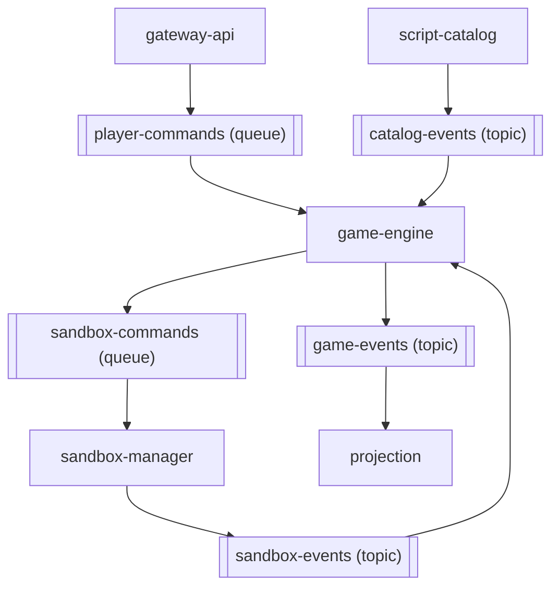

What Service Bus sessions give us:

- One consumer at a time per player session, first-in first-out inside it. Different players run in parallel.
- They do **not** give exclusion across different entities. A player command and a SandboxReady for the same session can be handled at the same time. The version column in the database serializes them (section 8).

Why the bus for each flow:

- **player-commands:** the gateway replies 202 at once; the bus keeps one player's commands in order and retries on failure.
- **sandbox-commands:** creating a container takes seconds; the engine doesn't wait, and the request survives a sandbox-manager restart.
- **sandbox-events:** the engine learns "ready" or "failed" without polling.
- **game-events:** the engine doesn't know who listens; later features subscribe without engine changes.
- **catalog-events:** tells the engine to drop its cached "current version" pointer.

### The Four Direct HTTP Calls

These four are the only direct service-to-service calls.

| From | To | Route | When and why |
| --- | --- | --- | --- |
| game-engine | sandbox-manager | `POST /internal/sandboxes/:id/exec` | Every sandbox command. Synchronous because the command needs its output. |
| game-engine | script-catalog | `GET /internal/scripts/:id/versions/:v` and `GET /internal/templates/:key/versions/:v` | Cache miss only. Published versions never change, so they are cached for 24 h. |
| gateway-api | game-engine | `GET /internal/sessions/:id/owner` | Cache miss only. The gateway has no database of its own. |
| gateway-api | script-catalog | `/admin/*` routes | Admin role is checked at the gateway. Publishing is rare and needs an immediate valid/invalid answer, so it is synchronous. |

### Public Routes

| Route | Service | Use |
| --- | --- | --- |
| `POST /sessions` `{scriptSlug, requestId}` | gateway-api | Start a game. Returns 202 `{sessionId}`. |
| `POST /sessions/:sid/puzzles/:key/inputs` `{commandId, input}` | gateway-api | Send one command or answer. Returns 202. |
| `POST /sessions/:sid/reconnect` `{commandId}` | gateway-api | Tell the engine the player is back. |
| `POST /sessions/:sid/abandon` | gateway-api | Give up the game (owner only). Sends AbandonSession. |
| `POST /admin/scripts/:id/versions/:v/publish` | gateway-api → script-catalog | Publish a Script version (admin role). |
| `GET /sessions/:sid/stream` | projection | SSE live updates (Entra token, owner only). |

## 6. Scripts and Components

### Script = State Machine

A Script version is data. Once published it never changes.

| Part | Fields |
| --- | --- |
| ScriptVersion | scriptId, version, durationMinutes, initialState, states, finalStates |
| State (= a room) | key, puzzles, transitions |
| Puzzle | key, templateRef (`key@version`), opensAfter (list of puzzle keys, or none), onRuin (`resetPuzzle` or `resetRoom`) |
| Transition | on (`PuzzleSolved`, `AllSolved` or `Timeout`), guard, to (state key) |

- A session's position is its current state key plus its puzzle rows for that state.
- A session is pinned to the Script version it started with. Publishing a new version never changes running sessions.
- The engine core is one pure function: `transition(sessionSnapshot, event, scriptVersion) -> {nextSnapshot, effects[]}`. Effects are the outbox messages (ProvisionSandbox, DestroySandbox, domain events). It does no I/O, so it is easy to unit-test.

Checks on publish (script-catalog):

- every state is reachable;
- a final state is reachable from every state;
- every templateRef exists and is published;
- no opensAfter cycles;
- the winning path replays in CI with each template's solution.

### Component Factory

- A **Component Template** (in the catalog, versioned, never changed once published) has: key, version, family (`sandbox` or `input`), engine, inputSchema, policy, goal, invariants, solutionRef.
- Sandbox engines `terminal-git` and `sql` add: imageDigest, seedScript, checks (probe commands run inside the container).
- Input engines `hash`, `rsa`, `tls` and `answer` add a seed: the expected hash, N/e, the encrypted PMS, client random, server random, records.
- `ComponentFactory.create(puzzleDef, template)` looks up the engine in a registry and returns the matching class: TerminalGitComponent, SqlComponent, HashComponent, RsaComponent, TlsComponent or AnswerComponent.
- Components are built per message from cached template data and keep no state. Nothing is generated or stored per Script.
- A new Script or new puzzle order is new data. New template content is a new template version. Only a new engine needs code (a new class and, for a sandbox engine, an image).

How the input engines judge an answer (inside game-engine, on a worker_threads pool, 2 s limit; hex input up to 8 KB, RSA key up to 4096 bits):

| Engine | Check |
| --- | --- |
| answer | Plain field compare against the seed (login form, door code). The fields come from the seed. |
| hash | `sha256(input)` compared in constant time (`timingSafeEqual`). Never reversed. |
| rsa | The key must match N; then decrypt the PMS (PKCS#1 v1.5). |
| tls | TLS 1.2 PRF(PMS, client random, server random) → keys → decrypt the records. |

### Class Diagram: Script and Session

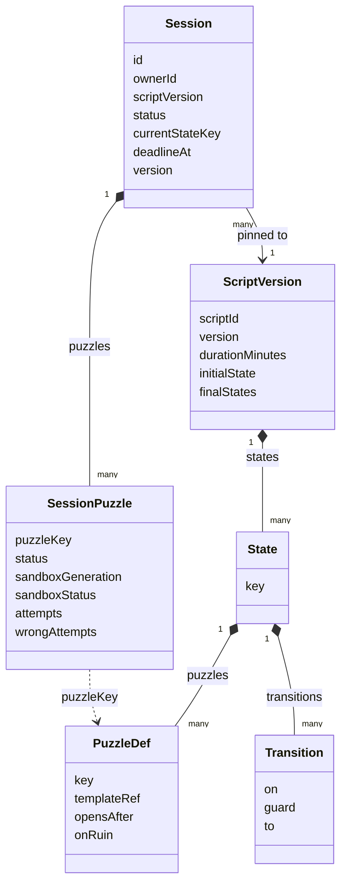

### Class Diagram: Component Contract

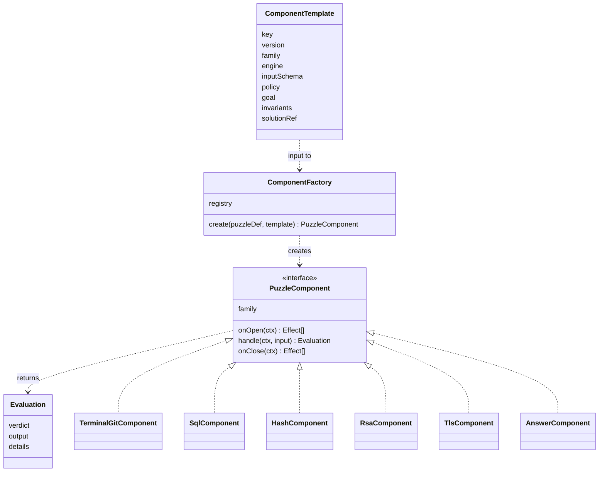

The contract (`<<interface>>` PuzzleComponent):

| Method | Sandbox family | Input family |
| --- | --- | --- |
| `onOpen(ctx)` | returns ProvisionSandbox | returns nothing |
| `handle(ctx, input)` | runs the command in the sandbox, then the checks | compares the answer on the worker pool |
| `onClose(ctx)` | returns DestroySandbox | returns nothing |

`handle` returns an Evaluation whose verdict is one of `progress`, `solved`, `rejected`, `ruined`.

| Verdict | Meaning |
| --- | --- |
| progress | The command ran; the goal is not met yet. |
| solved | The goal is met. The engine may open the next puzzles, enter the next room, or end in Escaped. |
| rejected | Not run or not accepted (blocked by policy, wrong answer, sandbox restarting, time is up). |
| ruined | An invariant broke (for example an extra git commit or DROP TABLE). The puzzle or room resets. |

Only sandbox kinds (`sql`, `terminal-git`) can be ruined. A wrong answer on an input kind is rejected, never a ruin.

## 7. Sandboxes

- **Identity.** `sandboxId = hash(sessionId, puzzleKey, generation)`. The container name is the sandboxId, so Docker rejects a duplicate create.
- **Provision** (ProvisionSandbox): upsert the row (if it is already ready, send SandboxReady again); take a Redis lock to avoid a parallel create; create the container from the pinned image digest with labels; start it; run the seed script; health-check it (the template's ready probe, 3 tries, 10 s total); send SandboxReady, or SandboxFailed and destroy it.
- **Exec** (HTTP from the engine, carries the commandId): if a stored result exists for that commandId, return it, so a redelivery never runs a command twice. Otherwise run the command with a 5 s timeout and a 64 KB output cap, run the checks, store and return the result. Each exec extends the idle lease by `SANDBOX_IDLE_MINUTES` (15).
- **Destroy:** remove the container, mark it destroyed, send SandboxDestroyed. A missing container counts as success.
- **Reconnect rule:** a sandbox never keeps state across a reconnect. A reconnect gives every open sandbox puzzle generation+1 and a fresh container.
- **Terminal (decision D2):** line by line. Each Enter is one SubmitInput. No interactive terminal (no vim, no less) and no WebSocket. The sandbox image sets `GIT_PAGER=cat` and `PAGER=cat`, so `git log` and `git show` print straight through. The xterm.js view keeps a prompt, local line editing and up-arrow history.

Isolation for every container:

| Area | Rule |
| --- | --- |
| Runtime | gVisor (`runsc`) |
| Network | none; egress also denied at the node firewall |
| Disk | read-only root filesystem + tmpfs `/work` (64 MB); no host mounts |
| User and rights | user 1000:1000, all capabilities dropped, no-new-privileges, default seccomp |
| Limits | 64 processes, 256 MB memory with no swap, 0.5 CPU, 256 open files |
| Secrets | no Docker socket, no secrets or credentials in the environment |
| Images | pinned by digest, built in CI |
| Hosts | separate sandbox node pool; the Docker API is reachable only by sandbox-manager on that host |

## 8. Data Consistency

### One Transition, One Transaction

`sessions.version` is a version column. Puzzle rows belong to the session, so any change to them also bumps the session version. Writes always read the database, never the cache.

1. Begin a transaction.
2. Insert the message id into the inbox. A duplicate fails the unique key, so the message is acknowledged with no effect.
3. Read the session and its puzzles (version = v).
4. Run the guards, the component and `transition()`.
5. Update the session to version v+1, only where the version is still v. Zero rows updated means another writer won.
6. Save the puzzles, the command log row and the outbox rows.
7. Commit. Then delete the Redis `session:{id}` key, then complete the Service Bus message.

If another writer won: roll back, abandon the message, and Service Bus redelivers it; the handler re-reads and re-evaluates. After 5 deliveries it goes to the DLQ. The three writers this protects against each other are the command handler, the sandbox-event handler and the janitor. Redis locks are not part of correctness; correctness comes from the version column and unique keys. Locks only stop wasted work.

### Outbox and Inbox

- **Outbox:** game-engine, sandbox-manager and script-catalog each have one. Rows are written in the same transaction as the state change, so there are no lost or phantom events. One relay leader per service (Redis lock) sends unsent rows in order, with MessageId = the row's messageId. A crash between send and mark-sent causes a resend, which Service Bus duplicate detection or the consumer's inbox drops. Sent rows are deleted after 7 days.
- **Inbox:** `(consumer, messageId)` is unique. Inserted in the consumer's transaction. Kept 14 days.

Layers that stop duplicates:

1. The client's commandId is the MessageId, so Service Bus drops duplicates.
2. The inbox unique key.
3. Natural keys: sandboxId, container name, the stored exec result per commandId.
4. Each event's sessionVersion: projection ignores a version it already has.

### Redis

Redis is for caching and locks only. If Redis errors or takes more than 50 ms, services fall back to the database or the internal API; a circuit breaker opens after 5 failures for 30 s.

| Key | Holds | Lifetime |
| --- | --- | --- |
| `tpl:scriptver:{scriptId}:{version}` | a published Script version | 24 h, never needs clearing |
| `tpl:template:{key}:{version}` | a published template | 24 h |
| `tpl:script:{slug}:current` | pointer to the published version | 60 s, deleted on publish |
| `session:{id}` | hot snapshot: version, status, ownerId, currentStateKey, puzzles | 5 min, deleted after every commit |
| `lock:relay:{service}` | outbox relay leader | 15 s, renewed |
| `lock:janitor:{service}` | cleanup job leader | 60 s |
| `lock:provision:{sandboxId}` | one container create at a time | held while creating |

Rules:

- **One read point.** Every session read goes through one SessionReader (gateway: `getSessionOwner`; engine read API: `getSessionSnapshot`). The session cache lives only there. The session cache is kept (proposal P2 was rejected).
- **Cache-aside.** After commit the writer deletes `session:{id}`. Refilling uses a compare-and-set: write only if the cached version is older, so a slow reader cannot put an old snapshot back.
- **Publish.** The catalog commits the pointer change and the outbox row, then deletes the pointer key. The engine deletes it again when it receives ScriptVersionPublished. Worst case is the 60 s lifetime.
- projection does not use Redis. Live updates go through Postgres LISTEN/NOTIFY.

## 9. Data Model

Each service owns its own database. There are no foreign keys between databases.

The column types in these diagrams are illustrative; the TypeORM entities and migrations are authoritative.

### engine_db (game-engine)

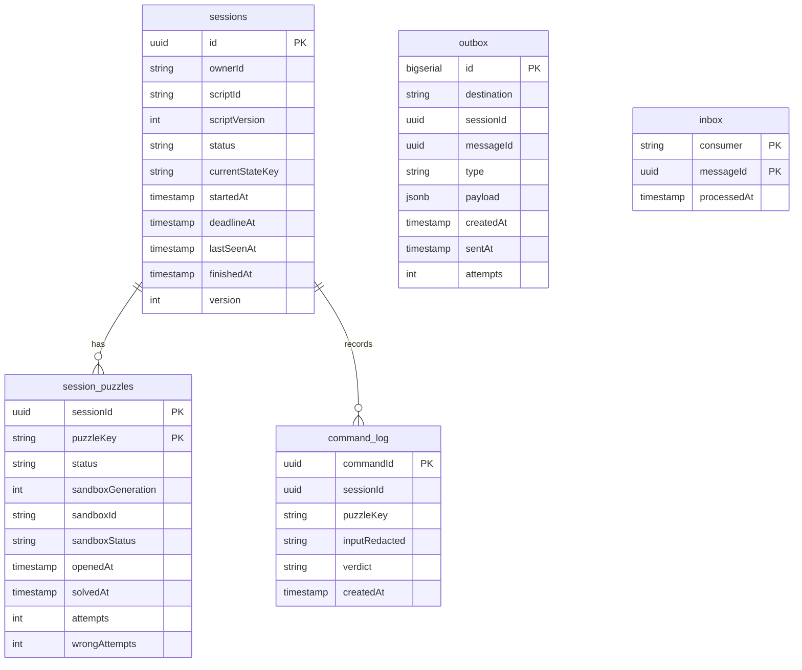

- `sessions.status`: Active, Escaped, Expired, Abandoned.
- `session_puzzles.status`: locked, open, solved. `sandboxStatus`: none, provisioning, ready, failed.
- Solve time, tries and wrong answers per puzzle per player come from `session_puzzles` (openedAt → solvedAt, attempts, wrongAttempts).

### catalog_db (script-catalog)

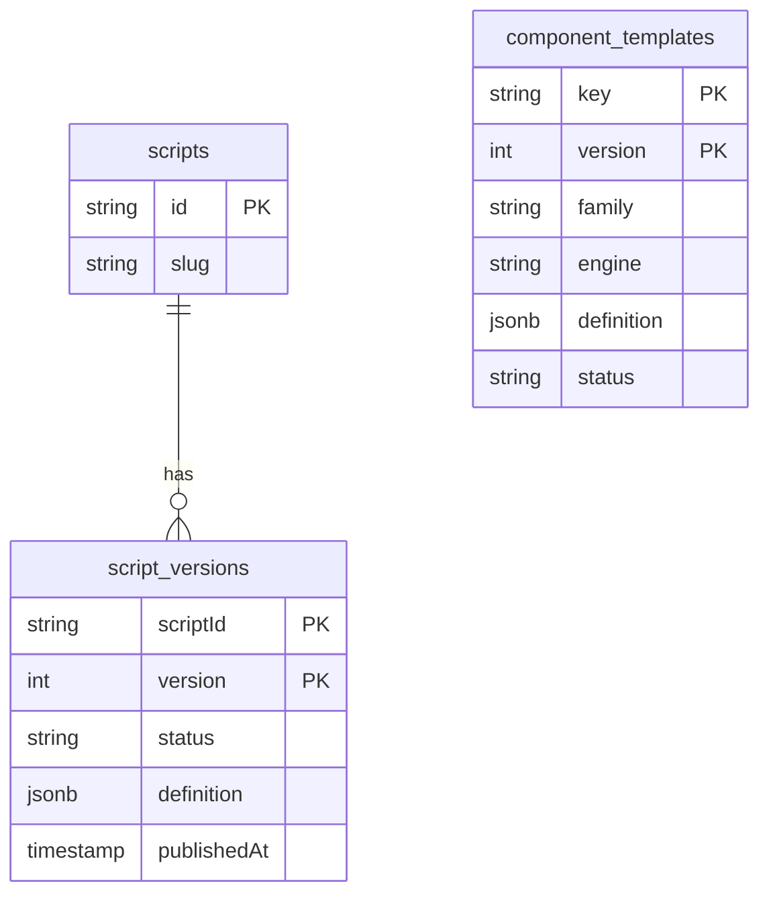

- `script_versions.status`: draft, published, retired.
- script-catalog also has an outbox (same shape as in engine_db).

### sandbox_db (sandbox-manager)

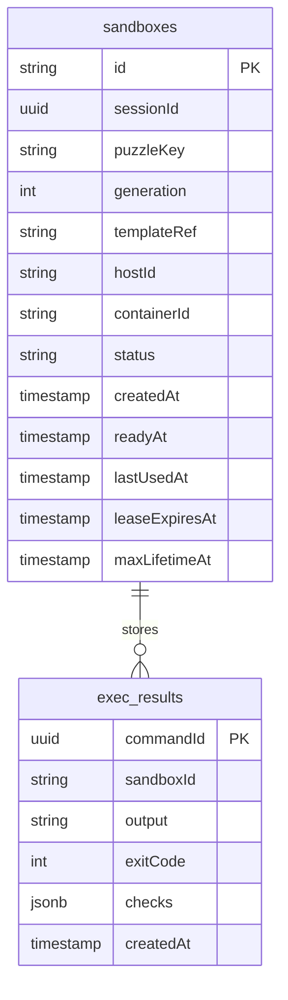

- `sandboxes.status`: creating, ready, failed, destroying, destroyed. sandbox_db also has an outbox.

### projection_db (projection)

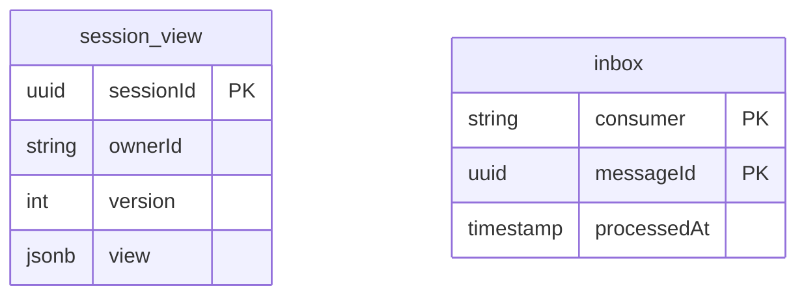

- projection writes `session_view` only when an event's sessionVersion is newer than the stored version.

## 10. Session Lifecycle

### Session Status

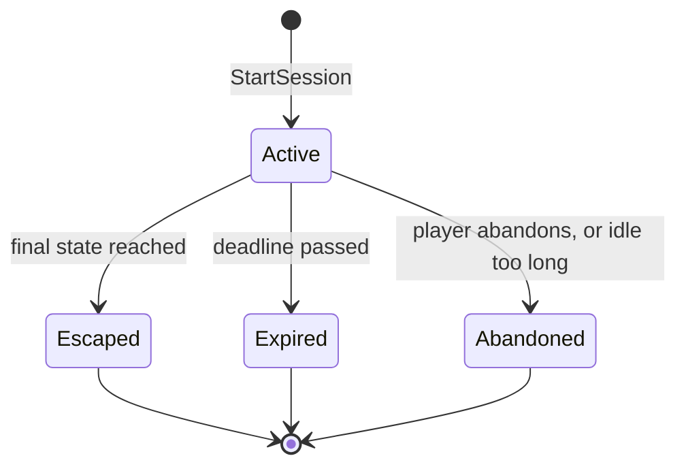

- Escaped, Expired and Abandoned are final; there is no way out of them.
- Abandoned: the player sends `POST /sessions/:sid/abandon` (owner only; gateway-api sends AbandonSession), or the janitor abandons a session idle for `ABANDON_MINUTES`.
- A ruin is not an ending (decision D1). It resets the puzzle or the room and the clock keeps running. Ruins stay visible in stats through the PuzzleReset event and the command log verdict `ruined`.

### Puzzle Status

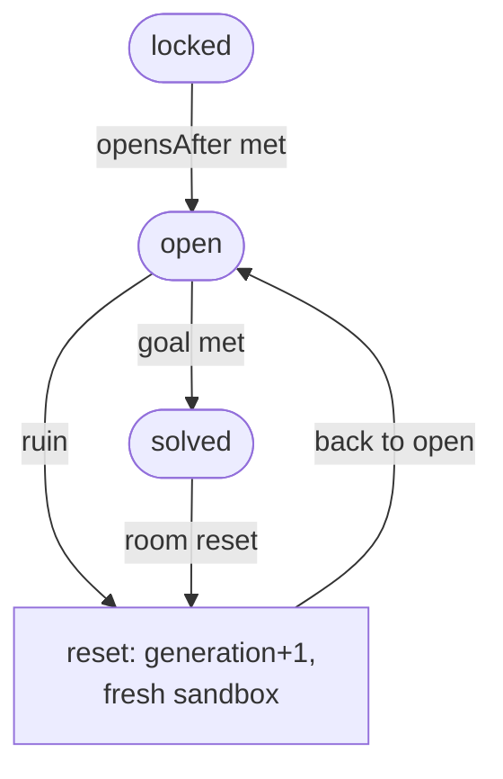

Rounded boxes are puzzle statuses; the square box is the reset step, not a status.

- `onRuin = resetPuzzle`: the ruined puzzle gets generation+1 and a fresh sandbox.
- `onRuin = resetRoom`: the same for every puzzle in the room, and solved puzzles in that room go back to open.

### Cleanup Jobs

game-engine janitor (every 60 s, one leader):

- Active and past the deadline → Expired, and destroy every live sandbox.
- Active and not seen for `ABANDON_MINUTES` (30) → Abandoned, and destroy.
- A puzzle waiting more than 3 min for its sandbox → provision again with generation+1 (at most 3 times, then mark the puzzle unavailable and alert).
- Outbox rows unsent for more than 5 min → alert.

Expiry is also checked on every command (`now < deadlineAt`), so the janitor's delay never lets a late answer count.

sandbox-manager reaper (every 60 s on each host):

- Lease expired, or past the 2 h hard cap → destroy.
- Stuck in creating for more than 3 min → failed, destroy, SandboxFailed.
- A managed container with no row, or with a destroyed row → remove (orphan).
- A ready sandbox whose health probe fails 3 times in a row → destroy and SandboxFailed (the engine provisions again).

## 11. Key Flows

### F1 Start a Game

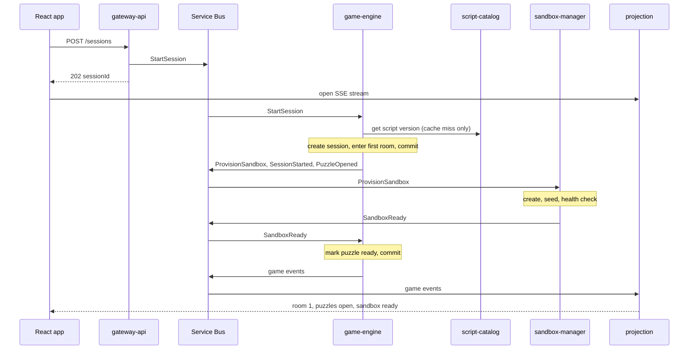

### F2 Normal Sandbox Command

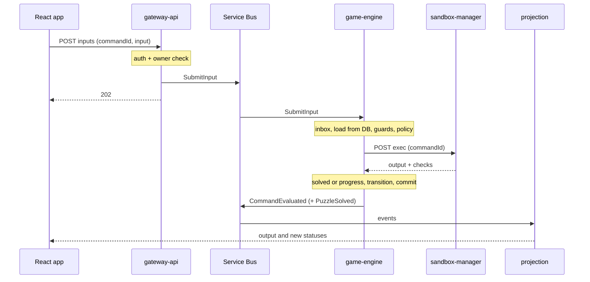

- Guards: session Active, before the deadline, puzzle open, sandbox ready, generation matches. Otherwise the verdict is `rejected` with a reason (for example "sandbox restarting").
- The policy deny-list runs on the parsed input first; a blocked command is rejected, not run.
- A solve may open the next puzzles, enter the next room (RoomEntered) or end the game (SessionEscaped).

### F3 Ruin, Then Reset

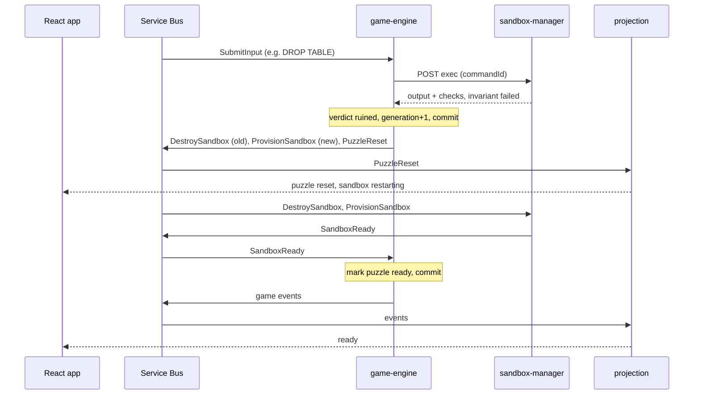

- Intake is the same as F2 (gateway-api, 202).
- With `resetRoom` the same happens for every puzzle in the room, and solved puzzles in that room go back to open.
- The session stays Active and the clock keeps running (decision D1).

### F4 Crypto Answer (Hash, RSA, TLS)

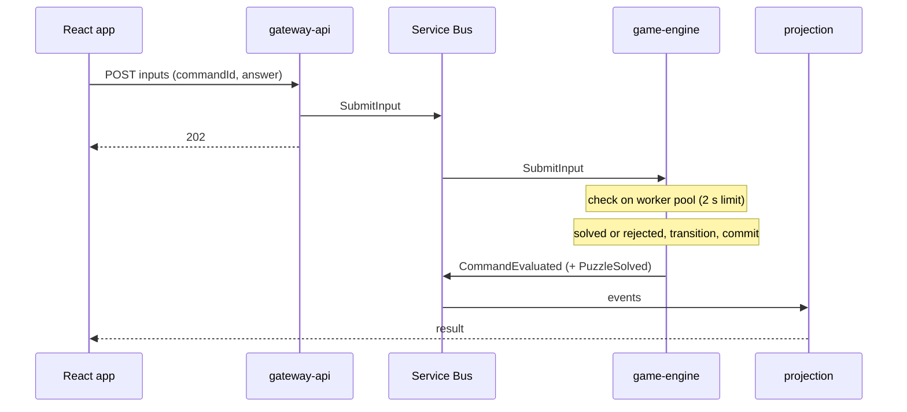

- No sandbox. A wrong answer counts as a wrong attempt.

### F5 Reconnect

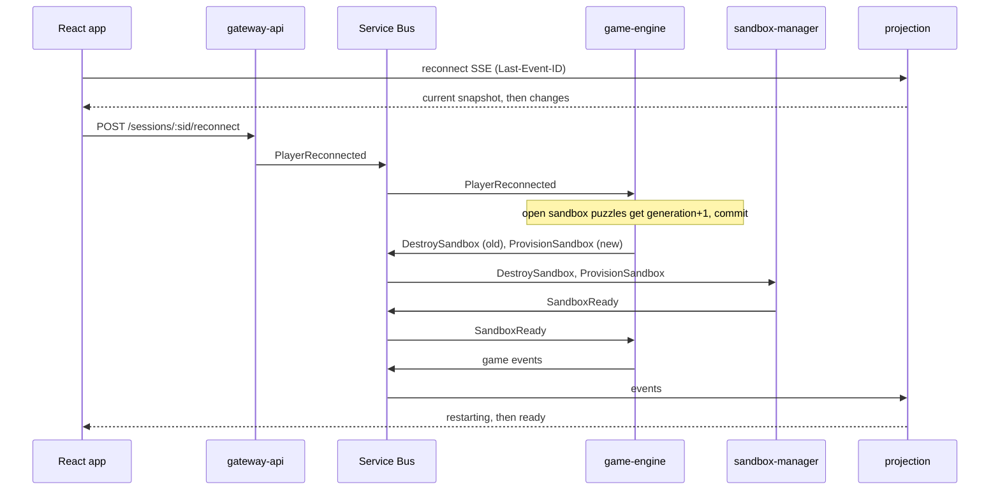

### F6 Time Runs Out

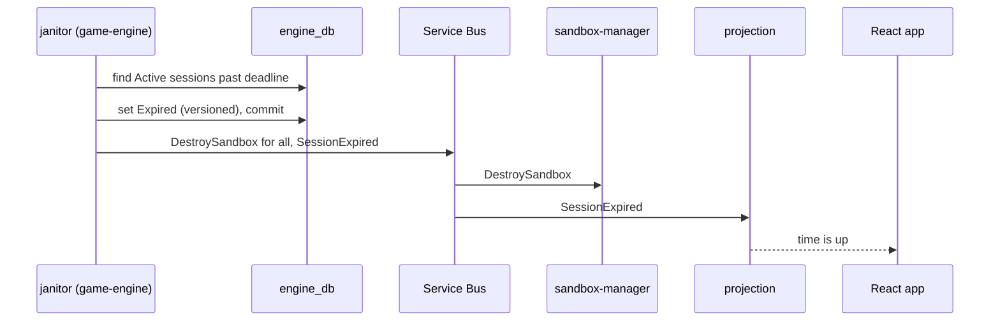

- If a player command commits first, the janitor's write loses on the version check; it re-reads and expires the session on its next pass.
- If the janitor commits first, the command's guard sees Expired and rejects it.

### F7 Admin Publishes a Script Version

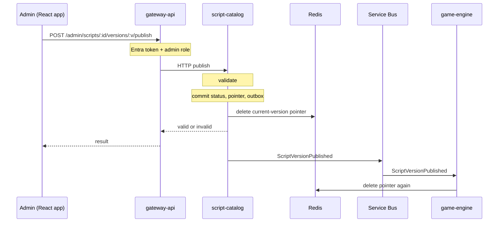

- New sessions use the new version; running sessions keep theirs.

## 12. Real-Time Updates (projection)

- projection does not use Redis. Live updates go through Postgres LISTEN/NOTIFY.
- projection reads game-events in order per session and updates `session_view` only if the event is newer than what it has. Then it sends a Postgres NOTIFY.
- Every projection instance LISTENs and pushes to its own SSE connections at `GET /sessions/:sid/stream` (Entra token, owner only).
- On connect or reconnect it sends the current snapshot first (id = version), then changes. Last-Event-ID lets the browser skip versions it already has.
- Why SSE and not WebSocket: commands already go over REST, the push is one-way, and SSE reconnects by itself and resumes from the last version.
- The browser shows only the view: puzzle statuses, command output, a countdown from `deadlineAt`, and "sandbox restarting".

## 13. Demo Script: The Escape Room (decision D3)

The escape room from the story script is the demo content. It is data only; the engine runs it like any other Script. The experience is built from clickable images (the skin), and the server drives it.

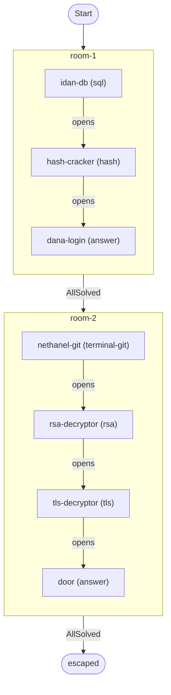

| Room | Puzzle | Engine | opensAfter | What the player does |
| --- | --- | --- | --- | --- |
| room-1 | idan-db | sql | none | On Idan's computer, queries the `employees` and `logs` tables read-only: finds Dana's username, then her auth log entry, and copies her password hash. |
| room-1 | hash-cracker | hash | idan-db | Enters the hash in the Hash-Cracker machine and gets Dana's password. |
| room-1 | dana-login | answer | hash-cracker | Logs in to Dana's computer with her username and password. An "open room" file appears; it is only the UI of the move to room-2. |
| room-2 | nethanel-git | terminal-git | none | In the git terminal on Nathaniel's computer, finds the commit "Security fix: Removed private key from repository." and recovers the private key from the previous commit. |
| room-2 | rsa-decryptor | rsa | nethanel-git | Pastes the private key, the encrypted PMS and the modulus N (both from the `Cibus_payment_try.pcap` capture) and gets the decrypted PMS. |
| room-2 | tls-decryptor | tls | rsa-decryptor | Pastes the PMS and the client random from the capture and gets the decrypted capture. |
| room-2 | door | answer | tls-decryptor | Finds Nathaniel's credit card number in the decrypted App-Data records and enters it on the door lock. |

- Room transitions: room-1 → room-2 on AllSolved; room-2 → escaped on AllSolved.
- `onRuin = resetPuzzle` for every puzzle; resetRoom is not used in the demo. Only idan-db (sql) and nethanel-git (terminal-git) can be ruined; a wrong answer on the other puzzles is rejected.
- Table names: `employees` and `logs` are correct (the story script's extra table names are not used).
- Winning: the door opens, Dana appears with a "Welcome to the team" sign. The session ends as Escaped.

## 14. Failure Handling

| Risk | How it is handled |
| --- | --- |
| Sandbox escape | gVisor, no network, non-root, read-only disk, dropped capabilities, seccomp, limits, separate node pool, egress denied, no socket or secrets, pinned images. A breakout lands on an isolated machine with nothing to steal. |
| Fork or disk bombs | Process limit, tmpfs size, memory without swap, 5 s exec kill, 64 KB output cap. |
| Duplicate messages | Service Bus duplicate detection, inbox, natural keys, stored exec results. A redelivery never runs a sandbox command again. |
| Two writers at once | Version column; the loser retries from a fresh read. |
| Out of order | Per-session order on the bus, one relay leader, sessionVersion in events. |
| Expiry vs solve | Whichever commit wins; the guard checks the deadline again on retry. |
| Double provision | Fixed sandboxId, unique container name, row upsert, lock. |
| Stale sandbox | Generation check: commands and events for an old generation are rejected or ignored. |
| Leaked containers | Lease, max lifetime, labels, orphan reaper. The lease still expires if a destroy message is lost. |
| Stale cache | Immutable versioned keys, 60 s pointer, delete twice, delete after commit + version compare-and-set, writes skip the cache, Redis down → database. |
| Service Bus down | The gateway returns 503; the client retries with the same commandId. Outbox rows wait and are sent later. |
| Poison message | DLQ after 5 deliveries, alert, admin replay after a fix. |
| sandbox-manager down | Commands are rejected "sandbox unavailable" (5 s exec timeout); provisioning waits in the queue; the janitor retries. |
| projection lagging | The browser shows the last snapshot; a reconnect resyncs. |

## 15. Later Features

These only subscribe to game-events; the engine does not change for them: hints, admin statistics, SkillSwapper lookup, Clippy coach.

## 16. Environment Configuration

Each service has a `.env.example`. Real values live in Azure Key Vault.

| Variable | Default | Meaning |
| --- | --- | --- |
| `SERVICEBUS_NAMESPACE` | | Azure Service Bus namespace |
| `DATABASE_URL` | | the service's own database |
| `REDIS_URL` | | Redis cache and locks |
| `ENTRA_TENANT_ID` | | Microsoft Entra tenant |
| `ENTRA_API_CLIENT_ID` | | Entra app id of the API |
| `CORS_ORIGINS` | | allowed browser origins (gateway-api, projection) |
| `SANDBOX_IDLE_MINUTES` | 15 | idle lease per sandbox |
| `SANDBOX_MAX_LIFETIME_MINUTES` | 120 | hard cap per sandbox |
| `SANDBOX_EXEC_TIMEOUT_MS` | 5000 | exec kill timeout |
| `SANDBOX_MAX_OUTPUT_BYTES` | 65536 | exec output cap |
| `ABANDON_MINUTES` | 30 | inactivity before Abandoned |
| `OUTBOX_RETENTION_DAYS` | 7 | keep sent outbox rows |
| `INBOX_RETENTION_DAYS` | 14 | keep inbox rows |
| `SWAGGER_ENABLED` | | turn the OpenAPI (Swagger) page on or off |

Frontend: `VITE_API_BASE_URL`, `VITE_ENTRA_CLIENT_ID`, `VITE_ENTRA_TENANT_ID`, `VITE_ENTRA_API_SCOPE`, `VITE_ASSETS_BASE_URL`.

Variables per service:

| Service | Variables |
| --- | --- |
| gateway-api | `SERVICEBUS_NAMESPACE`, `REDIS_URL`, `ENTRA_TENANT_ID`, `ENTRA_API_CLIENT_ID`, `CORS_ORIGINS`, `SWAGGER_ENABLED` (no `DATABASE_URL`) |
| game-engine | `SERVICEBUS_NAMESPACE`, `DATABASE_URL`, `REDIS_URL`, `ABANDON_MINUTES`, `OUTBOX_RETENTION_DAYS`, `INBOX_RETENTION_DAYS` |
| sandbox-manager | `SERVICEBUS_NAMESPACE`, `DATABASE_URL`, `REDIS_URL`, `SANDBOX_*`, `OUTBOX_RETENTION_DAYS`, `INBOX_RETENTION_DAYS` |
| script-catalog | `SERVICEBUS_NAMESPACE`, `DATABASE_URL`, `REDIS_URL`, `OUTBOX_RETENTION_DAYS` |
| projection | `SERVICEBUS_NAMESPACE`, `DATABASE_URL`, `ENTRA_TENANT_ID`, `ENTRA_API_CLIENT_ID`, `CORS_ORIGINS`, `INBOX_RETENTION_DAYS` |
| frontend | the `VITE_*` variables above |

## 17. Decisions Made

| Id | Decision (Daniel, 2026-10-27) |
| --- | --- |
| D1 | A ruin never ends the game. It resets the puzzle or the room; the clock keeps running. Endings stay Escaped, Expired, Abandoned. |
| D2 | Line-by-line terminal. No interactive terminal, no WebSocket. The sandbox sets `GIT_PAGER=cat` and `PAGER=cat`. |
| D3 | Keep the story-script puzzles as the demo script. A Script is content in the database; the engine runs any Script. |
| P2 | Rejected. The Redis session cache stays. |

## 18. Open Decisions

Not decided yet. The body of this document describes the current five-service design.

| Id | Question | Proposal |
| --- | --- | --- |
| (a) | What goes in the admin overview (Redis key `admin:overview`)? | Active sessions, finished today, average solve time per puzzle, wrong attempts per puzzle. Owned by projection, served as `GET /admin/overview` through gateway-api (admin role), rebuilt when a session ends, read from projection_db on a miss. |
| P1 | Fold script-catalog into game-engine as a module? | Gains: one fewer service, database, topic and cache-clearing path. Costs: admin publishing shares a process with live games. |
| P3 | Fold projection into game-engine for the demo? | Gains: one fewer service and database. Costs: lose a separately scalable read side; SSE load lands on the core. |
| P4 | Keep gateway-api, sandbox-manager and Service Bus as they are? | Why: auth in one place, Docker kept away from the core, per-player ordering. |
