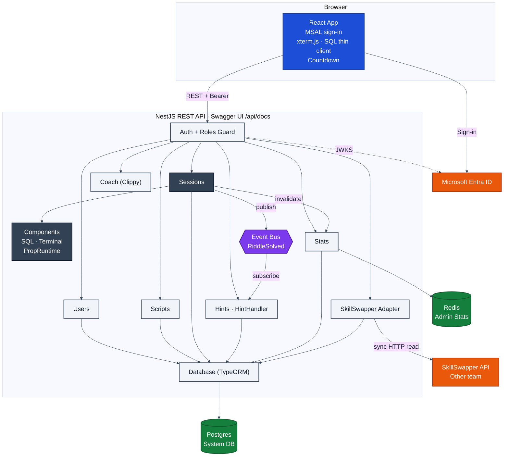
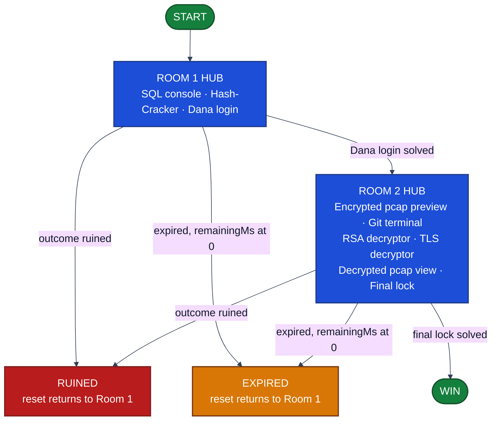
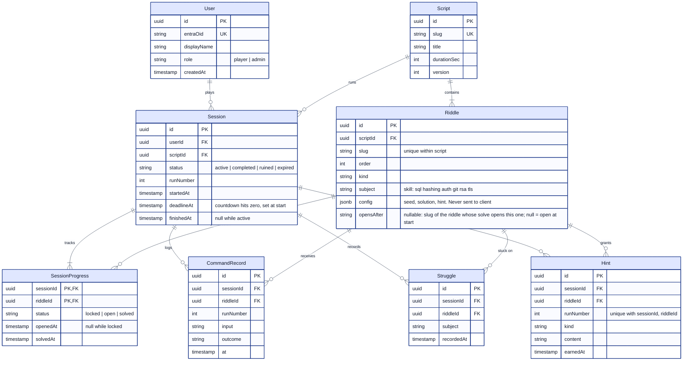
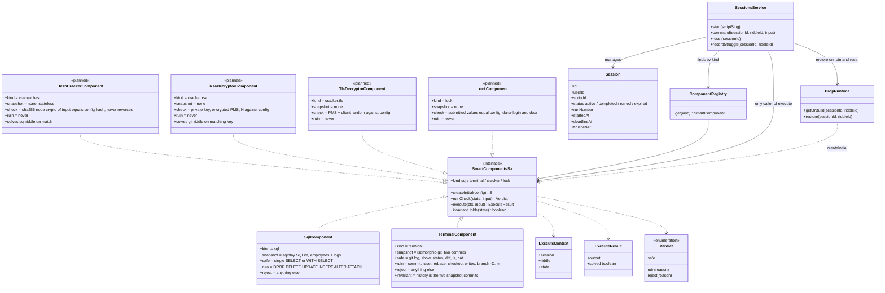
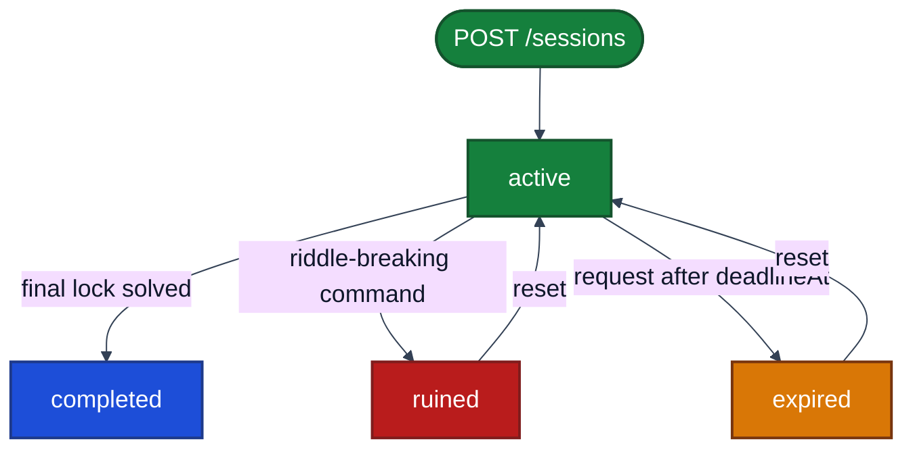
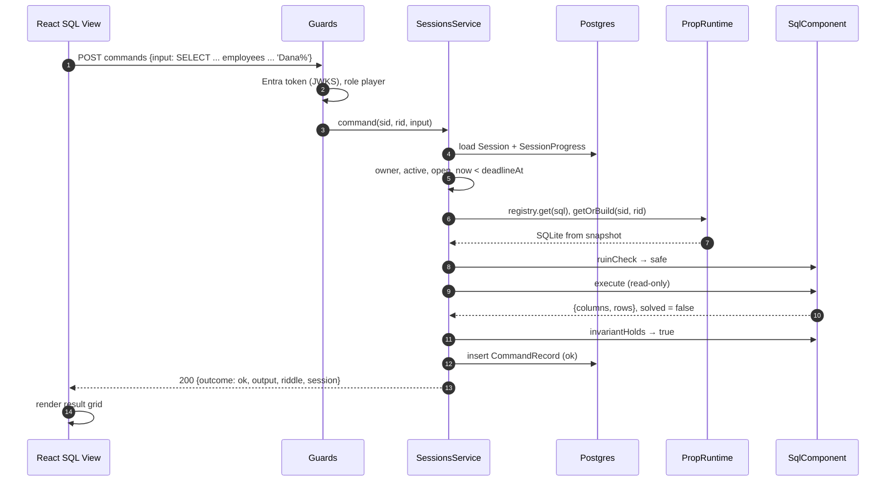
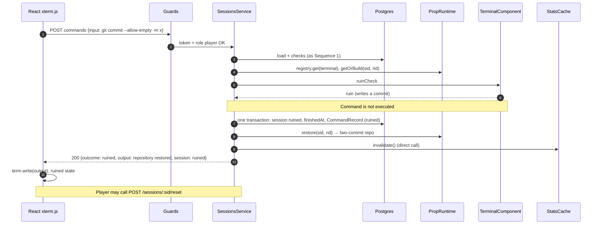
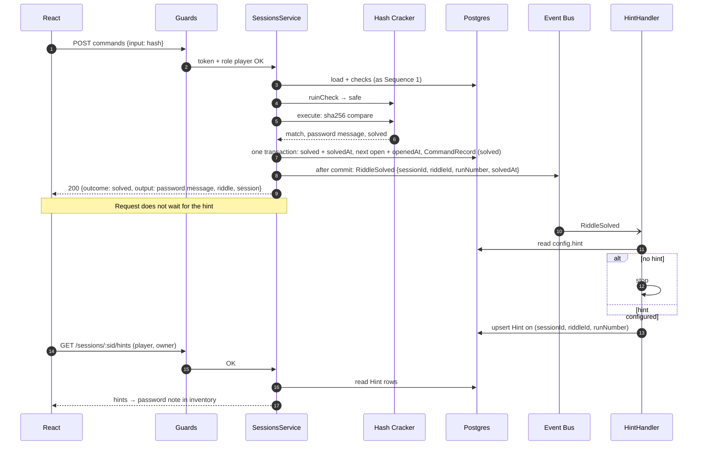
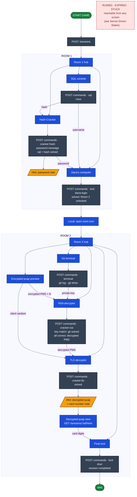

# Smart Test Components: Platform and Escape Room Design

# Part 1: Platform

## Project Definition

- A headless platform of smart test components. Each component is a self-contained challenge (SQL database, git terminal, hash cracker, decryptor, lock).
- The player sends commands. The server decides every outcome: allowed, solved, or ruined.
- No product UI. React presents state and collects input only.
- The browser never owns business rules. The server never renders the UI.
- **The escape room is one script on this platform:** an ordered list of riddles with sample content. There is no second backend.

## Scope

| Status | Items |
| --- | --- |
| Built (base) | Entra sign-in, session start, session timer |
| Specified, not built | Everything else in this document |

## Technology Stack

These are binding constraints. A design choice that drops one is a change to this section, not a local exception.

| Area | Rule |
| --- | --- |
| Backend | NestJS in TypeScript. The REST API (HTTP and JSON) owns all business logic: validation, state changes, and domain rules. OpenAPI is published through Swagger UI (`@nestjs/swagger`). TypeScript only; no Java or JDK. |
| Frontend | React in TypeScript. It talks to the backend only through the REST API. It presents state and collects input. It never owns a business rule and never opens Postgres, Redis, or the event bus. |
| Authentication | Microsoft Entra ID. The browser signs in with Entra and sends the token. The server validates it on every call. No passwords are collected, hashed, or stored, and there are no server-side session cookies. |
| Authorization | Role-based and enforced on the server. Every protected action names its role. A missing or insufficient role is rejected by the API. Hiding a button is not authorization. |
| Database | Postgres is the system database, accessed only through TypeORM. Users store their Entra identity, never a password. TypeORM migrations build the schema, and one documented command rebuilds a clean local database. Connection settings come from environment variables: `.env.example` lists them with placeholders, and the real `.env` and secrets stay out of git. No in-memory or mocked substitute: an API write survives a restart. |
| Caching | Redis for exactly one feature: **Admin Statistics**. It caches read-heavy aggregates for `GET /admin/stats`. Postgres is the source of truth, and the cache is cleared when a session ends. No other feature adds a cache. |
| Event-driven | Exactly one feature: **Hint Platform**. Sessions publishes `RiddleSolved`, and a separate handler stores the earned note. The request does not do that work inline. Every other feature is request/response. |

### Riddle Props

Riddle props are riddle state, not TypeORM databases. Postgres remains the system database.

- **SQL riddle:** sqlplay supplies the small SQLite database with the `employees` and `logs` tables. Only `SELECT` is allowed.
- **Hash-Cracker:** the server stores a sha256 hex built with Node `crypto` in `logs`. It compares the player's hash to that value and returns Dana's password on a match. It never reverses a hash.
- **Terminal riddle:** xterm.js (`@xterm/xterm`) draws the screen only. The repository is isomorphic-git on the server: two commits, where the first adds the private key and the second removes it with "Security fix: Removed private key from repository." The terminal sends each line to the server, and the server returns text.

## System Architecture

Color key: blue = browser, gray = API modules, purple = event bus, green = data stores, orange = external services.

### Architecture Rules

- Only the Database module accesses Postgres.
- Only the Stats module accesses Redis.
- Only Sessions publishes events. Only Hints subscribes.
- Only Sessions runs components. Components never call Sessions.
- Riddle props (SQLite database, git repository) live in server memory per session and component. They are riddle state, not Postgres data and not a cache.
- SkillSwapper belongs to another team. Read-only, synchronous, nothing stored.

### Service Layout: One Backend, Two Repos

- Two repos: frontend (React) and backend (NestJS).
- One backend service: a modular monolith. Riddles (Components module: SmartComponent kinds, ComponentRegistry, PropRuntime) and Story (Scripts and Sessions modules) are modules inside it, not separate services. Hints, Stats, Coach, and the SkillSwapper adapter are modules too.
- Why not microservices:
  - One team, one domain. No independent scaling or deploy need.
  - Ruin-and-reset must be atomic: stop session, restore prop, write records, respond, in one transaction. Across services that becomes a distributed transaction or saga.
  - A command is one in-process call (Sessions to component), not a network hop with retries, timeouts, and versioned contracts.
  - One deploy, one database, one log stream, one Swagger.
  - Module boundaries plus the Architecture Rules (only Database touches Postgres, only Stats touches Redis, only Sessions calls execute) give the same separation.
- Split later if needed: modules talk through services and the one event, so a module (for example Hints or Stats) can be extracted without redesign.

## React Rules & Constraints

**Allowed**

- Sign in with MSAL and call the REST API with the Entra token.
- Render the terminal (xterm.js) and the SQL thin client (one command box, one result grid).
- Render the countdown from server `deadlineAt` / `remainingMs`.
- Display outcomes returned by the server.

**Not allowed**

- Decide solved, ruined, or allowed.
- Parse SQL or git; hash or compare.
- Perform RSA or TLS decryption, or any puzzle computation.
- Hold a repository or a SQLite file.
- Gate steps or own the timer.
- Open Postgres, Redis, or the event bus.

**Server-side riddles**

- sqlplay runs on the server only. The browser receives columns and rows.
- RSA and TLS decryptors run on the server. The browser sends inputs and renders output.
- The browser never decrypts the pcap. It receives the plaintext pcap or card number only as the server response to a correct TLS decryptor submission.

## Frontend Scene State Machine

Room-level view. The puzzle-level flow is in Part 2.

Color key: blue = room hubs, green = start and win, red = ruined, amber = expired.

### Transition Rules

- Opening and closing windows, and click-outside, are local.
- Every progress transition (room unlock, riddle solved, win) fires only on a server response outcome.
- Room 2 unlocks on outcome `solved` for the dana-login lock. The "open room" desktop icon is a local step after that response.

### Server-Driven States

| State | Trigger | Behavior |
| --- | --- | --- |
| Ruined | Outcome `ruined` | Show message; offer reset (`POST /sessions/:sid/reset`); return to Room 1 hub with fresh state |
| Expired | Outcome `expired`, or server `remainingMs` ≤ 0 | Show time-up; offer reset |
| Stuck | Player action: `POST /sessions/:sid/struggles` | Open help panel; stay in current scene |

### Timing and Hints

- The visible countdown renders server `deadlineAt` / `remainingMs`. It is the only countdown; no per-riddle or per-phase timers in the browser.
- The frontend sends no timer calls. Riddle timing arrives in solve responses: `riddle {status, openedAt, solvedAt}`.
- After a `solved` outcome, refresh the inventory with `GET /sessions/:sid/hints`. The note may lag the response.

### Submissions

- Hash check: `POST /sessions/:sid/riddles/:rid/commands` with the hash as `input`. Returns outcome `solved` and the message with Dana's password. No GET.
- Dana login, final lock, RSA and TLS: POST commands to their riddles.
- Encrypted pcap delivery: open item.

## Component Responsibilities

| Module | Responsibility |
| --- | --- |
| Config | Environment variables only (`.env`, `.env.example`) |
| Database | TypeORM to Postgres, migrations. Only path to Postgres |
| Auth | Validates Entra tokens (JWKS; audience = API client id). Global guard. No passwords |
| Roles (in Auth) | `@Roles(role)` + roles guard. Roles: `player`, `admin`. Every protected endpoint names one |
| Users | User record and role. `GET /me` |
| Scripts | Script and riddle definitions, including unlock order (`opensAfter`), seeded by migration. Read-only at runtime |
| Components | Component registry by kind. Owns PropRuntime (in-memory riddle props) |
| Sessions | Lifecycle, timer, command routing, ruin and reset, progress, per-riddle timing, struggles. Publishes `RiddleSolved` |
| Hints (later) | Earned notes. `HintHandler` is the only event subscriber. `GET /sessions/:sid/hints` |
| Stats (later) | Admin statistics. Only Redis user |
| SkillSwapper (later) | `SkillSwapperAdapter`, read-only client of the other team's API; they set the contract. `GET /sessions/:sid/helpers`. Stores nothing |
| Coach (later) | Clippy board: next small step, never a solution |

## Data Model

- Postgres holds system data only.
- Riddle content (`employees`, `logs`, git repository) is not stored in Postgres.

PK = primary key, FK = foreign key, UK = unique key.

### Data Rules

- A Riddle is one configured step of a Script; its `kind` selects the SmartComponent that runs it.
- Unlock order is data: on a solve, the server opens every Riddle whose `opensAfter` is the solved riddle. Sessions never hard-codes order.
- `runNumber` starts at 1 and increments only on reset (after a ruin restores the props). A wrong answer is not a new run; it is a CommandRecord with outcome `rejected`.
- `Hint` belongs to the later Hint Platform. Maximum one hint per riddle per run.
- Solve time = `solvedAt` − `openedAt` (from `SessionProgress`).
- Tries and rejected commands per riddle are counted from `CommandRecord` per session, riddle, and runNumber.
- `subject` is the skill the riddle tests.
- Nothing from SkillSwapper is stored.

## Smart Component Contract (Class Diagram)

One contract for every kind. Current kinds: `sql`, `terminal`. Later: `cracker`, `lock`.

Planned classes are marked `<<planned>>`.

### Contract Steps

| Step | Rule |
| --- | --- |
| Initial snapshot | Built from config |
| Ruin check (before) | Classifies input as safe, ruin, or reject. Reject = not allowed, no change |
| Execute | Runs on riddle state; returns output and solved flag |
| Invariant (after) | If the state no longer holds, take the ruin path |

### Snapshots

- **SQL:** sqlplay SQLite with `employees` and `logs`. Dana's auth log holds a sha256 hex built on the server with `node:crypto`. Read-only connection.
- **Terminal:** in-memory isomorphic-git repository, exactly two commits. Commit 1 adds the private key. Commit 2 removes it: "Security fix: Removed private key from repository."

### Later Kinds

- **Hash cracker:** hash sent as a POST command (`input`). sha256 with Node `crypto`, compare only, never reverse. Match returns outcome `solved` with the message holding Dana's password.
- **RSA and TLS decryptors:** run in NestJS. Compare submitted values to config.
- **Locks:** compare submitted values to config.
- Crackers and locks have no destructible state. Ruin check is always safe.
- Shown as planned classes in the diagram above.

### Completion Through a Later Riddle

Some riddles are solved by the correct input to the next riddle. No "complete" endpoints; no frontend-reported copy.

| Riddle | Solved by | Result |
| --- | --- | --- |
| sql | Correct hash on `cracker:hash` | sql riddle solved (`solvedAt` = that request) |
| git | Matching private key on `cracker:rsa` | git riddle solved (`solvedAt` = that request) |

| RSA submission | Result |
| --- | --- |
| Private key matches config | Git riddle solved (`solvedAt` = this request) |
| Key, encrypted PMS, and N all correct | Also returns decrypted PMS; RSA riddle solved |
| Key correct, other inputs wrong | Git solved, RSA not; outcome `rejected` with message |

## Session Lifecycle

Color key: green = active, blue = completed, red = ruined, amber = expired.

### Lifecycle Steps

- **Start:** `POST /sessions {scriptSlug}`. `deadlineAt` = now + script duration. Riddles with `opensAfter` null open (`openedAt` stamped), rest locked. Props built on first command.
- **Timer:** server-owned. Every session request checks `deadlineAt`. Past it: session expired, command not run. No scheduler.
- **Command:** `POST /sessions/:sid/riddles/:rid/commands`. Requires active session, owner, open riddle.
  - Order: timer check → ruin check → execute → invariant check → record command → respond.
  - Response: outcome (`ok`, `solved`, `rejected`, `ruined`, `expired`), output, `riddle {status, openedAt, solvedAt}`, `session {status, deadlineAt, remainingMs}`.
  - Solving one riddle opens the next. Room 2 opens git and RSA together; git is solved by a matching key on the RSA decryptor.
- **Solve:** one transaction marks the riddle solved (`solvedAt`), opens the next riddle(s) (`openedAt`), records the command. After commit, publish `RiddleSolved`.
- **Ruin:** request/response, not an event. Same transaction: session ruined, command recorded, component restored from snapshot, stats cache cleared, all before responding. HTTP 200 with outcome `ruined`, not an error.
- **Reset:** `POST /sessions/:sid/reset`. Restores all props, returns progress to the first riddle, clears `openedAt` / `solvedAt` and earned hints, increments runNumber, restarts the timer.
- **Complete:** final lock solved → session completed, stats cache cleared.

### Per-Riddle Timing

- `openedAt` stamped by the server: riddles with `opensAfter` null at start; next riddle(s) in the unlocking solve transaction; git and RSA together when room 2 opens.
- No timer endpoints. No frontend timing calls. `deadlineAt` stays the only countdown.
- Use: per-skill solve time and tries select which SkillSwapper skill teachers to request. Admin Statistics may aggregate per-riddle durations.

## Data Flow

### Sequence 1: SQL SELECT

### Sequence 2: Ruined Terminal Command

- Variant: a command that passes the ruin check but fails `invariantHolds` takes the same path from the transaction step. The restore discards its effect.

### Sequence 3: Riddle Solved → Hint Handler

- One event and one handler serve every riddle.
- Riddles without a hint in config are skipped.
- Upsert makes a repeated event harmless.
- On startup: re-publish for solved riddles with hint config and no `Hint` row.
- The note may appear after the solve response.

## Later Features

Specified, not built. Each is tied to exactly one mechanism.

| Feature | Mechanism | Behavior |
| --- | --- | --- |
| Hint Platform | **Event bus** (the one event-driven feature) | On riddle solve, `RiddleSolved` is published; `HintHandler` saves the configured hint (max one per riddle per run). Read: `GET /sessions/:sid/hints`. Reset clears hints |
| Admin Statistics | **Redis** (the one cached feature) | `GET /admin/stats` (admin). Reads `stats:v1`; on miss, aggregates from Postgres and stores with a safety TTL. Cleared directly when a session completes, is ruined, or expires. Redis down → serve from Postgres |
| Clippy Board | Request/response | Coach API: given session, hints, and struggle subject, returns the next small step. Never a solution. Reads struggle subject from Postgres |
| SkillSwapper | Request/response | Read-only adapter to the other team's API (their contract). `GET /sessions/:sid/helpers` (player, owner): server picks skills from slowest riddles and struggles, calls their API synchronously, returns people. Nothing stored |

**Admin statistics aggregates:** sessions by status, completion rate, average completion time, ruins per component, struggles per subject, and possibly per-riddle solve times.

**Request/response only:** ruin and reset, stats cache invalidation, session completion, struggle recording, SkillSwapper.

### Event Bus

- In-process `@nestjs/event-emitter` behind an EventBus port.
- One event: `RiddleSolved { sessionId, riddleId, runNumber, solvedAt }`.
- One publisher: SessionsService, after the solve transaction commits.
- One subscriber: `HintHandler`. Reads `Riddle.config.hint`; none → stop; otherwise upsert one `Hint` per session, riddle, and runNumber.
- Startup recovery: re-publish for solved progress rows with hint config and no `Hint` row.
- Read path: `GET /sessions/:sid/hints` after a solved outcome; eventually consistent.

### Struggles

- `POST /sessions/:sid/struggles` (player, owner): plain record of the "I'm stuck" action.
- `Struggle(id, sessionId, riddleId, subject, recordedAt)`; subject set by the server from the component.
- No event. Read by Clippy and the SkillSwapper helper lookup.

# Part 2: Escape Room

## Story in Brief

- Two locked rooms. The player must solve every puzzle and get out to join the TDP program.
- Room 1: Dana leaves; Idan's computer (SQL) and Dana's computer (login) hold the first clues.
- Room 2: Nathaniel's computer holds an encrypted Cibus payment capture and a git terminal.
- The final door opens with Nathaniel's credit card digits. Dana waits outside: "Welcome to the team."
- Correction: `story-script.txt` lists `users` and `passwords` tables. That is wrong; `employees` and `logs` are correct.

## Puzzle Flow

Color key: blue = UI screen, dark gray = server call, amber = hint earned, green = start and win. Labeled edges carry data the player copies.

## Puzzle Steps

| # | Room | Screen | Player does | Server call | Outcome | Opens next | Hint earned |
| --- | --- | --- | --- | --- | --- | --- | --- |
| 1 | 1 | SQL console | SELECT employees by name → Dana's username; SELECT logs where username = Dana's and type = 'auth' → hash | POST commands (sql) | ok, rows (ruined on DROP or write) | – | – |
| 2 | 1 | Hash-Cracker | Paste hash | POST commands (cracker:hash) | solved, message with Dana's password; also marks sql solved | dana-login | Password note |
| 3 | 1 | Dana's computer | Username + password, Login | POST commands (lock dana-login) | solved / rejected | Room 2: git + rsa | – |
| 4 | 2 | Encrypted pcap preview | Copy client random, encrypted PMS (CKE), modulus N (certificate) | Delivery: open item | – | – | – |
| 5 | 2 | Git terminal | `git log`; `git show <previous commit>` → private key | POST commands (terminal) | ok (ruined on commit or write) | – | – |
| 6 | 2 | RSA decryptor | Private key + encrypted PMS + N, Decrypt | POST commands (cracker:rsa) | Key match → git solved; all correct → solved, decrypted PMS | tls | – |
| 7 | 2 | TLS decryptor | PMS + client random, Decrypt | POST commands (cracker:tls) | solved, decrypted pcap available | Final lock | Decrypted pcap + card-number note |
| 8 | 2 | Decrypted pcap view | Find Nathaniel's card in App-Data records | GET /sessions/:sid/hints | – | – | – |
| 9 | 2 | Final lock | Enter card digits | POST commands (lock door) | solved → session completed | WIN | – |

- After step 3, the "open room" icon is a local step that moves to the Room 2 hub.
- The card-number note is earned by the server on TLS solve. The story says "on copy"; copying is local and cannot be a server event.

## Gating and Timing

| Riddle | Opens (`openedAt`) | Solved (`solvedAt`) |
| --- | --- | --- |
| sql | Session start | Correct hash on hash-cracker |
| hash-cracker | Session start | Correct hash |
| dana-login | Hash-cracker solve | Correct username + password |
| git | Dana-login solve | Matching private key on rsa |
| rsa | Dana-login solve | Key, encrypted PMS, and N all correct |
| tls | RSA solve | Correct PMS + client random |
| door (final lock) | TLS solve | Correct card digits |

- sql and git follow the same rule: each is solved by the next riddle's correct input.
- The gating shown here is stored as `opensAfter` in the Script Riddles table.

## Script Riddles

One script: an ordered list of riddles with sample content.

| # | Kind | Riddle | Subject | opensAfter |
| --- | --- | --- | --- | --- |
| 1 | sql | idan-db (employees, logs) | sql | null |
| 2 | cracker:hash | hash-cracker (hash sent by POST) | hashing | null |
| 3 | lock | dana-login (username, password) | auth | hash-cracker |
| 4 | terminal | nethanel-git | git | dana-login |
| 5 | cracker:rsa | rsa-decryptor (private key, encrypted PMS, N) | rsa | dana-login |
| 6 | cracker:tls | tls-decryptor (PMS, client random) | tls | rsa-decryptor |
| 7 | lock | door (credit card digits) | tls | tls-decryptor |

- **Hints:** hash cracker → note with Dana's password. TLS decryptor → decrypted pcap, plus note with the card number.
- **Room 2:** riddles 4 and 5 open together. Riddle 4 is solved by a correct private key on riddle 5, not by a terminal command.
- **Out of scope:** clickable images, rooms, desktop icons (product UI).

# Appendix

## Environment Configuration

- `.env.example` placeholders: `DATABASE_URL`, `ENTRA_TENANT_ID`, `ENTRA_API_CLIENT_ID`, `ENTRA_AUDIENCE`, `REDIS_URL`, `SKILLSWAPPER_BASE_URL`, `SKILLSWAPPER_API_KEY`, `PORT`.
- No secrets in git.

## Resolved Conflicts

| Conflict | Decision |
| --- | --- |
| Story script lists `users` and `passwords` tables; binding context says `employees` and `logs` | `employees` and `logs` only |
| The original technologies document said sqlplay supplies the console UI; binding context says thin client | sqlplay is a server-side prop; React is the thin client |

## Open Items

- Delivery of the encrypted pcap preview (`Cibus_payment_try.pcap`). The decrypted pcap is a TLS decryptor hint.
- "Open room" executable and room transitions: product UI, not a component.
- Automatic stuck detection (e.g. after N failures): not in this design. Only the explicit stuck action.
- Full list of admin statistics beyond those named.
