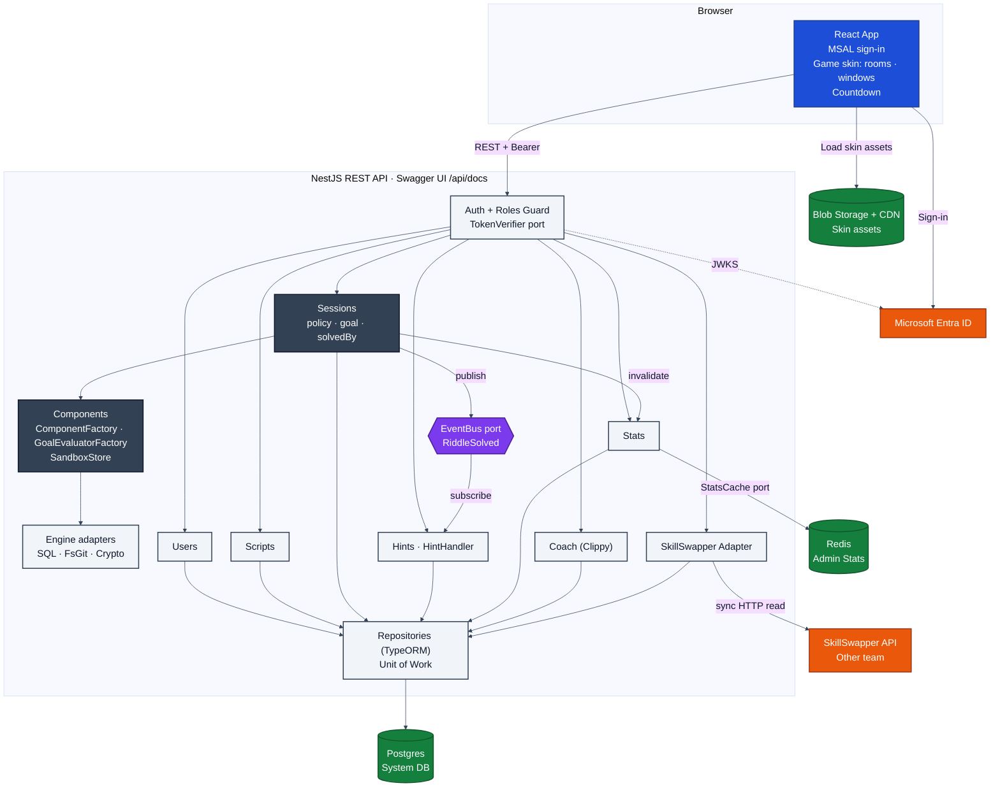
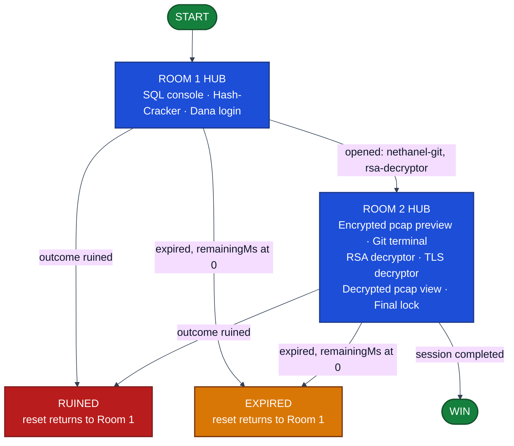
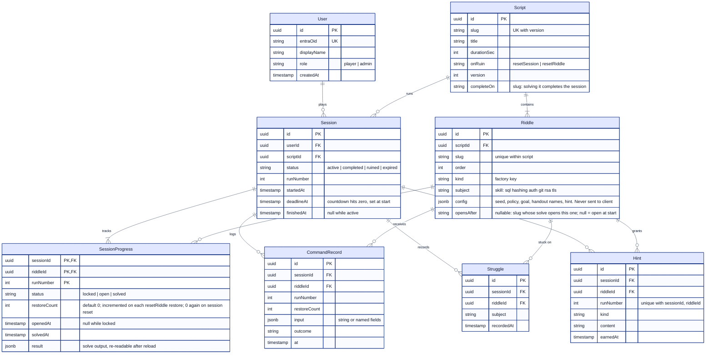
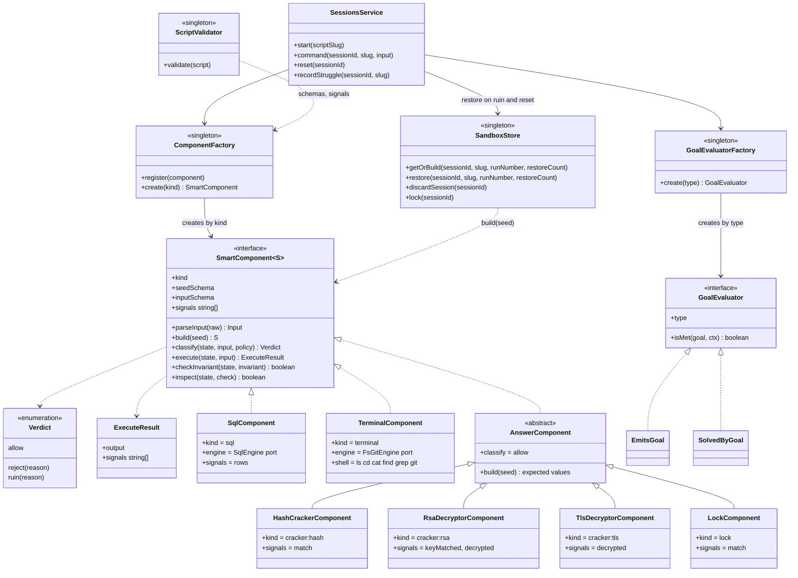
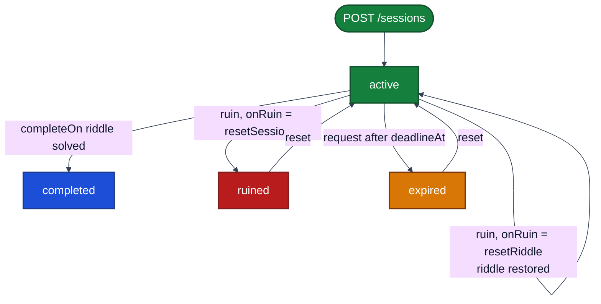
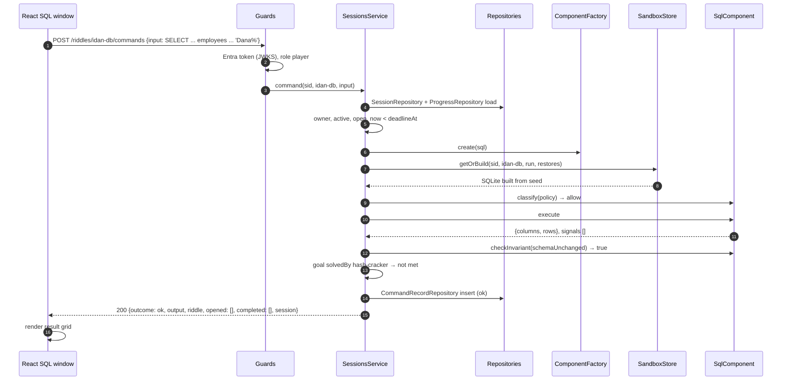
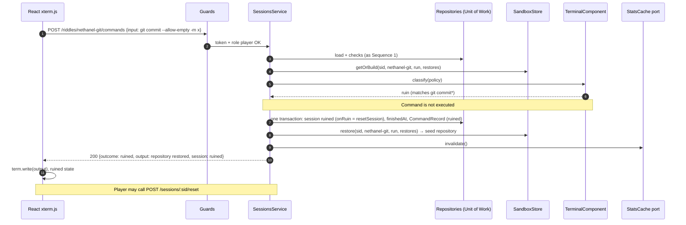
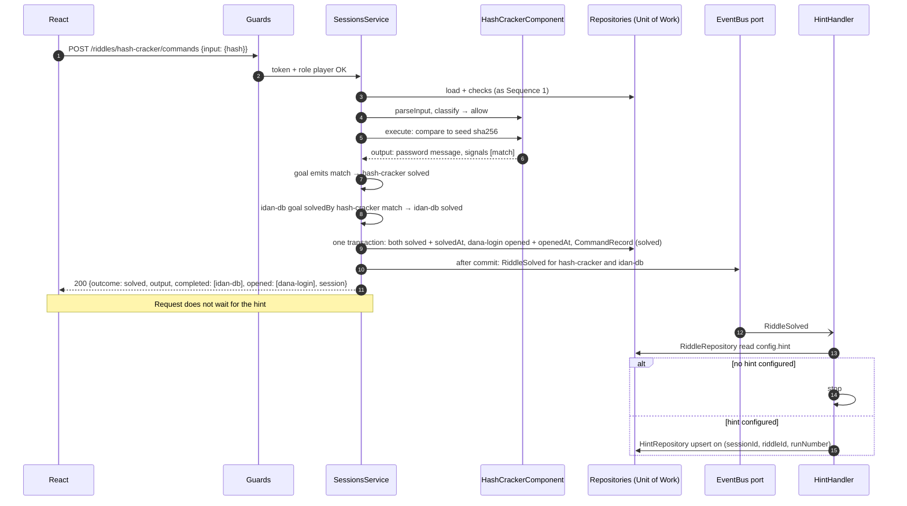
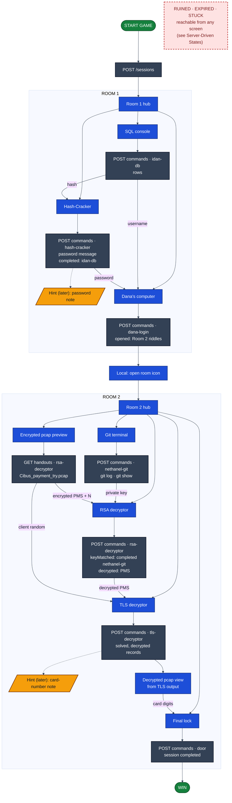

# Smart Test Components: Platform and Escape Room Design

# Part 1: Platform

## Project Definition

- A platform of smart test components: interactive riddles that test a real skill, such as SQL, git, hashing, RSA, or TLS.
- A **component** is a factory product: a small live sandbox of one kind. Some kinds run the player's commands (SQL database, terminal with a filesystem and git). Others check a submitted answer (hash, key, lock).
- A **riddle** is a component kind plus data: a **seed** (the starting sandbox), a **policy** (what is allowed, rejected, or ruins it), and a **goal** (what solves it). The same component with different data is a different riddle. For example, one terminal component can serve:
  - read the git history to find a leaked key (read-only),
  - search folders for a specific file,
  - rebase a broken history until the tree matches a target.
- The server is the judge. It holds the sandboxes, the answers, the timer, and the rules, decides every outcome (`ok`, `solved`, `rejected`, `ruined`, `expired`), and records how long each riddle took and how many tries it needed. It never renders.
- The frontend is the stage. It draws the game's skin (rooms, pictures, windows), sends what the player typed, and shows what the server answered. It never decides whether something is right.
- **The escape room is the first game:** one Script (which riddles, in what order, with which data) plus one skin. A later game is a new Script and a new skin over the same components. There is no second backend.

## Scope

| Status | Items |
| --- | --- |
| Built (base) | Entra sign-in, session start, session timer |
| Demo target | Escape room Script playable end to end: component factory, all six kinds, policy and goal engine, sessions, escape room skin. Does not depend on any Later Feature |
| Later | Hint Platform, Admin Statistics, Clippy Board, SkillSwapper |

## Technology Stack

These are binding constraints. A design choice that drops one is a change to this section, not a local exception.

| Area | Rule |
| --- | --- |
| Backend | NestJS in TypeScript. The REST API (HTTP and JSON) owns all business logic: validation, state changes, and domain rules. OpenAPI is published through Swagger UI (`@nestjs/swagger`). TypeScript only; no Java or JDK. |
| Frontend | React in TypeScript. It talks to the backend only through the REST API. It draws the skin, collects input, and presents state. It never owns a business rule and never opens Postgres, Redis, or the event bus. |
| Authentication | Microsoft Entra ID. The browser signs in with Entra and sends the token. The server validates it on every call. No passwords are collected, hashed, or stored, and there are no server-side session cookies. |
| Authorization | Role-based and enforced on the server. Every protected action names its role. A missing or insufficient role is rejected by the API. Hiding a button is not authorization. |
| Database | Postgres is the system database, accessed only through repositories built on TypeORM (see Repository Pattern). Users store their Entra identity, never a password. TypeORM migrations build the schema and seed the Scripts, and one documented command rebuilds a clean local database. Connection settings come from environment variables: `.env.example` lists them with placeholders, and the real `.env` and secrets stay out of git. No in-memory or mocked substitute: an API write survives a restart. |
| Caching | Redis for exactly one feature: **Admin Statistics**. It caches read-heavy aggregates for `GET /admin/stats`. Postgres is the source of truth, and the cache is cleared when a session ends. No other feature adds a cache. |
| Event-driven | Exactly one feature: **Hint Platform**. Sessions publishes `RiddleSolved`, and a separate handler stores the earned note. The request does not do that work inline. Every other feature is request/response. |
| Game assets | Azure Blob Storage + CDN for the skin only (pictures, backgrounds, icons). Static, published by deploy, browser read-only. Riddle data never goes to Blob. |

### Sandbox Engines

Sandboxes are riddle state, not TypeORM data and not a cache. Postgres remains the system database. Each engine sits behind an adapter (see Adapter Pattern), so components never import a library directly.

| Engine | Library | Used by |
| --- | --- | --- |
| SQL engine | sqlplay (SQLite, in memory) built from seed tables | `sql` |
| Filesystem + git engine | `memfs` in-memory filesystem, isomorphic-git on that filesystem, and a small shell (`ls`, `cd`, `cat`, `find`, `grep`, `git <subcommand>`) | `terminal` |
| Crypto engine | Node `crypto`: sha256, RSA decrypt, TLS key derivation and record decrypt | `cracker:hash`, `cracker:rsa`, `cracker:tls` |
| None | Field comparison | `lock` |

- xterm.js (`@xterm/xterm`) only draws the terminal. Each line goes to the server, and the server returns text.
- The browser only ever receives output: columns and rows, terminal text, or a result message.

## Architecture Patterns

| Pattern | Where | What it buys |
| --- | --- | --- |
| Factory | `ComponentFactory` builds a component by `kind`. `GoalEvaluatorFactory` builds a goal check by goal `type` | New riddle = new data, not new code. New kind = one class registered in one place |
| Strategy | Policies and goals are data interpreted by small, interchangeable evaluators | Riddle rules live in `Riddle.config`, not in component classes |
| Repository | One repository per entity wraps TypeORM. Modules share repositories, never the ORM | Several modules can read and write Postgres through one controlled path, testable with fakes |
| Singleton | NestJS default-scope providers: factories, `SandboxStore`, `EventBus`, cache client, SkillSwapper client | One registry and one sandbox store per process; no duplicated state |
| Event-Driven | `RiddleSolved` on the event bus, handled by `HintHandler` | Hint work is decoupled from the solve request |
| Adapter (Ports and Adapters) | Domain code depends on ports. Adapters wrap sqlplay, isomorphic-git and memfs, Node `crypto`, `@nestjs/event-emitter`, Redis, Entra JWKS, and the SkillSwapper API | Libraries and external services can be swapped without touching domain code |

### Factory: Components Built by Kind

- `ComponentFactory.create(kind)` returns the `SmartComponent` for a riddle's `kind`. Kinds are registered once at module start (`sql`, `terminal`, `cracker:hash`, `cracker:rsa`, `cracker:tls`, `lock`).
- A component knows how to build a sandbox from a seed, parse input, run it, and report facts about the result as **signals** (for example `match`, `keyMatched`, `decrypted`). It knows nothing about any specific riddle, story, or neighbouring riddle.
- `GoalEvaluatorFactory.create(goal.type)` returns the evaluator that decides whether the goal is met. Goal types are a small closed set implemented once (see Riddle Config).
- Adding a riddle: write a config row in a Script; ScriptValidator rejects a bad one before it runs. Adding a goal type or a kind: one class plus one registration. Sessions does not change in either case.

### Repository: Shared, Controlled Database Access

- Every entity has exactly one repository class, owned by one module and exported for others: `UserRepository` (Users), `ScriptRepository` and `RiddleRepository` (Scripts), `SessionRepository`, `ProgressRepository`, `CommandRecordRepository`, `StruggleRepository` (Sessions), `HintRepository` (Hints), `StatsReadRepository` (Stats, read-only aggregate queries).
- Services call repository methods that speak the domain (`findActiveForOwner`, `openRiddles`, `countTries`), never raw TypeORM.
- Several modules may use the same repository. Sessions, Hints, Stats, Coach, and SkillSwapper all read session data through `SessionRepository` and `ProgressRepository`. Only the owning module writes.
- **Unit of Work:** a multi-step write (solve, ruin, reset) runs in one `DataSource.transaction`. Repositories accept the transaction's `EntityManager` (`repo.with(em)`), so all writes commit or roll back together.

### Singleton: One Instance per Process

- NestJS providers are singletons by default. The design relies on this for `ComponentFactory`, `GoalEvaluatorFactory`, `SandboxStore`, the `EventBus` adapter, the Redis client, and the SkillSwapper client.
- Components are stateless singletons. All riddle state lives in sandboxes held by `SandboxStore`, keyed by session, riddle slug, run number, and restore count.
- Constraint: `SandboxStore` is in process memory, so the demo runs one API instance. A lost sandbox (restart, other instance) is rebuilt from the seed by replaying the `ok` commands for that session, riddle, runNumber and restoreCount, in order, from `CommandRecord`. Read-only riddles rebuild from the seed alone.
- `discardSession` runs on complete, ruin (resetSession), expire and reset. An idle sandbox (no command for 30 minutes, `SANDBOX_IDLE_MINUTES`) is evicted; replay rebuilds it if the player returns.

### Event-Driven: Hint Platform

- Publish/subscribe through an `EventBus` port with an in-process `@nestjs/event-emitter` adapter.
- One event, one publisher, one subscriber (see Event Bus). Published only after the solve transaction commits.
- Cross-riddle completion (`solvedBy`) is not an event. It must commit in the same transaction as the solve, so it is a synchronous rule inside Sessions.

### Adapter: Ports Around Every Library and External Service

| Port (domain interface) | Adapter | Library or service |
| --- | --- | --- |
| `SqlEngine` | `SqlplayEngine` | sqlplay / SQLite |
| `FsGitEngine` | `MemfsGitEngine` | memfs + isomorphic-git |
| `CryptoEngine` | `NodeCryptoEngine` | Node `crypto` |
| `EventBus` | `EventEmitterBus` | `@nestjs/event-emitter` |
| `StatsCache` | `RedisStatsCache` | Redis |
| `TokenVerifier` | `EntraJwksVerifier` | Microsoft Entra ID (JWKS) |
| `SkillSwapperPort` | `SkillSwapperAdapter` | Other team's HTTP API (their contract, mapped to ours) |

## System Architecture

Color key: blue = browser, gray = API modules, dark gray = core, purple = event bus, green = data stores, orange = external services.



### Architecture Rules

- Only repositories access Postgres. Each entity has one owning repository; other modules use the owner's exported repository and never TypeORM directly. Only the owning module writes.
- Only the Stats module accesses Redis, through the `StatsCache` port.
- Only Sessions publishes events, and only after commit. Only Hints subscribes.
- Only Sessions calls components, always through `ComponentFactory`. Components never call Sessions, repositories, or other components.
- Components hold no riddle-specific rules. Seed, policy, and goal come only from `Riddle.config`.
- Sandboxes live in `SandboxStore` in server memory, per session, riddle, run, and restore count. They are riddle state, not Postgres data and not a cache.
- Commands for one session are serialized; different sessions run in parallel.
- Domain code depends on ports. Only adapters import sqlplay, isomorphic-git, memfs, Redis, the event emitter, or HTTP clients.
- SkillSwapper belongs to another team. Read-only, synchronous, nothing stored.
- Only the browser reads Blob Storage (public, static skin assets). No API module touches it, and no riddle data is stored there.

### Service Layout: One Backend, Two Repos

- Two repos: frontend (React) and backend (NestJS).
- One backend service: a modular monolith. Riddles (Components module: factories, kinds, engine adapters, `SandboxStore`) and Story (Scripts and Sessions modules) are modules inside it, not separate services. Hints, Stats, Coach, and the SkillSwapper adapter are modules too.
- Why not microservices:
  - One team, one domain. No independent scaling or deploy need.
  - Ruin-and-reset must be atomic: stop session, restore sandbox, write records, respond, in one transaction. Across services that becomes a distributed transaction or saga.
  - A command is one in-process call (Sessions to component), not a network hop with retries, timeouts, and versioned contracts.
  - One deploy, one database, one log stream, one Swagger.
  - Module boundaries plus the Architecture Rules give the same separation.
- Split later if needed: modules talk through repositories, ports, and the one event, so a module (for example Hints or Stats) can be extracted without redesign.

### Frontend Skin

- Every smart component has two halves, linked only by the riddle's `slug`. Brain: server-side (component, sandbox, policy, goal). Face: React (a picture in the room plus the window that opens when it is clicked).
- The face belongs to the game's **skin**, not to a shared component package. A skin is one folder in the frontend repo: scene manifest, rooms, pictures, and windows. A new game draws its own skin and may copy windows from another.
- The scene manifest maps each riddle `slug` to its room, picture, position, and window. It holds no answers, no order, no input fields.
- Pictures light up, unlock, or show solved only from server state: the `opened` and `completed` lists in a command response, and `GET /sessions/:sid` on load. React never computes unlock order.
- Skin images (scene pictures, room backgrounds, icons) are static assets in Azure Blob Storage behind a CDN, one folder per script: `<scriptSlug>/...`, published by a deploy step from the frontend repo (`assets/<scriptSlug>/`). No upload API.
- Riddle handouts (for example `Cibus_payment_try.pcap`) are riddle data, not skin. They must match the riddle's answers, so the API serves them from `Riddle.config.handouts`.
- Secrets never go to Blob Storage or the manifest: no solutions, no decrypted pcap, no card number, no passwords. Those come only from server responses.
- Frontend env: `VITE_ASSETS_BASE_URL` (CDN base URL).

## React Rules & Constraints

**Allowed**

- Sign in with MSAL and call the REST API with the Entra token.
- Draw the skin: rooms, pictures, and windows (SQL box with result grid, xterm.js terminal, answer forms).
- Render the countdown from server `deadlineAt` / `remainingMs`.
- Display outcomes and output returned by the server.
- Load skin assets from `VITE_ASSETS_BASE_URL`. Never hard-code solutions or secrets in assets or the manifest.

**Not allowed**

- Decide solved, ruined, allowed, or which riddle opens next.
- Parse SQL or git; hash or compare.
- Perform RSA or TLS decryption, or any puzzle computation.
- Hold a repository, a filesystem, or a SQLite file.
- Gate steps or own the timer.
- Open Postgres, Redis, or the event bus.

**Server-side riddles**

- Every sandbox and every answer check runs on the server. The browser sends input and renders output.
- The browser never decrypts the pcap. It receives the decrypted records only as the server response to a correct TLS decryptor submission.

## Frontend Scene State Machine

Room-level view for the escape room skin. The puzzle-level flow is in Part 2.

Color key: blue = room hubs, green = start and win, red = ruined, amber = expired.



### Transition Rules

- Opening and closing windows, and click-outside, are local.
- Every progress transition (picture lights up, room unlock, riddle solved, win) fires only on server state: `opened`, `completed`, `riddle.status`, `session.status`.
- Room 2 unlocks when the `dana-login` solve response lists the Room 2 riddles in `opened`. The "open room" desktop icon is a local step after that response.

### Server-Driven States

| State | Trigger | Behavior |
| --- | --- | --- |
| Ruined | Outcome `ruined` | Show message; offer reset (`POST /sessions/:sid/reset`); return to Room 1 hub with fresh state |
| Expired | Outcome `expired`, or server `remainingMs` ≤ 0 | Show time-up; offer reset |
| Stuck | Player action: `POST /sessions/:sid/struggles` | Open help panel; stay in current scene |

### Timing and Hints

- The visible countdown renders server `deadlineAt` / `remainingMs`. It is the only countdown; no per-riddle or per-phase timers in the browser.
- The frontend sends no timer calls. Riddle timing arrives in command responses: `riddle {status, openedAt, solvedAt}`.
- On page load, `GET /sessions/:sid` restores session state, every riddle's status by slug, and the saved `result` of solved answer riddles.
- Hint Platform (later): after a `solved` outcome, refresh the inventory with `GET /sessions/:sid/hints`. The note may lag the response. The demo path never waits for a hint.

### Submissions

- Every riddle uses one endpoint: `POST /sessions/:sid/riddles/:slug/commands {input}`.
- Command kinds (`sql`, `terminal`) send `input` as a string. Answer kinds send `input` as an object of named fields, validated by the component's schema (for example `{hash}`, `{username, password}`, `{privateKey, encryptedPms, n}`).
- Handouts: `GET /sessions/:sid/riddles/:slug/handouts/:name` (player, owner, riddle open).

## Component Responsibilities

| Module | Responsibility |
| --- | --- |
| Config | Environment variables only (`.env`, `.env.example`) |
| Database | TypeORM `DataSource`, migrations, Script seeds, Unit of Work helper. Hosts no business logic |
| Auth | `TokenVerifier` port with the Entra JWKS adapter (audience = API client id). Global guard. No passwords |
| Roles (in Auth) | `@Roles(role)` + roles guard. Roles: `player`, `admin`. Every protected endpoint names one |
| Users | `UserRepository`, user record and role. `GET /me` |
| Scripts | `ScriptRepository`, `RiddleRepository`. Scripts and riddle configs (seed, policy, goal, `opensAfter`), seeded by migration. Read-only at runtime |
| Components | `ComponentFactory`, `GoalEvaluatorFactory`, `ScriptValidator`, the six kinds, engine adapters, `SandboxStore` |
| Sessions | Lifecycle, timer, command pipeline (policy, execute, invariant, goal, `solvedBy`), ruin and reset, progress, per-riddle timing, handouts, struggles. Publishes `RiddleSolved` |
| Hints (later) | `HintRepository`. `HintHandler` is the only event subscriber. `GET /sessions/:sid/hints` |
| Stats (later) | `StatsReadRepository`, `StatsCache` port. Admin statistics. Only Redis user |
| SkillSwapper (later) | `SkillSwapperPort` and `SkillSwapperAdapter`, read-only client of the other team's API; they set the contract. `GET /sessions/:sid/helpers`. Stores nothing |
| Coach (later) | Clippy board: next small step, never a solution. Reads through Sessions repositories |

## Data Model

- Postgres holds system data and riddle configs.
- Live sandboxes (SQLite tables, filesystem, git repository) are not stored in Postgres. Only their seed is, inside `Riddle.config`.

PK = primary key, FK = foreign key, UK = unique key.



### Data Rules

- A Riddle is one configured step of a Script. Its `kind` is the factory key for the component, and its `config` makes that component into this specific riddle.
- Unlock order is data: on a solve, the server opens every Riddle whose `opensAfter` is the solved riddle. Sessions never hard-codes order.
- Cross-riddle completion is data: a riddle whose goal is `solvedBy` is solved when the named riddle emits the named signal.
- What a ruin does is data: `Script.onRuin`. `resetSession` ruins the session; `resetRiddle` restores that riddle's sandbox, increments its `restoreCount`, and leaves it open. The ruin is recorded only as a CommandRecord with outcome `ruined`.
- `runNumber` starts at 1 and increments only on session reset. A wrong answer is not a new run; it is a CommandRecord with outcome `rejected`.
- `Hint` belongs to the later Hint Platform. Maximum one hint per riddle per run.
- Solve time = `solvedAt` − `openedAt` (from `SessionProgress`), per run.
- Tries and rejected commands per riddle are counted from `CommandRecord` per session, riddle, and runNumber.
- `subject` is the skill the riddle tests.
- Nothing from SkillSwapper is stored.
- A Script is immutable once a session uses it. A change is a new Script row with the same `slug` and a higher `version`; sessions keep the `scriptId` they started with, so their replay stays valid. `POST /sessions {scriptSlug}` starts the highest version.

## Riddle Config

`Riddle.config` turns a generic component into a specific riddle. It is seeded by migration and never sent to the client, except handout files through the handouts endpoint.

| Field | Meaning |
| --- | --- |
| `seed` | Starting sandbox: tables and rows, files and commits, or the expected values for an answer check |
| `policy` | `allow` and `ruin` patterns, matched in order (`ruin` first). Anything that matches neither is rejected. Optional `invariant`. Answer kinds default to allow all. Patterns are matched against the parsed input, not raw text (see Command Pipeline step 2) |
| `goal` | `{type, ...}`: what solves the riddle. Interpreted by a goal evaluator |
| `handouts` | Names of files stored in the backend repo at `seeds/<scriptSlug>/handouts/`, produced by the seed builder. Served only to the session owner while the riddle is open |
| `hint` | Note earned on solve (later Hint Platform) |

### Goal Types

| Type | Solved when | Demo |
| --- | --- | --- |
| `emits` | This riddle's own command emits the named signal (`match`, `decrypted`) | Yes |
| `solvedBy` | Another riddle in the same Script emits the named signal | Yes |
| `queryReturns` | The player's SQL result contains the configured value | Later |
| `stateMatches` | A check on the sandbox holds, for example `treeEquals` (git tree at a ref) or `fileExists` | Later |
| `answerEquals` | Submitted text equals the configured value (for example a found file path) | Later |

### Invariant Types

| Type | Holds when |
| --- | --- |
| `historyUnchanged` | Git commits equal the seed commits |
| `schemaUnchanged` | SQL tables and rows equal the seed |

### One Component, Three Riddles

The escape room uses only the first config. The others show that the same `terminal` component serves different riddles with no code change beyond goal types.

```jsonc
// escape room: find the leaked key in history (read-only)
{ "seed":   { "fs": { "/repo/README.md": "..." }, "git": ["c1: add private key", "c2: Security fix: Removed private key from repository."] },
  "policy": { "allow": ["git log*", "git show*", "git status", "git diff*", "ls*", "cat*"],
              "ruin":  ["git commit*", "git reset*", "git rebase*", "git checkout*", "git branch -D*", "rm*"],
              "invariant": { "type": "historyUnchanged" } },
  "goal":   { "type": "solvedBy", "riddle": "rsa-decryptor", "signal": "keyMatched" } }

// later: find a file in a folder tree
{ "seed":   { "fs": { "/home/a/b/c/secret.txt": "..." } },
  "policy": { "allow": ["cd*", "ls*", "find*", "grep*", "cat*"], "ruin": ["rm*"] },
  "goal":   { "type": "answerEquals", "value": "/home/a/b/c/secret.txt" } }

// later: fix a broken history with rebase
{ "seed":   { "git": ["c1", "c2: bad", "c3", "c4"] },
  "policy": { "allow": ["git *", "ls*", "cat*"], "ruin": ["git push --force*", "rm -rf*"] },
  "goal":   { "type": "stateMatches", "check": "treeEquals", "ref": "HEAD", "commits": ["c1", "c3", "c4"] } }
```

## Smart Component Contract (Class Diagram)

One contract for every kind. Kinds for the demo: `sql`, `terminal`, `cracker:hash`, `cracker:rsa`, `cracker:tls`, `lock`.



### Command Pipeline

Sessions runs the same pipeline for every kind. No step knows which riddle it is running.

| Step | Rule |
| --- | --- |
| 1. Guard | Lock the session: one command per session at a time (per-session mutex in SandboxStore, and `SELECT … FOR UPDATE` on the Session row inside the transaction). Owner, session active, riddle open, `now < deadlineAt`. Past the deadline: session expired, command not run |
| 2. Parse | `component.parseInput(raw)`. Invalid shape → `rejected`. `terminal`: one command split into argv; `;`, `&&`, `\|\|`, `\|`, `>`, `<`, backticks and `$(` are rejected. `sql`: parsed into statements; more than one statement is rejected; policy matches the statement type |
| 3. Policy | `component.classify(state, input, config.policy)`. `reject` → `rejected`, no change. `ruin` → ruin path, command not run |
| 4. Execute | `component.execute(state, input)` on the sandbox; returns output and signals |
| 5. Invariant | If `config.policy.invariant` no longer holds, take the ruin path. The restore discards the effect |
| 6. Goal | `GoalEvaluatorFactory.create(goal.type).isMet(goal, {state, input, signals})` |
| 7. solvedBy | Every open riddle whose goal is `solvedBy` this slug with an emitted signal is solved too |
| 8. Commit | One transaction: progress updates (`solvedAt`, `openedAt` via `opensAfter`, `result`), CommandRecord. After commit: publish `RiddleSolved` per solved riddle |
| 9. Respond | Outcome, output, `riddle`, `opened`, `completed`, `session` |

### Script Validation

- `ScriptValidator` runs at boot and in CI. A Script that fails does not load.
- Checks:
  - every `kind` is registered;
  - `config.seed` matches the kind's `seedSchema`;
  - policy and invariant types are known;
  - goal `type` is registered;
  - `opensAfter` and `solvedBy.riddle` name slugs in the same Script;
  - no unlock cycles;
  - every riddle is reachable from a start riddle;
  - `solvedBy.signal` and `emits.signal` are in the target kind's declared `signals`;
  - `completeOn` names a riddle.
- Linked answers: values shared between riddles are generated from one source file per Script by a seed builder at migration time, not typed twice.
- Winning path: the validator also runs the Script's winning path (a `solution` list of inputs per riddle) against fresh sandboxes and requires the session to end `completed`. `solution` is stored with the seed builder source only, never in `Riddle.config` and never in the client.

### Component Kinds

- **`sql`:** builds an in-memory SQLite from `seed.tables`. Read-only connection unless the policy allows writes; the read-only connection stays as a second guard behind the policy. Output: `{columns, rows}`.
- **`terminal`:** builds a memfs filesystem and an isomorphic-git repository from `seed.fs` and `seed.git`. Runs one shell line per command. Output: text.
- **Answer kinds** (`cracker:hash`, `cracker:rsa`, `cracker:tls`, `lock`): stateless sandbox holding the expected values from the seed. They compare or compute with the crypto engine and never reverse a hash. Policy defaults to allow, so they never ruin. Output: a result message or computed value (for example the decrypted PMS).

## Session Lifecycle

Color key: green = active, blue = completed, red = ruined, amber = expired.



### Lifecycle Steps

- **Start:** `POST /sessions {scriptSlug}`. `deadlineAt` = now + script duration. Riddles with `opensAfter` null open (`openedAt` stamped), the rest are locked. Sandboxes are built on first command.
- **Read:** `GET /sessions/:sid` (player, owner): session status, `deadlineAt`, `remainingMs`, and every riddle's status by slug, with `result` for solved riddles. Each riddle also returns `kind` and `inputFields` (from the kind's `inputSchema`, names and types only).
- **Timer:** server-owned. Every session request checks `deadlineAt`. Past it: session expired, command not run. No scheduler. A session is expired when `now ≥ deadlineAt`, whether or not a request marked it. Reads (`GET /sessions/:sid`, stats) treat an `active` session past `deadlineAt` as expired; the next request writes `expired` and `finishedAt = deadlineAt`.
- **Command:** `POST /sessions/:sid/riddles/:slug/commands`. Runs the Command Pipeline.
  - Response: `outcome` (`ok`, `solved`, `rejected`, `ruined`, `expired`), `output`, `riddle {slug, status, openedAt, solvedAt}`, `opened [slugs]`, `completed [slugs]`, `session {status, deadlineAt, remainingMs}`.
- **Solve:** one transaction marks the riddle solved (`solvedAt`, `result`), solves its `solvedBy` dependents, opens the next riddle(s) (`openedAt`), and records the command. After commit, publish `RiddleSolved` for each solved riddle.
- **Ruin:** request/response, not an event. One transaction: command recorded, sandbox restored from seed, and then by `Script.onRuin` either the session is ruined (`finishedAt`) and the stats cache cleared, or only that riddle's `restoreCount` is incremented and it stays open. HTTP 200 with outcome `ruined`, not an error.
- **Reset:** `POST /sessions/:sid/reset`. Discards all sandboxes, returns progress to the start state, starts new SessionProgress rows for the new runNumber (earlier runs keep their timings), clears earned hints, increments runNumber, restarts the timer.
- **Complete:** the riddle named by `Script.completeOn` solved → session completed, stats cache cleared.

### Per-Riddle Timing

- `openedAt` is stamped by the server: riddles with `opensAfter` null at start, and the next riddle(s) in the unlocking solve transaction.
- No timer endpoints. No frontend timing calls. `deadlineAt` stays the only countdown.
- Each run keeps its own timings.
- Use: per-skill solve time and tries select which SkillSwapper skill teachers to request. Admin Statistics may aggregate per-riddle durations.

## Data Flow

### Sequence 1: SQL SELECT



### Sequence 2: Ruined Terminal Command



- Variant: a command that passes the policy but fails `checkInvariant` takes the same path from the transaction step. The restore discards its effect.

### Sequence 3: Hash Solved, SQL Completed, Hint Handler



- One event and one handler serve every riddle.
- Riddles without a hint in config are skipped.
- Upsert makes a repeated event harmless.
- On startup: re-publish for solved riddles with hint config and no `Hint` row.
- The note may appear after the solve response.

## Later Features

Specified, not built. Each is tied to exactly one mechanism. The demo does not depend on any of them.

| Feature | Mechanism | Behavior |
| --- | --- | --- |
| Hint Platform | **Event bus** (the one event-driven feature) | On riddle solve, `RiddleSolved` is published; `HintHandler` saves the configured hint (max one per riddle per run). Read: `GET /sessions/:sid/hints`. Reset clears hints |
| Admin Statistics | **Redis** (the one cached feature) | `GET /admin/stats` (admin). Reads `stats:v1` through `StatsCache`; on miss, aggregates through `StatsReadRepository` and stores with a safety TTL. Cleared directly when a session completes, is ruined, or expires. Redis down → serve from Postgres. Aggregates count `active` past `deadlineAt` as expired, so a missed invalidation cannot keep a stale status |
| Clippy Board | Request/response | Coach API: given session, hints, and struggle subject, returns the next small step. Never a solution. Reads struggles through `StruggleRepository` |
| SkillSwapper | Request/response, **Adapter** | `SkillSwapperAdapter` implements `SkillSwapperPort` over the other team's API (their contract). `GET /sessions/:sid/helpers` (player, owner): server picks skills from slowest riddles and struggles, calls their API synchronously, returns people. Nothing stored |

**Admin statistics aggregates:** sessions by status, completion rate, average completion time, ruins per component kind, struggles per subject, and possibly per-riddle solve times.

**Request/response only:** ruin and reset, `solvedBy` completion, stats cache invalidation, session completion, struggle recording, SkillSwapper.

### Event Bus

- `EventBus` port with an in-process `@nestjs/event-emitter` adapter.
- One event: `RiddleSolved { sessionId, riddleId, runNumber, solvedAt }`.
- One publisher: SessionsService, after the solve transaction commits.
- One subscriber: `HintHandler`. Reads `Riddle.config.hint`; none → stop; otherwise upsert one `Hint` per session, riddle, and runNumber.
- Startup recovery: re-publish for solved progress rows with hint config and no `Hint` row.
- Read path: `GET /sessions/:sid/hints` after a solved outcome; eventually consistent.

### Struggles

- `POST /sessions/:sid/struggles` (player, owner): plain record of the "I'm stuck" action.
- `Struggle(id, sessionId, riddleId, subject, recordedAt)`; subject set by the server from the riddle.
- No event. Read by Clippy and the SkillSwapper helper lookup.

# Part 2: Escape Room (Demo)

The escape room is one Script (`escape-room`, `onRuin = resetSession`, `completeOn = door`) plus one skin. Everything story-specific lives here, as data and skin. Part 1 does not change for it.

## Story in Brief

- Two locked rooms. The player must solve every puzzle and get out to join the TDP program.
- Room 1: Dana leaves; Idan's computer (SQL) and Dana's computer (login) hold the first clues.
- Room 2: Nathaniel's computer holds an encrypted Cibus payment capture and a git terminal.
- The final door opens with Nathaniel's credit card digits. Dana waits outside: "Welcome to the team."
- Correction: `story-script.txt` lists `users` and `passwords` tables. That is wrong; `employees` and `logs` are correct.

## Puzzle Flow

Color key: blue = UI screen, dark gray = server call, amber = hint earned (later), green = start and win. Labeled edges carry data the player copies.



## Puzzle Steps

| # | Room | Screen | Player does | Server call | Outcome | Opens next |
| --- | --- | --- | --- | --- | --- | --- |
| 1 | 1 | SQL console | SELECT employees by name → Dana's username; SELECT logs where username = Dana's and type = 'auth' → hash | POST commands (idan-db) | ok, rows (ruined on DROP or write) | – |
| 2 | 1 | Hash-Cracker | Paste hash | POST commands (hash-cracker) | solved, message with Dana's password; `completed: [idan-db]` | dana-login |
| 3 | 1 | Dana's computer | Username + password, Login | POST commands (dana-login) | solved / rejected | nethanel-git, rsa-decryptor |
| 4 | 2 | Encrypted pcap preview | Download; copy client random, encrypted PMS (CKE), modulus N (certificate) | GET handouts (rsa-decryptor) | – | – |
| 5 | 2 | Git terminal | `git log`; `git show <previous commit>` → private key | POST commands (nethanel-git) | ok (ruined on commit or write) | – |
| 6 | 2 | RSA decryptor | Private key + encrypted PMS + N, Decrypt | POST commands (rsa-decryptor) | Key match → `completed: [nethanel-git]`; all correct → solved, decrypted PMS | tls-decryptor |
| 7 | 2 | TLS decryptor | PMS + client random, Decrypt | POST commands (tls-decryptor) | solved, decrypted App-Data records in output | door |
| 8 | 2 | Decrypted pcap view | Find Nathaniel's card in App-Data records | None (TLS output; `GET /sessions/:sid` after reload) | – | – |
| 9 | 2 | Final lock | Enter card digits | POST commands (door) | solved → session completed | WIN |

- After step 3, the "open room" icon is a local step that moves to the Room 2 hub.
- With the later Hint Platform, the hash cracker and TLS decryptor also earn inventory notes. The story says the card note is earned "on copy"; copying is local and cannot be a server event, so the note is earned on TLS solve.

## Gating and Timing

| Riddle | Opens (`openedAt`) | Solved (`solvedAt`) |
| --- | --- | --- |
| idan-db | Session start | `solvedBy` hash-cracker `match` |
| hash-cracker | Session start | Own signal `match` |
| dana-login | hash-cracker solve | Own signal `match` |
| nethanel-git | dana-login solve | `solvedBy` rsa-decryptor `keyMatched` |
| rsa-decryptor | dana-login solve | Own signal `decrypted` |
| tls-decryptor | rsa-decryptor solve | Own signal `decrypted` |
| door (final lock) | tls-decryptor solve | Own signal `match` |

- idan-db and nethanel-git follow the same rule: each is solved by the next riddle's correct input, expressed as a `solvedBy` goal.
- All gating is stored as `opensAfter` and `goal` in the Script's Riddle rows.

## Script Riddles

| # | Slug | Kind | Subject | opensAfter | Seed | Policy | Goal |
| --- | --- | --- | --- | --- | --- | --- | --- |
| 1 | idan-db | sql | sql | null | `employees`, `logs`; Dana's auth log holds a sha256 hex built with `node:crypto` at seed time | allow single `SELECT` / `WITH … SELECT`; ruin `DROP DELETE UPDATE INSERT ALTER ATTACH`; invariant `schemaUnchanged` | `solvedBy` hash-cracker `match` |
| 2 | hash-cracker | cracker:hash | hashing | null | Dana's sha256, password message | allow all | `emits match` |
| 3 | dana-login | lock | auth | hash-cracker | username, password | allow all | `emits match` |
| 4 | nethanel-git | terminal | git | dana-login | memfs repo, commit 1 adds the private key, commit 2 removes it: "Security fix: Removed private key from repository." | allow `git log/show/status/diff`, `ls`, `cat`; ruin `git commit/reset/rebase/checkout/branch -D`, `rm`; invariant `historyUnchanged` | `solvedBy` rsa-decryptor `keyMatched` |
| 5 | rsa-decryptor | cracker:rsa | rsa | dana-login | private key, N, encrypted PMS; handout `Cibus_payment_try.pcap` | allow all | `emits decrypted` |
| 6 | tls-decryptor | cracker:tls | tls | rsa-decryptor | PMS, client random, encrypted App-Data records | allow all | `emits decrypted` |
| 7 | door | lock | tls | tls-decryptor | Nathaniel's card digits | allow all | `emits match` |

- **Room 2:** riddles 4 and 5 open together. Riddle 4 is solved by a matching private key on riddle 5, not by a terminal command.
- **RSA partial answer:** a matching key with a wrong PMS or N emits `keyMatched` only. nethanel-git is completed, rsa-decryptor stays open, and the outcome is `rejected` with a message.
- **Hints (later):** hash-cracker → note with Dana's password. tls-decryptor → note with the card number.
- **Linked answers:** shared values (Dana's username and password, the logs sha256, the private key in git and in rsa-decryptor, N and encrypted PMS in the pcap handout and rsa seed, PMS and client random for TLS, the card digits in the TLS records and door) are generated from one source file per Script by a seed builder at migration time, not typed twice. The winning path is checked by `ScriptValidator` (see Script Validation).

## Escape Room Skin (Demo)

The skin is built in the frontend repo for the demo. It is the game's look and owns no rules.

```
src/skins/escape-room/
  manifest.ts          slug → room, picture, position, window
  rooms/Room1.tsx      Idan's computer, Dana's computer, hash-cracker icon
  rooms/Room2.tsx      Nathaniel's computer, pcap file, decryptors, door
  windows/SqlWindow.tsx       command box + result grid
  windows/TerminalWindow.tsx  xterm.js
  windows/AnswerForm.tsx      fields from `GET /sessions/:sid` inputFields
  windows/PcapViewer.tsx      renders handout and TLS output
assets/escape-room/    pictures, backgrounds, icons → Blob Storage
```

```ts
// manifest.ts (shape)
{ slug: 'idan-db',       room: 1, picture: 'idan-computer.png', at: { x: 120, y: 340 }, window: SqlWindow }
{ slug: 'nethanel-git',  room: 2, picture: 'nathaniel-pc.png',  at: { x: 410, y: 300 }, window: TerminalWindow }
{ slug: 'door',          room: 2, picture: 'door.png',          at: { x: 900, y: 200 }, window: AnswerForm }
```

- A picture is dimmed while its riddle is `locked`, active while `open`, and shows a solved state when `solved`, all from server state.
- Room 2 becomes reachable when its riddles appear in `opened`.
- Win screen on `session.status = completed`.

# Appendix

## Environment Configuration

- Backend `.env.example` placeholders: `DATABASE_URL`, `ENTRA_TENANT_ID`, `ENTRA_API_CLIENT_ID`, `ENTRA_AUDIENCE`, `REDIS_URL`, `SKILLSWAPPER_BASE_URL`, `SKILLSWAPPER_API_KEY`, `PORT`, `SANDBOX_IDLE_MINUTES` (30).
- Frontend `.env.example` placeholders: `VITE_API_BASE_URL`, `VITE_ASSETS_BASE_URL`, `VITE_ENTRA_CLIENT_ID`, `VITE_ENTRA_TENANT_ID`.
- No secrets in git.

## Resolved Conflicts

| Conflict | Decision |
| --- | --- |
| Story script lists `users` and `passwords` tables; binding context says `employees` and `logs` | `employees` and `logs` only |
| The original technologies document said sqlplay supplies the console UI; binding context says thin client | sqlplay is a server-side engine; React draws the SQL window |
| Earlier draft put allowed, ruin, and invariant rules inside component classes | Rules moved to `Riddle.config.policy`; components stay generic so the same kind serves different riddles |
| Earlier draft had crackers solve the previous riddle in code | Expressed as `solvedBy` goals in Script data |
| Earlier draft served the encrypted pcap from Blob Storage | Served by the API as a riddle handout, since it must match the riddle's answers |
| Earlier draft delivered the decrypted pcap only through hints | TLS solve output carries it; hints are an optional extra |

## Open Items

- "Open room" executable and room transitions: skin, not a component.
- Automatic stuck detection (for example after N failures): not in this design. Only the explicit stuck action.
- Full list of admin statistics beyond those named.
- Scale-out beyond one API instance: needs sticky sessions or shared sandbox storage; replay already allows rebuilding, and the per-session lock moves to the database row lock only.
