# Smart Test Components: Platform Design (v2)

Version 2. This document replaces the v1 design (one backend, modular monolith). v2 is event-driven and made of four microservices; the read model (projection) is a module inside game-engine. Source: the architect's v2 sketch (2026-10-27) and its factsheet. Updated 2026-10-29: Azure Event Hubs replaces Azure Service Bus; hints, copy and paste, and the capture on Nathaniel's computer were added; SkillSwapper teacher recommendations are planned (section 15).

## 1. What the Platform Is

- **Smart test components.** The platform is a set of interactive puzzles that test a real skill: SQL, git, hashing, RSA, TLS, or a plain answer such as a login or a door code. Each puzzle is built from a **Component Template**: a versioned piece of content that says which engine runs it, what input it accepts, what is forbidden, what solves it, and what must never break.
- **Headless.** The backend is the judge. It holds the sandboxes, the answers, the clock and the rules, and it decides every outcome. It never draws a screen. The React frontend only presents state and collects input, so a player cannot cheat by editing the page.
- **Scripts are content, not code.** A **Script** is a list in the database: which puzzles, in which rooms, in what order, and the starting state of each. The engine runs any Script as a state machine. Changing the order, the rooms or the puzzles is a new Script version, not a code change. Only a brand-new kind of engine needs code.
- **The escape room is one Script on the platform.** It is the demo content (section 13). A later game is another Script and another skin over the same services. There is no second backend.
- **Four microservices:** gateway-api, game-engine, sandbox-manager and script-catalog. Each is its own NestJS app, its own deployable, with its own database (the gateway's holds user accounts and refresh-token families only). They talk through Azure Event Hubs, plus exactly four direct internal HTTP calls. The read model (projection) is a module inside game-engine, built with a service boundary so it can be moved into its own service later (section 3).
- **A mistake never ends the game.** If a player's command breaks ("ruins") a puzzle, the puzzle or the whole room resets to a fresh copy and the player keeps going while the clock keeps running.
- **Hints on request.** Each stage of a Script can carry one hint: a short text that helps the player through that stage. The player asks for it with the Hint button; the server decides which hint applies and sends it (section 6).

## 2. Technology Stack

| Area | Choice |
| --- | --- |
| Services | NestJS + TypeScript for every service. REST is documented in OpenAPI (Swagger). No Java. |
| Frontend | React + TypeScript. Presents state and collects input only. Never touches Postgres, Redis or Event Hubs. |
| Sign-in | JWT access token (HS256, 15 min) plus a rotating refresh token, issued by gateway-api at `/auth/*`. The token carries the user id, not the role. Passwords are stored only as argon2id hashes. Roles (player, admin) are enforced on the server. |
| Database | PostgreSQL via TypeORM, with migrations. Each service has its own database. |
| Messaging | Azure Event Hubs (Standard tier or higher). Partition key = sessionId, so one player session = one ordered stream. Consumers use the Event Hubs processor client with a Blob Storage checkpoint store. |
| Reliable messaging | Outbox and inbox tables in each service database. Retries and dead letters are handled in each consumer (section 5). |
| Cache and locks | Redis, for caching and distributed locks only. Never the source of truth. |
| Live updates | Server-Sent Events (SSE) from the projection module in game-engine to the browser. |
| Sandboxes | Docker containers with the gVisor runtime (`runsc`), on a separate sandbox node pool. |
| Terminal view | xterm.js, line by line. |
| SQL view | Thin: one command box and one result grid. |
| Copy and paste | Every output on screen (terminal, SQL grid, machine outputs, capture viewer) is selectable text the player can copy; every input field accepts paste. Browser clipboard only, no server part (section 13). |
| Crypto puzzles | Node crypto, on a worker_threads pool inside game-engine. |
| Skin images | Blob Storage + CDN, read only by the browser. |
| Configuration | `.env.example` lists every variable. No secrets in git: Azure Key Vault + managed identity. |

## 3. The Four Services

| Service | What it does | Database | Public? |
| --- | --- | --- | --- |
| **gateway-api** | The public front door. Its auth module issues tokens at `/auth/*` (access token + rotating refresh token). On every request it checks the access token, reads `gateway_db` (user active, token version, refresh family) and loads the role, then checks the role and that the player owns the session. Validates the command, sends it to Event Hubs and replies 202 ("received") at once. | gateway_db (users and refresh tokens) | yes |
| **game-engine** | The brain. Runs the Script state machine, owns sessions and puzzle progress, builds puzzles with the Component Factory, checks crypto answers, runs the inbox, outbox and the stuck-session janitor. Also holds the **projection module**: the read model. It listens to game events, keeps a ready-to-show copy of each session, and pushes it to the browser over SSE. It also serves the admin overview (`GET /admin/overview`) from one Redis key, `admin:overview`. | engine_db (the projection module uses its own `projection` schema) | only the two projection module routes |
| **sandbox-manager** | The only service with access to the Docker API. Creates, health-checks, times out and destroys containers, runs sandbox commands, and reaps leftovers. Runs on the sandbox node pool. | sandbox_db | no |
| **script-catalog** | The library of Script versions and Component Templates: authoring, validation, publish. Clears the cache on publish. | catalog_db | no |

Modules inside game-engine (one process, not separate services): state machine, Component Factory, crypto checks, inbox + outbox, janitor, projection. The projection module is built with a service boundary (a modular monolith inside game-engine), so it can be moved into its own service later.

Why each piece is separate:

- **gateway-api:** auth and intake in one place; the player gets an instant reply even if the engine is busy. Without it every service would do auth itself and be public.
- **game-engine:** the only place that decides what a move means. Everything else serves it.
- **sandbox-manager:** running player commands is dangerous. Keeping Docker access in one service on separate machines limits the damage of a container escape.
- **script-catalog:** authoring and publishing are rare admin work and must not affect running games. A running session keeps the Script version it started with.
- **projection module (in game-engine):** reading the screen state never touches the engine's tables or transactions. Many viewers, one writer. On reconnect it sends a full snapshot.

### Service Rules

- A service reads and writes only its own database. No joins across services; data moves by events.
- Cross-service traffic goes over Event Hubs, or over the four internal HTTP calls in section 5, and no others.
- Internal HTTP uses a private network plus managed-identity tokens.
- Only gateway-api and the projection module's two routes are publicly routed (ingress). The ingress routes `GET /sessions/:sid/stream` and `GET /admin/overview` to game-engine.
- **Events only.** The projection module reads game-events through Event Hubs with its own consumer group, `projection`, as before. The engine's code never calls it directly and never writes the view in the engine's transaction.
- **Own schema.** Its tables live in their own Postgres schema, `projection`, inside engine_db, with their own repositories. It never reads or joins engine tables, and engine modules never read its tables.
- **No imports.** There are no imports between the projection module and other engine modules, in either direction, except the shared event contracts. A lint rule enforces this.
- **Own routes and auth.** Its public routes stay `GET /sessions/:sid/stream` (SSE) and `GET /admin/overview`. It still verifies the JWT itself, with no call to gateway-api.
- **Moving it out later** means moving the module into its own NestJS app, moving the `projection` schema to its own database, and re-routing the two paths. No logic changes.

## 4. Architecture

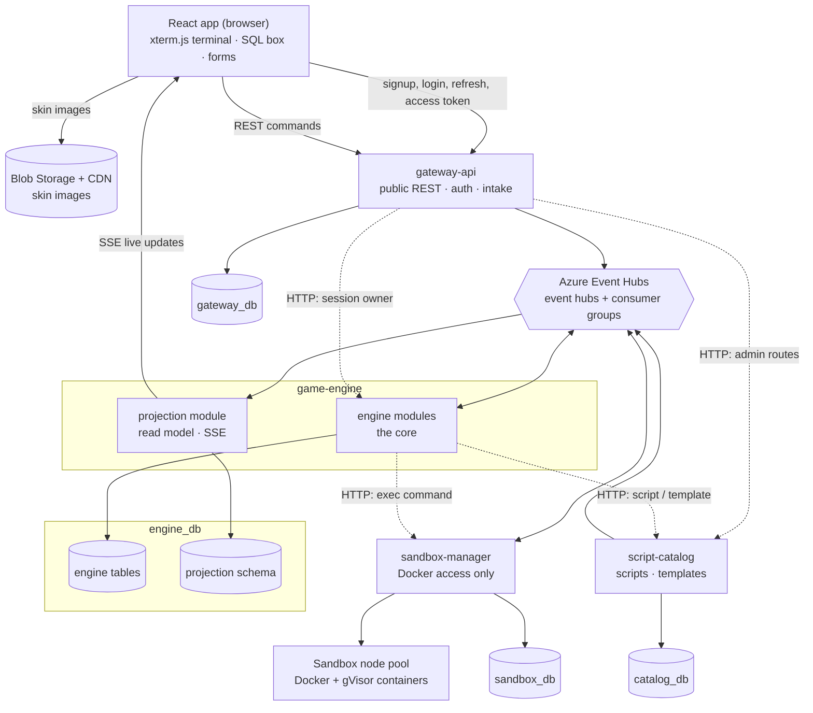

- Solid arrows are REST, SSE, Event Hubs and database traffic. Dotted arrows are the four direct HTTP calls.
- What travels on each Event Hubs arrow is shown in section 5.
- Redis is not drawn. It is a cache and lock store only (section 8), and it is not part of correctness. The projection module uses it for one key only, `admin:overview`.

## 5. Messaging: Events and Direct Calls

### Event Hubs

Five event hubs in one Event Hubs namespace. Every message is sent with partition key = the player's sessionId (catalog-events: the scriptId) and carries a `messageId` property. Every event also carries `{eventId, sessionId, sessionVersion, occurredAt}`.

| Event hub | Carries | Producer | Consumer group | Message types |
| --- | --- | --- | --- | --- |
| player-commands | commands | gateway-api (`messageId` = client commandId) | `engine` (game-engine) | StartSession, SubmitInput, RequestHint, PlayerReconnected, AbandonSession |
| sandbox-commands | commands | game-engine (outbox) | `sandbox` (sandbox-manager) | ProvisionSandbox, DestroySandbox |
| sandbox-events | events | sandbox-manager (outbox) | `engine` (game-engine) | SandboxReady, SandboxFailed, SandboxDestroyed |
| game-events | events | game-engine (outbox) | `projection` (game-engine, projection module) (later: one consumer group per new feature) | SessionStarted, PuzzleOpened, CommandEvaluated, PuzzleSolved, HintRevealed, RoomEntered, PuzzleReset, SessionEscaped, SessionExpired, SessionAbandoned |
| catalog-events | events | script-catalog (outbox) | `engine` (game-engine) | ScriptVersionPublished, TemplateVersionPublished |

- **Partitions:** 4 per event hub to start. The partition count is fixed when the event hub is created (Standard tier), so it is sized up front.
- **Retention:** 7 days. A consumer that is down picks up from its checkpoint when it comes back; nothing is lost inside the retention window.
- **Delivery is at-least-once.** Event Hubs has no duplicate detection and no per-message acknowledgement. The consumer's inbox (section 8) drops duplicates.

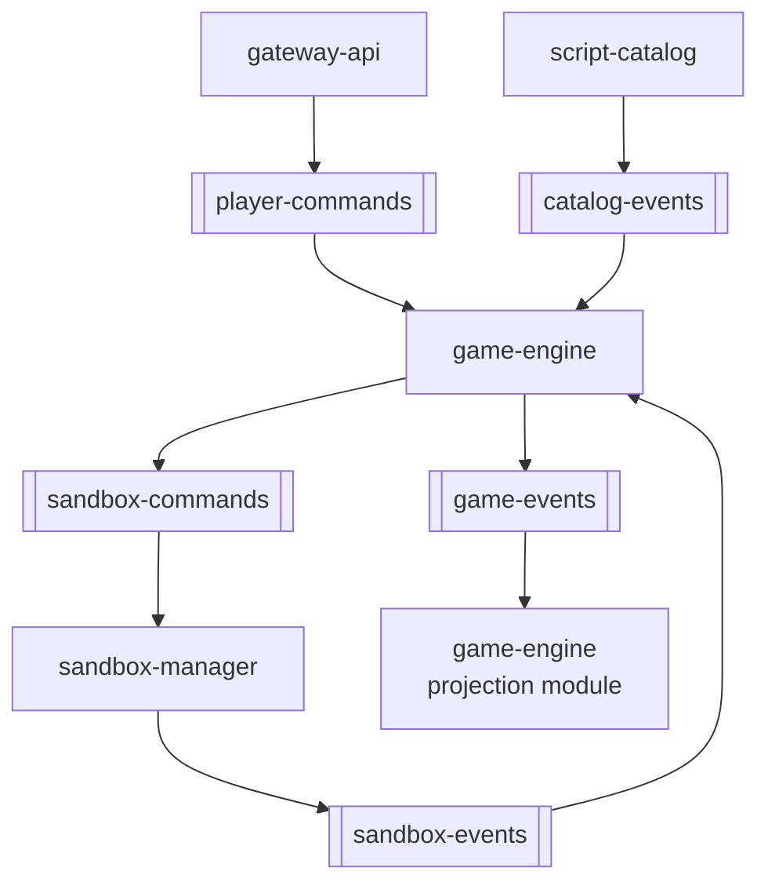

How a consumer processes events:

- **Ownership.** Each partition is owned by one consumer instance at a time (the processor client balances partitions across instances).
- **Order.** Inside a partition, events for the same sessionId are handled one at a time, in order. Events for different sessionIds in the same partition are handled in parallel, so one slow player (for example a 5 s sandbox exec) does not hold up the others.
- **Checkpoint.** The consumer moves its checkpoint forward only past events that are fully handled (committed, or dead-lettered).
- **Retry.** If handling fails (database error, version conflict, timeout), the consumer retries in process from a fresh read, up to 5 times with backoff.
- **Dead letters.** After 5 failed tries the consumer writes the event to a `dead_letters` table in its own database, raises an alert and moves on. An admin can replay dead letters after a fix.
- **No exclusion across event hubs.** A player command and a SandboxReady for the same session can be handled at the same time. The version column in the database serializes them (section 8).

Why Event Hubs for each flow:

- **player-commands:** the gateway replies 202 at once; the partition keeps one player's commands in order, and the consumer retries on failure.
- **sandbox-commands:** creating a container takes seconds; the engine doesn't wait, and the request survives a sandbox-manager restart.
- **sandbox-events:** the engine learns "ready" or "failed" without polling.
- **game-events:** the engine doesn't know who listens; later features add their own consumer group without engine changes.
- **catalog-events:** tells the engine to drop its cached "current version" pointer.

### The Four Direct HTTP Calls

These four are the only direct service-to-service calls. Checking a JWT is local, so it adds no call.

| From | To | Route | When and why |
| --- | --- | --- | --- |
| game-engine | sandbox-manager | `POST /internal/sandboxes/:id/exec` | Every sandbox command. Synchronous because the command needs its output. |
| game-engine | script-catalog | `GET /internal/scripts/:id/versions/:v` and `GET /internal/templates/:key/versions/:v` | Cache miss only. Published versions never change, so they are cached for 24 h. |
| gateway-api | game-engine | `GET /internal/sessions/:id/owner` | Cache miss only. gateway_db holds users and refresh tokens only; session owners live in engine_db. |
| gateway-api | script-catalog | `/admin/*` routes | Admin role is checked at the gateway. Publishing is rare and needs an immediate valid/invalid answer, so it is synchronous. |

### Public Routes

| Route | Service | Use |
| --- | --- | --- |
| `POST /auth/signup` | gateway-api | Create a player account. |
| `POST /auth/login` | gateway-api | Username + password, returns an access token + refresh token. |
| `POST /auth/refresh` | gateway-api | Swap a refresh token for a new access token + new refresh token. |
| `POST /auth/logout` | gateway-api | Revoke one refresh family (this device). |
| `POST /auth/logout-all` | gateway-api | Revoke all the user's refresh families. |
| `GET /me` | gateway-api | The signed-in user (player, admin). |
| `GET /admin/users` | gateway-api | List users (admin; a player gets 403). |
| `GET /health` | gateway-api | Returns `{status, db}`; runs `SELECT 1` on gateway_db. |
| `POST /sessions` `{scriptSlug, requestId}` | gateway-api | Start a game. Returns 202 `{sessionId}`. |
| `POST /sessions/:sid/puzzles/:key/inputs` `{commandId, input}` | gateway-api | Send one command or answer. Returns 202. |
| `POST /sessions/:sid/hints` `{commandId}` | gateway-api | Ask for the hint of the current stage (the Hint button). Sends RequestHint. Returns 202. |
| `POST /sessions/:sid/reconnect` `{commandId}` | gateway-api | Tell the engine the player is back. |
| `POST /sessions/:sid/abandon` | gateway-api | Give up the game (owner only). Sends AbandonSession. |
| `POST /admin/scripts/:id/versions/:v/publish` | gateway-api → script-catalog | Publish a Script version (admin role). |
| `GET /sessions/:sid/stream` | game-engine (projection module) | SSE live updates (JWT, owner only). |
| `GET /admin/overview` | game-engine (projection module) | Admin overview (JWT, admin role). Served by the projection module directly, not through gateway-api, so it adds no direct service-to-service call. |

## 6. Scripts and Components

### Script = State Machine

A Script version is data. Once published it never changes.

| Part | Fields |
| --- | --- |
| ScriptVersion | scriptId, version, durationMinutes, initialState, states, finalStates |
| State (= a room) | key, puzzles, transitions, files |
| Puzzle | key, templateRef (`key@version`), opensAfter (list of puzzle keys, or none), onRuin (`resetPuzzle` or `resetRoom`), hint (text, optional) |
| Transition | on (`PuzzleSolved`, `AllSolved` or `Timeout`), guard, to (state key) |
| File | name, content (shown in the room, for example a capture on a computer), revealedBy (optional puzzle key whose solve output replaces the content) |

- A session's position is its current state key plus its puzzle rows for that state.
- A session is pinned to the Script version it started with. Publishing a new version never changes running sessions.
- The engine core is one pure function: `transition(sessionSnapshot, event, scriptVersion) -> {nextSnapshot, effects[]}`. Effects are the outbox messages (ProvisionSandbox, DestroySandbox, domain events). It does no I/O, so it is easy to unit-test.

Checks on publish (script-catalog):

- every state is reachable;
- a final state is reachable from every state;
- every templateRef exists and is published;
- no opensAfter cycles;
- the winning path replays in CI with each template's solution.

### Hints

A hint is part of the Script: one optional text on a puzzle. It helps the player through one **stage**: from the end of the previous stage until that puzzle is solved. A puzzle without a hint is covered by the next hint in its room.

- **Current hint:** in the current room, the first puzzle (in Script order) that is not solved and has a hint. If every puzzle with a hint is solved, there is no current hint.
- **Asking:** the player presses the Hint button (bottom right). The browser sends `POST /sessions/:sid/hints`; gateway-api sends RequestHint; the engine finds the current hint, stamps `hintRevealedAt` on that puzzle row (only the first time) and emits HintRevealed `{puzzleKey, text, firstTime}`. The projection module adds it to the session view and pushes it over SSE (flow F9).
- **Asking again** in the same stage shows the same hint again; it is not counted twice. If there is no current hint, the request is rejected with reason `noHint` and the screen says "No hint for this step".
- **Cost:** none. The clock is not changed. Hint use is recorded (`hintRevealedAt`) and shown in the admin overview as hints used per puzzle.
- Revealed hints stay in the session view, so they come back after a reconnect.
- Hints are plain text and do not contain answers. A hint text change is a new Script version.

### Room Files

A State can list files that the player sees in the room, for example a capture on a computer. Their content is public puzzle material; it is sent to the browser in RoomEntered (SessionStarted for the first room).

- A file with `revealedBy` changes when that puzzle is solved: the solve output (for example the decrypted capture from the `tls` engine) replaces the file content in the PuzzleSolved event, and the screen shows "The file has been decrypted".
- Secret content (such as the decrypted records) is produced only by the engine on a correct solve, so the browser never holds it early.

### Component Factory

- A **Component Template** (in the catalog, versioned, never changed once published) has: key, version, family (`sandbox` or `input`), engine, inputSchema, policy, goal, invariants, solutionRef.
- Sandbox engines `terminal-git` and `sql` add: imageDigest, seedScript, checks (probe commands run inside the container).
- Input engines `hash`, `rsa`, `tls` and `answer` add a seed: the expected hash, N/e, the encrypted PMS, client random, server random, records.
- `ComponentFactory.create(puzzleDef, template)` looks up the engine in a registry and returns the matching class: TerminalGitComponent, SqlComponent, HashComponent, RsaComponent, TlsComponent or AnswerComponent.
- Components are built per message from cached template data and keep no state. Nothing is generated or stored per Script.
- A new Script or new puzzle order is new data. New template content is a new template version. Only a new engine needs code (a new class and, for a sandbox engine, an image).

How the input engines judge an answer (inside game-engine, on a worker_threads pool, 2 s limit; hex input up to 8 KB, RSA key up to 4096 bits):

| Engine | Check |
| --- | --- |
| answer | Plain field compare against the seed (login form, door code). The fields come from the seed. |
| hash | `sha256(input)` compared in constant time (`timingSafeEqual`). Never reversed. |
| rsa | The key must match N; then decrypt the PMS (PKCS#1 v1.5). |
| tls | TLS 1.2 PRF(PMS, client random, server random) → keys → decrypt the records. |

### Class Diagram: Script and Session

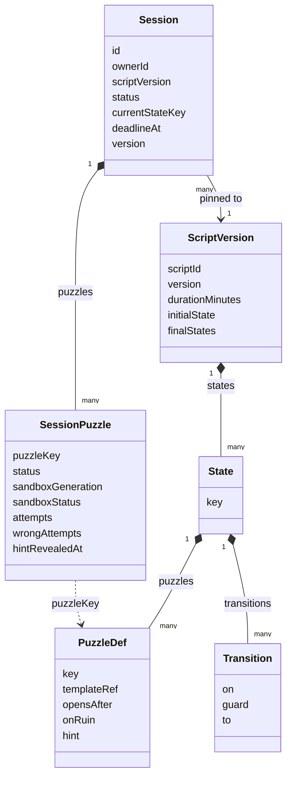

### Class Diagram: Component Contract

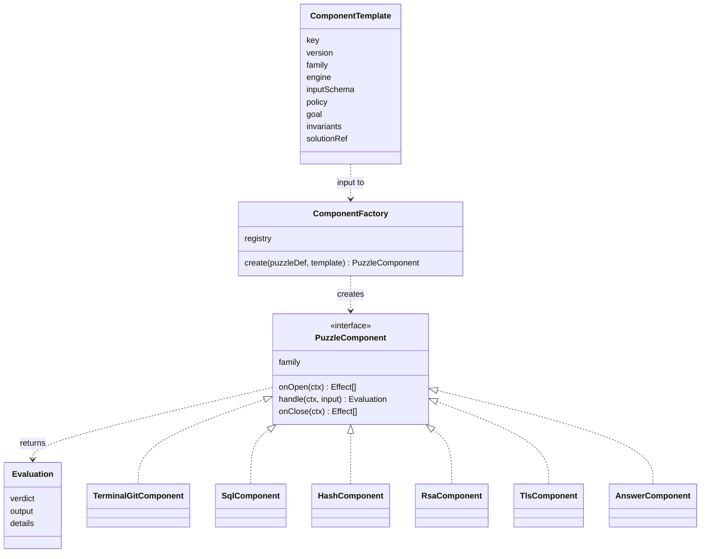

The contract (`<<interface>>` PuzzleComponent):

| Method | Sandbox family | Input family |
| --- | --- | --- |
| `onOpen(ctx)` | returns ProvisionSandbox | returns nothing |
| `handle(ctx, input)` | runs the command in the sandbox, then the checks | compares the answer on the worker pool |
| `onClose(ctx)` | returns DestroySandbox | returns nothing |

`handle` returns an Evaluation whose verdict is one of `progress`, `solved`, `rejected`, `ruined`.

| Verdict | Meaning |
| --- | --- |
| progress | The command ran; the goal is not met yet. |
| solved | The goal is met. The engine may open the next puzzles, enter the next room, or end in Escaped. |
| rejected | Not run or not accepted (blocked by policy, wrong answer, sandbox restarting, time is up, no hint for this step). |
| ruined | An invariant broke (for example an extra git commit or DROP TABLE). The puzzle or room resets. |

Only sandbox kinds (`sql`, `terminal-git`) can be ruined. A wrong answer on an input kind is rejected, never a ruin.

## 7. Sandboxes

- **Identity.** `sandboxId = hash(sessionId, puzzleKey, generation)`. The container name is the sandboxId, so Docker rejects a duplicate create.
- **Provision** (ProvisionSandbox): upsert the row (if it is already ready, send SandboxReady again); take a Redis lock to avoid a parallel create; create the container from the pinned image digest with labels; start it; run the seed script; health-check it (the template's ready probe, 3 tries, 10 s total); send SandboxReady, or SandboxFailed and destroy it.
- **Exec** (HTTP from the engine, carries the commandId): if a stored result exists for that commandId, return it, so a redelivery never runs a command twice. Otherwise run the command with a 5 s timeout and a 64 KB output cap, run the checks, store and return the result. Each exec extends the idle lease by `SANDBOX_IDLE_MINUTES` (15).
- **Destroy:** remove the container, mark it destroyed, send SandboxDestroyed. A missing container counts as success.
- **Reconnect rule:** a sandbox never keeps state across a reconnect. A reconnect gives every open sandbox puzzle generation+1 and a fresh container.
- **Terminal:** line by line. Each Enter is one SubmitInput. No interactive terminal (no vim, no less) and no WebSocket. The sandbox image sets `GIT_PAGER=cat` and `PAGER=cat`, so `git log` and `git show` print straight through. The xterm.js view keeps a prompt, local line editing and up-arrow history.
- **Copy and paste in the terminal:** the player selects output with the mouse and copies it (Cmd+C on macOS, Ctrl+Shift+C elsewhere, or right-click → Copy; plain Ctrl+C stays "cancel line"). Paste (Cmd+V / Ctrl+Shift+V) goes into the current prompt line; a pasted line break is not sent as Enter, so one paste can never run several commands.

Isolation for every container:

| Area | Rule |
| --- | --- |
| Runtime | gVisor (`runsc`) |
| Network | none; egress also denied at the node firewall |
| Disk | read-only root filesystem + tmpfs `/work` (64 MB); no host mounts |
| User and rights | user 1000:1000, all capabilities dropped, no-new-privileges, default seccomp |
| Limits | 64 processes, 256 MB memory with no swap, 0.5 CPU, 256 open files |
| Secrets | no Docker socket, no secrets or credentials in the environment |
| Images | pinned by digest, built in CI |
| Hosts | separate sandbox node pool; the Docker API is reachable only by sandbox-manager on that host |

## 8. Data Consistency

### One Transition, One Transaction

`sessions.version` is a version column. Puzzle rows belong to the session, so any change to them also bumps the session version. Writes always read the database, never the cache.

1. Begin a transaction.
2. Insert the message id into the inbox. A duplicate fails the unique key, so the message is marked handled with no effect.
3. Read the session and its puzzles (version = v).
4. Run the guards, the component and `transition()`.
5. Update the session to version v+1, only where the version is still v. Zero rows updated means another writer won.
6. Save the puzzles, the command log row and the outbox rows.
7. Commit. Then delete the Redis `session:{id}` key, then mark the event as handled so the checkpoint can move past it.

If another writer won: roll back, re-read and re-evaluate in process (section 5). After 5 failed tries the event goes to the consumer's `dead_letters` table. The three writers this protects against each other are the command handler, the sandbox-event handler and the janitor. Redis locks are not part of correctness; correctness comes from the version column and unique keys. Locks only stop wasted work.

### Outbox and Inbox

- **Outbox:** game-engine, sandbox-manager and script-catalog each have one. Rows are written in the same transaction as the state change, so there are no lost or phantom events. One relay leader per service (Redis lock) sends unsent rows in order, with the `messageId` property = the row's messageId. A crash between send and mark-sent causes a resend, which the consumer's inbox drops. Sent rows are deleted after 7 days.
- **Inbox:** `(consumer, messageId)` is unique. Inserted in the consumer's transaction. Kept 14 days.
- **Separate tables in game-engine:** the projection module has its own `projection.inbox` and `projection.dead_letters` in the `projection` schema. The engine's inbox and dead_letters stay in the engine's own schema.

Layers that stop duplicates:

1. The client's commandId is the `messageId`, so a retried request (or a resent event) has the same id.
2. The inbox unique key.
3. Natural keys: sandboxId, container name, the stored exec result per commandId.
4. Each event's sessionVersion: the projection module ignores a version it already has.

### Redis

Redis is for caching and locks only. If Redis errors or takes more than 50 ms, services fall back to the database or the internal API; a circuit breaker opens after 5 failures for 30 s.

| Key | Holds | Lifetime |
| --- | --- | --- |
| `tpl:scriptver:{scriptId}:{version}` | a published Script version | 24 h, never needs clearing |
| `tpl:template:{key}:{version}` | a published template | 24 h |
| `tpl:script:{slug}:current` | pointer to the published version | 60 s, deleted on publish |
| `session:{id}` | hot snapshot: version, status, ownerId, currentStateKey, puzzles | 5 min, deleted after every commit |
| `lock:relay:{service}` | outbox relay leader | 15 s, renewed |
| `lock:janitor:{service}` | cleanup job leader | 60 s |
| `lock:provision:{sandboxId}` | one container create at a time | held while creating |
| `admin:overview` | admin overview, owned by the projection module in game-engine (section 12) | overwritten on SessionStarted, SessionEscaped, SessionExpired, SessionAbandoned |

Rules:

- **One read point.** Every session read goes through one SessionReader (gateway: `getSessionOwner`; engine read API: `getSessionSnapshot`). The session cache lives only there.
- **Cache-aside.** After commit the writer deletes `session:{id}`. Refilling uses a compare-and-set: write only if the cached version is older, so a slow reader cannot put an old snapshot back.
- **Publish.** The catalog commits the pointer change and the outbox row, then deletes the pointer key. The engine deletes it again when it receives ScriptVersionPublished. Worst case is the 60 s lifetime.
- The projection module uses one key only, `admin:overview`. Live updates go through Postgres LISTEN/NOTIFY.

## 9. Data Model

Each service owns its own database. There are no foreign keys between databases.

The column types in these diagrams are illustrative; the TypeORM entities and migrations are authoritative.

### engine_db (game-engine)

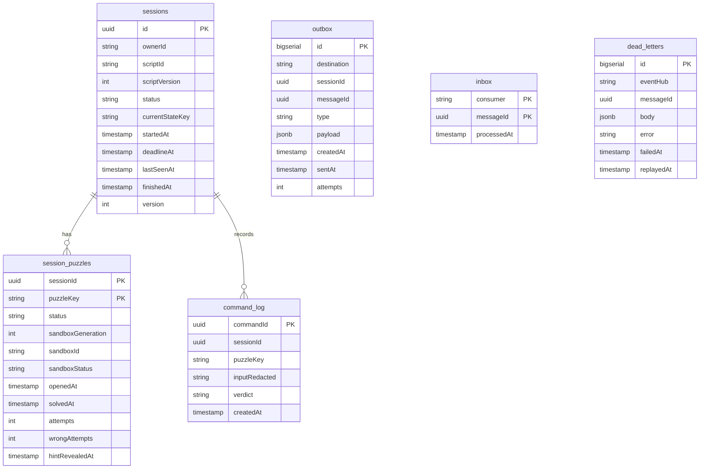

- `sessions.status`: Active, Escaped, Expired, Abandoned.
- `session_puzzles.status`: locked, open, solved. `sandboxStatus`: none, provisioning, ready, failed.
- Solve time, tries, wrong answers and hint use per puzzle per player come from `session_puzzles` (openedAt → solvedAt, attempts, wrongAttempts, hintRevealedAt).
- `dead_letters` holds events that failed 5 times (section 5). sandbox_db and the `projection` schema in engine_db have the same table.

### projection schema (projection module in game-engine)

The projection module's tables live in their own `projection` schema inside engine_db. They are not joined with the engine tables above.

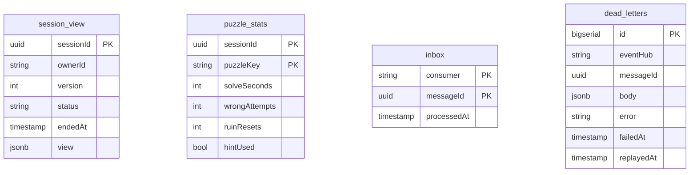

- The projection module writes `session_view` only when an event's sessionVersion is newer than the stored version.
- `puzzle_stats` has one row per session and puzzle. `solveSeconds` is null until the puzzle is solved. It is updated from CommandEvaluated (verdict `rejected`, reason `wrongAnswer`), PuzzleSolved, PuzzleReset and HintRevealed (`firstTime` = true), with the same newer-version rule, through the inbox.
- `inbox` and `dead_letters` here are the projection module's own tables (`projection.inbox`, `projection.dead_letters`). The engine's inbox and dead_letters are separate tables in the engine's schema.

### catalog_db (script-catalog)

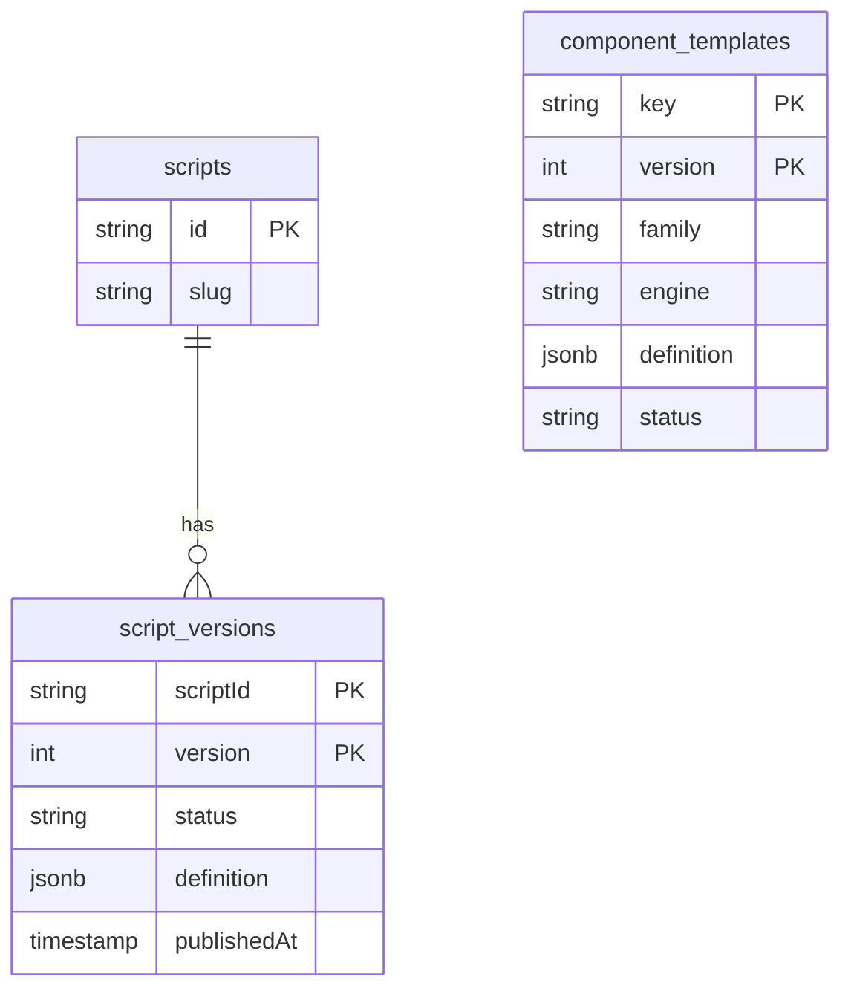

- `script_versions.status`: draft, published, retired.
- script-catalog also has an outbox (same shape as in engine_db).

### sandbox_db (sandbox-manager)

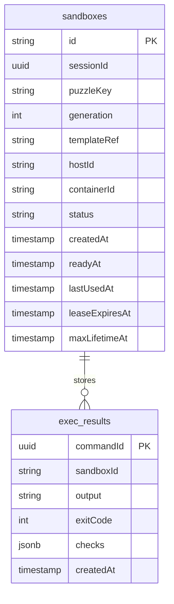

- `sandboxes.status`: creating, ready, failed, destroying, destroyed. sandbox_db also has an outbox.

### gateway_db (gateway-api)

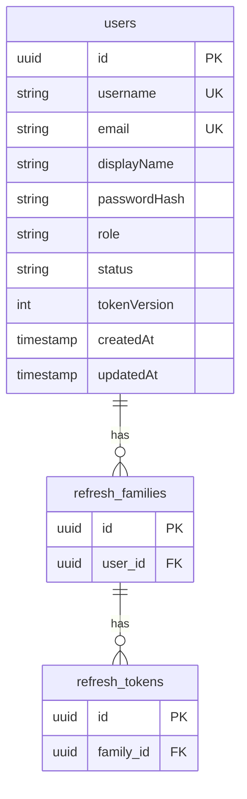

- `passwordHash` is an argon2id hash; plain-text passwords are never stored or logged.
- `users.role`: player, admin.
- The schema comes from the TypeORM migration `1740000000000-InitialSchema`, with `synchronize` off (false).
- Seed the admin with `npm run seed:admin` (safe to run twice). Local reset: `npm run db:reset -- --confirm-local-reset`.

## 10. Session Lifecycle

### Session Status

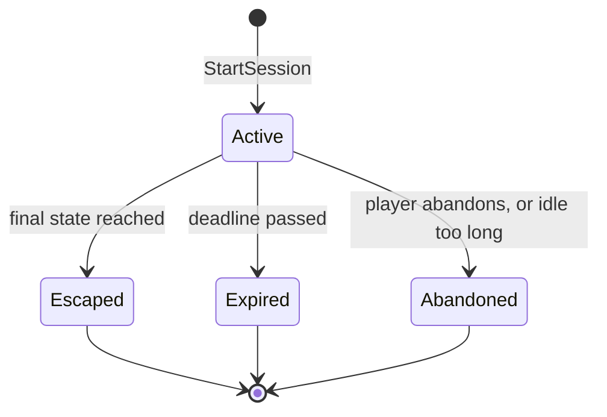

- Escaped, Expired and Abandoned are final; there is no way out of them.
- Abandoned: the player sends `POST /sessions/:sid/abandon` (owner only; gateway-api sends AbandonSession), or the janitor abandons a session idle for `ABANDON_MINUTES`.
- A ruin is not an ending. It resets the puzzle or the room and the clock keeps running. Ruins stay visible in stats through the PuzzleReset event and the command log verdict `ruined`.

### Puzzle Status

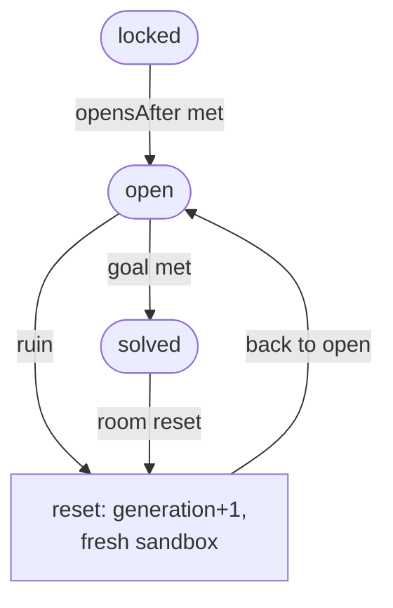

Rounded boxes are puzzle statuses; the square box is the reset step, not a status.

- `onRuin = resetPuzzle`: the ruined puzzle gets generation+1 and a fresh sandbox.
- `onRuin = resetRoom`: the same for every puzzle in the room, and solved puzzles in that room go back to open.

### Cleanup Jobs

game-engine janitor (every 60 s, one leader):

- Active and past the deadline → Expired, and destroy every live sandbox.
- Active and not seen for `ABANDON_MINUTES` (30) → Abandoned, and destroy.
- A puzzle waiting more than 3 min for its sandbox → provision again with generation+1 (at most 3 times, then mark the puzzle unavailable and alert).
- Outbox rows unsent for more than 5 min → alert.

Expiry is also checked on every command (`now < deadlineAt`), so the janitor's delay never lets a late answer count.

sandbox-manager reaper (every 60 s on each host):

- Lease expired, or past the 2 h hard cap → destroy.
- Stuck in creating for more than 3 min → failed, destroy, SandboxFailed.
- A managed container with no row, or with a destroyed row → remove (orphan).
- A ready sandbox whose health probe fails 3 times in a row → destroy and SandboxFailed (the engine provisions again).

## 11. Key Flows

### F0 Signup/Login, Access and Refresh

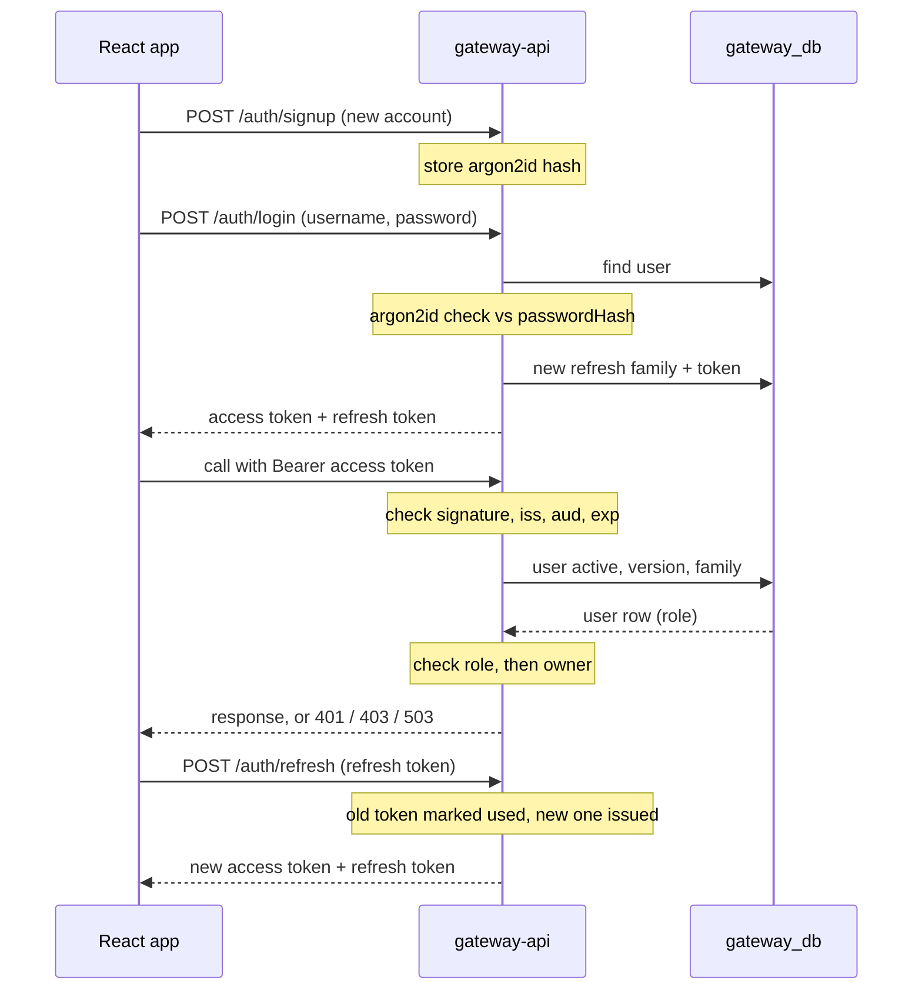

Reusing an already-used refresh token revokes its whole family; logout revokes one family; logout-all revokes all the user's families and bumps `tokenVersion`.

- The access token is an HS256 JWT signed with `JWT_ACCESS_SECRET`, with `iss` = `JWT_ISSUER`, `aud` = `JWT_AUDIENCE` and a lifetime of `JWT_ACCESS_TTL` (900 s). It carries `sub` (userId), `fid` (refresh family id) and `ver` (tokenVersion). It does not carry the role.
- gateway-api's guard checks signature, `iss`, `aud` and `exp`, then reads gateway_db on every request: the user is active, `tokenVersion` equals `ver`, and the family is neither revoked nor expired. It loads the role from the users row, then checks the role, then the owner. If the database is unreachable it returns 503.
- The refresh token lives for `REFRESH_TOKEN_TTL_DAYS` and is replaced on every refresh.
- The projection module in game-engine verifies the same access token on the SSE stream and on `GET /admin/overview` with `JWT_ACCESS_SECRET`, `JWT_ISSUER` and `JWT_AUDIENCE`, and does not call gateway-api.

### F1 Start a Game

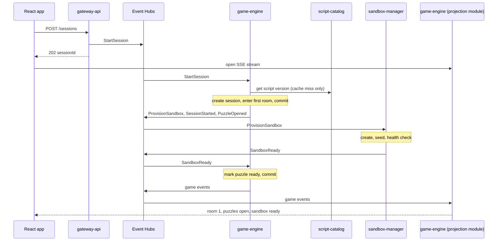

### F2 Normal Sandbox Command

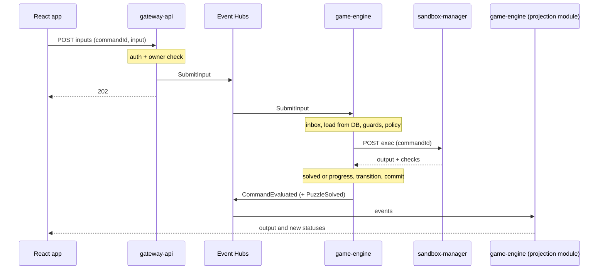

- Guards: session Active, before the deadline, puzzle open, sandbox ready, generation matches. Otherwise the verdict is `rejected` with a reason (for example "sandbox restarting").
- The policy deny-list runs on the parsed input first; a blocked command is rejected, not run.
- A solve may open the next puzzles, enter the next room (RoomEntered) or end the game (SessionEscaped).

### F3 Ruin, Then Reset

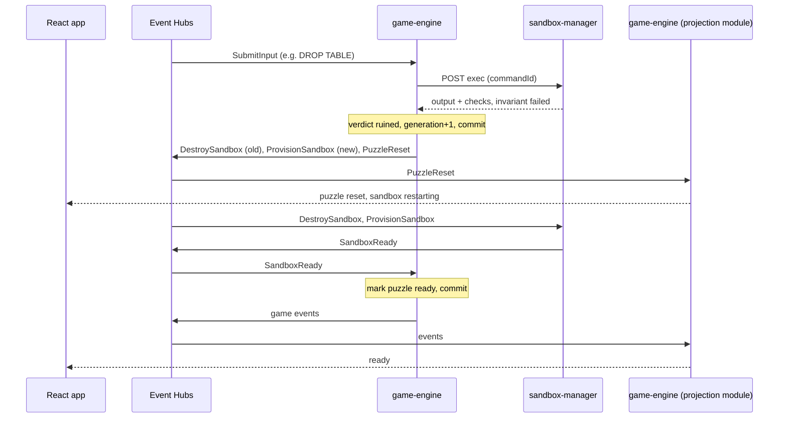

- Intake is the same as F2 (gateway-api, 202).
- With `resetRoom` the same happens for every puzzle in the room, and solved puzzles in that room go back to open.
- The session stays Active and the clock keeps running.

### F4 Crypto Answer (Hash, RSA, TLS)

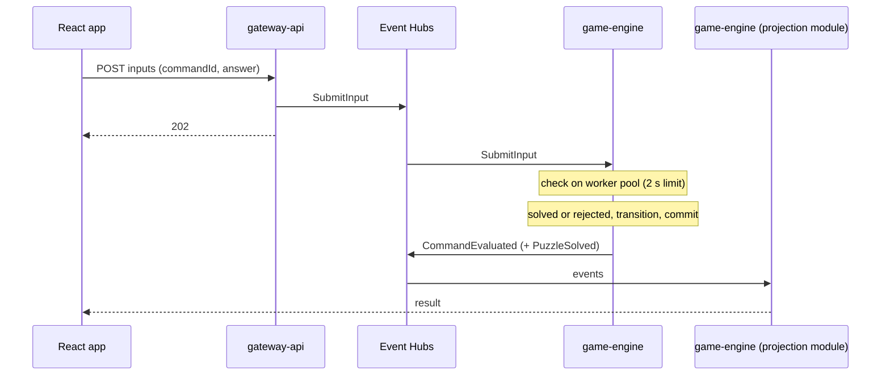

- No sandbox. A wrong answer counts as a wrong attempt.

### F5 Reconnect

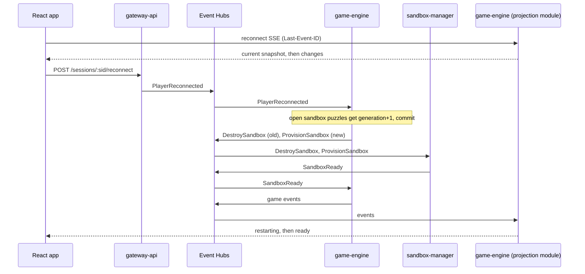

### F6 Time Runs Out

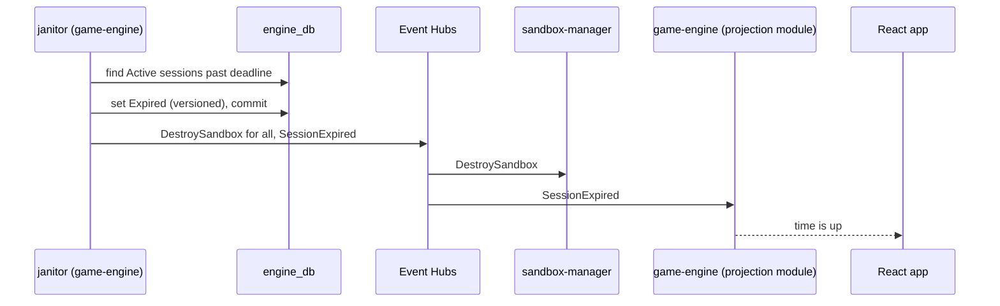

- If a player command commits first, the janitor's write loses on the version check; it re-reads and expires the session on its next pass.
- If the janitor commits first, the command's guard sees Expired and rejects it.

### F7 Admin Publishes a Script Version

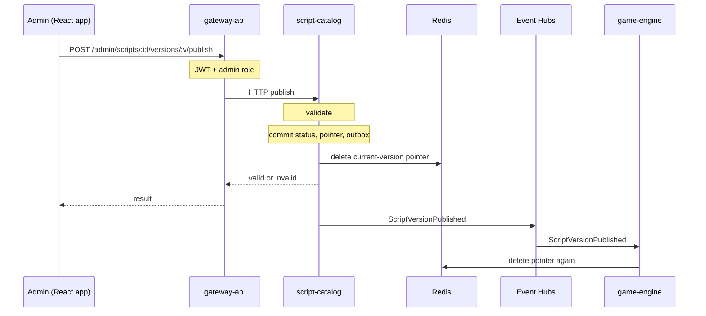

- New sessions use the new version; running sessions keep theirs.

### F8 Admin Overview

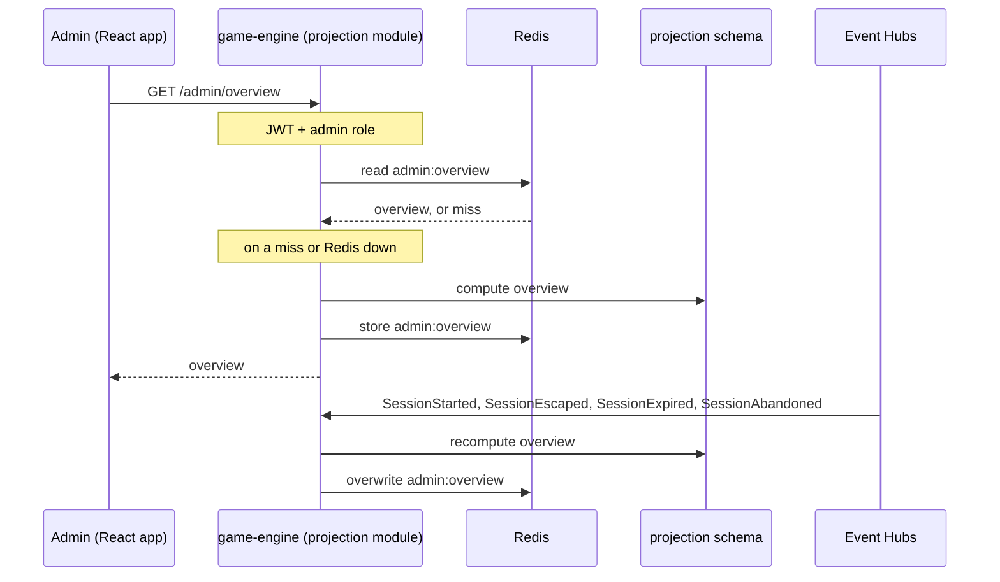

- Served by the projection module directly; no new service-to-service call.
- Not refreshed on every move, only when a session starts or ends.

### F9 Hint

```mermaid
sequenceDiagram
  participant UI as React app
  participant GW as gateway-api
  participant EH as Event Hubs
  participant ENG as game-engine
  participant PROJ as game-engine (projection module)
  UI->>GW: POST /sessions/:sid/hints (commandId)
  Note over GW: auth + owner check
  GW->>EH: RequestHint
  GW-->>UI: 202
  EH->>ENG: RequestHint
  Note over ENG: guards, find current hint, stamp hintRevealedAt (first time), commit
  ENG->>EH: HintRevealed (puzzleKey, text, firstTime)
  EH->>PROJ: HintRevealed
  PROJ-->>UI: hint text
```

- Guards: session Active and before the deadline. No sandbox and no worker pool; the hint text comes from the pinned Script version.
- No current hint → CommandEvaluated with verdict `rejected` and reason `noHint`; the screen says "No hint for this step". It does not count as a wrong attempt.

## 12. Real-Time Updates (projection module in game-engine)

- The projection module is part of game-engine and follows the Service Rules in section 3: it gets game events only through its own consumer group, `projection`, and uses only its own `projection` schema.
- It uses one Redis key only, `admin:overview`. Live updates go through Postgres LISTEN/NOTIFY.
- It reads game-events in order per session and updates `session_view` only if the event is newer than what it has. Then it sends a Postgres NOTIFY.
- Every game-engine instance LISTENs and pushes to its own SSE connections at `GET /sessions/:sid/stream`. The projection module verifies the access token's signature, `iss`, `aud` and `exp` with `JWT_ACCESS_SECRET` (plus `JWT_ISSUER`, `JWT_AUDIENCE`) and checks the owner via `sub`, with no call to gateway-api.
- On connect or reconnect it sends the current snapshot first (id = version), then changes. Last-Event-ID lets the browser skip versions it already has.
- Why SSE and not WebSocket: commands already go over REST, the push is one-way, and SSE reconnects by itself and resumes from the last version.
- The browser shows only the view: puzzle statuses, command output, a countdown from `deadlineAt`, "sandbox restarting", the hints revealed so far and the room files (for example the capture, encrypted or decrypted).

### Admin Overview

The projection module serves `GET /admin/overview` directly. It is already public for SSE, and it checks the JWT (with the same `JWT_ACCESS_SECRET`) and the admin role. There is no new service-to-service HTTP call; there are still exactly four (section 5).

What the Redis key `admin:overview` holds (owner: the projection module in game-engine). It is computed from `session_view` and `puzzle_stats`:

| Field | Meaning |
| --- | --- |
| `gamesInProgress` | live count of Active sessions (`session_view.status` = Active) |
| `gamesFinishedToday` | `{escaped, expired, abandoned}`: sessions that ended today, by ending (`session_view.status` and `endedAt`) |
| `perPuzzle[]` | `{puzzleKey, avgSolveSeconds, wrongAttempts, ruinResets, hintsUsed}` per puzzle, from `puzzle_stats` |

- `wrongAttempts` counts CommandEvaluated events with verdict `rejected` and reason `wrongAnswer`. Policy blocks, sandbox restarting and time-up are not counted. `ruinResets` counts PuzzleReset events. `hintsUsed` counts HintRevealed events with `firstTime` = true.
- "Today" is the calendar day in the server's configured timezone.
- **Refresh:** on SessionStarted, SessionEscaped, SessionExpired and SessionAbandoned, the projection module recomputes the overview from `session_view` and `puzzle_stats` and overwrites the key. Not on every move.
- **Fallback:** if the key is missing or Redis is down, the projection module computes the overview from `session_view` and `puzzle_stats`, stores it and returns it. Postgres stays the source of truth.

## 13. Demo Script: The Escape Room

The escape room from the story script is the demo content. It is data only; the engine runs it like any other Script. The experience is built from clickable images (the skin), and the server drives it.

```mermaid
flowchart TB
  S(["Start"])
  subgraph R1["room-1"]
    direction TB
    P1["idan-db (sql)"]
    P2["hash-cracker (hash)"]
    P3["dana-login (answer)"]
    P1 -- "opens" --> P2
    P2 -- "opens" --> P3
  end
  subgraph R2["room-2"]
    direction TB
    P4["nethanel-git (terminal-git)"]
    P5["rsa-decryptor (rsa)"]
    P6["tls-decryptor (tls)"]
    P7["door (answer)"]
    P4 -- "opens" --> P5
    P5 -- "opens" --> P6
    P6 -- "opens" --> P7
  end
  E(["escaped"])
  S --> R1
  R1 -- "AllSolved" --> R2
  R2 -- "AllSolved" --> E
```

| Room | Puzzle | Engine | opensAfter | What the player does |
| --- | --- | --- | --- | --- |
| room-1 | idan-db | sql | none | On Idan's computer, queries the `employees` and `logs` tables read-only: finds Dana's username, then her auth log entry, and copies her password hash from the result grid. |
| room-1 | hash-cracker | hash | idan-db | Pastes the hash into the Hash-Cracker machine and gets Dana's password. |
| room-1 | dana-login | answer | hash-cracker | Pastes Dana's username and password into the login window on her computer. An "open room" file appears; it is only the UI of the move to room-2. |
| room-2 | nethanel-git | terminal-git | none | In the git terminal on Nathaniel's computer, finds the commit "Security fix: Removed private key from repository." and recovers the private key from the previous commit, then copies it from the terminal. |
| room-2 | rsa-decryptor | rsa | nethanel-git | Pastes the private key, and the encrypted PMS and the modulus N copied from the encrypted capture, and gets the decrypted PMS. |
| room-2 | tls-decryptor | tls | rsa-decryptor | Pastes the PMS and the client random copied from the capture. On success the machine shows "The file has been decrypted"; the capture on Nathaniel's computer is now the decrypted one. |
| room-2 | door | answer | tls-decryptor | Opens the decrypted capture on Nathaniel's computer, finds his credit card number in the Application Data payload, copies it and pastes it on the door lock. |

- Room transitions: room-1 → room-2 on AllSolved; room-2 → escaped on AllSolved.
- `onRuin = resetPuzzle` for every puzzle; resetRoom is not used in the demo. Only idan-db (sql) and nethanel-git (terminal-git) can be ruined; a wrong answer on the other puzzles is rejected.
- Table names: `employees` and `logs` are correct (the story script's extra table names are not used).

### Hints in the Demo

One hint per stage, four in total. Each hint sits on the puzzle that ends its stage (section 6).

| Stage | Hint on | Shown until | Hint text (draft) |
| --- | --- | --- | --- |
| room-1, until login | dana-login | Dana's login succeeds | "Dana's username and password are not written anywhere in the room. Idan's computer can look into the company tables: who is Dana, and what did she leave in the logs? A hash is not a password yet, but the Hash-Cracker can change that." |
| room-2, until the PMS is decrypted | rsa-decryptor | the RSA decryptor outputs the PMS | "Nathaniel says the private key was removed. Git remembers what came before. With the key, the RSA decryptor also needs two values from the capture: the encrypted PMS from the Client Key Exchange, and N from the certificate." |
| room-2, until the capture is decrypted | tls-decryptor | the TLS decryptor decrypts the capture | "The TLS decryptor needs the PMS you just got and the Client Random. The start of the capture, before the Client Key Exchange, is not encrypted." |
| room-2, until the door opens | door | the door opens | "Open the capture on Nathaniel's computer again: it is decrypted now. Look in the Application Data for his Cibus payment. What does the door code look like?" |

- idan-db, hash-cracker and nethanel-git have no hint of their own; they are covered by the next hint in their room.
- The "open room" step in room-1 is UI only, so there is no separate hint for it.

### Nathaniel's Computer and the Capture

- room-2 has one file, `Cibus_payment_try.pcap`, with `revealedBy = tls-decryptor`. It stays on Nathaniel's computer; it is not an inventory item.
- To read it, the player clicks Nathaniel's computer, then the file. It opens large in the middle of the screen and scrolls. Clicking outside it goes back to the room.
- Before tls-decryptor is solved, the file shows the TLS handshake in clear up to the Client Key Exchange (Client Hello with the client random, the certificate with N, the Client Key Exchange with the encrypted PMS) and the rest as encrypted records.
- When tls-decryptor is solved, the TLS decryptor shows "The file has been decrypted". The next time the player opens the file it shows the decrypted capture, including the Application Data payload.

### Copy and Paste

All of it is in the browser (selection + the clipboard); the server only sees what the player finally submits.

| Copy from | What | Paste into |
| --- | --- | --- |
| SQL result grid (Idan's computer) | Dana's username, her password hash | Hash-Cracker, Dana's login window |
| Hash-Cracker output | Dana's password | Dana's login window |
| git terminal (Nathaniel's computer) | the private key | RSA decryptor |
| encrypted capture | the modulus N, the encrypted PMS, the client random | RSA decryptor, TLS decryptor |
| RSA decryptor output | the decrypted PMS | TLS decryptor |
| decrypted capture | Nathaniel's credit card number | the door lock |

- Every output view is plain selectable text, with a Copy button on single values (machine outputs, grid cells).
- Every input field accepts paste. Multi-line fields (the private key) keep line breaks; single-line fields trim spaces and line breaks.

- Winning: the door opens, Dana appears with a "Welcome to the team" sign. The session ends as Escaped.

## 14. Failure Handling

| Risk | How it is handled |
| --- | --- |
| Sandbox escape | gVisor, no network, non-root, read-only disk, dropped capabilities, seccomp, limits, separate node pool, egress denied, no socket or secrets, pinned images. A breakout lands on an isolated machine with nothing to steal. |
| Fork or disk bombs | Process limit, tmpfs size, memory without swap, 5 s exec kill, 64 KB output cap. |
| Duplicate messages | Inbox unique key, natural keys, stored exec results (Event Hubs has no duplicate detection). A redelivery never runs a sandbox command again. |
| Two writers at once | Version column; the loser retries from a fresh read. |
| Out of order | Partition key = sessionId, one session handled at a time per partition, one relay leader, sessionVersion in events. |
| Expiry vs solve | Whichever commit wins; the guard checks the deadline again on retry. |
| Double provision | Fixed sandboxId, unique container name, row upsert, lock. |
| Stale sandbox | Generation check: commands and events for an old generation are rejected or ignored. |
| Leaked containers | Lease, max lifetime, labels, orphan reaper. The lease still expires if a destroy message is lost. |
| Stale cache | Immutable versioned keys, 60 s pointer, delete twice, delete after commit + version compare-and-set, writes skip the cache, Redis down → database. |
| Event Hubs down | The gateway returns 503; the client retries with the same commandId. Outbox rows wait and are sent later. |
| Consumer down | Events wait in the event hub (7-day retention); the consumer resumes from its checkpoint. |
| Poison message | 5 in-process tries, then the consumer's `dead_letters` table, alert, the checkpoint moves on; admin replay after a fix. |
| sandbox-manager down | Commands are rejected "sandbox unavailable" (5 s exec timeout); provisioning waits in the sandbox-commands event hub; the janitor retries. |
| projection module lagging | The browser shows the last snapshot; a reconnect resyncs. |

## 15. Later Features

A later feature adds its own module with its own consumer group on game-events; existing modules do not change. The later features are SkillSwapper teacher recommendations and the Clippy coach.

The admin overview is part of the projection module (section 12), not a later feature. Hints are part of the Script (section 6), not a later feature.

### SkillSwapper Teacher Recommendations (later)

After a game ends, the player sees teachers who can help with the skills they were slow on.

- **Who:** a recommendations module in game-engine, next to the projection module (which already pushes the end screen over SSE). It reads game-events in its own consumer group.
- **Which puzzles:** puzzles the player solved slower than that puzzle's target time. Unsolved puzzles do not count. Each puzzle in the Script gets two more fields for this: `skillTopic` (for example `SQL`, `git`, `RSA`, `TLS`) and `targetSeconds`. They travel in PuzzleOpened.
- **When:** on SessionEscaped, SessionExpired or SessionAbandoned. Solve time = PuzzleSolved.occurredAt − PuzzleOpened.occurredAt.
- **Call:** for each slow topic, one call to the SkillSwapper REST API with the topic and the number of teachers (`SKILLSWAP_TEACHERS_PER_TOPIC`), authenticated with the `skillSwapApiToken`.
- **Show:** the teachers in a pop-up on the end screen, so the player can contact them if they want to improve.
- SkillSwapper is an external API, not one of our services, so the count of direct service-to-service calls stays four. If SkillSwapper is down or slow (3 s timeout), the end screen shows no recommendations; the game result is not affected.

## 16. Environment Configuration

Each service has a `.env.example`. Every secret is a `REPLACE_...` placeholder there; no real values in git. Real values live in Azure Key Vault.

| Variable | Default | Meaning |
| --- | --- | --- |
| `EVENTHUBS_NAMESPACE` | | Azure Event Hubs namespace |
| `EVENTHUBS_CHECKPOINT_STORE_URL` | | Blob Storage container for consumer checkpoints (every service that consumes) |
| `DATABASE_URL` | | the service's own database (every service except gateway-api) |
| `REDIS_URL` | | Redis cache and locks |
| `DB_HOST` | | gateway_db host (gateway-api) |
| `DB_PORT` | 5432 | gateway_db port (gateway-api) |
| `DB_USER` | | gateway_db user (gateway-api) |
| `DB_PASSWORD` | | gateway_db password (gateway-api) |
| `DB_NAME` | | gateway_db name (gateway-api) |
| `DB_SSL` | false | use TLS to gateway_db (gateway-api) |
| `JWT_ACCESS_SECRET` | | secret that signs and verifies access tokens (gateway-api, game-engine) |
| `JWT_ACCESS_TTL` | 900 | access token lifetime in seconds (gateway-api) |
| `JWT_ISSUER` | escape-room-api | token issuer, `iss` (gateway-api, game-engine) |
| `JWT_AUDIENCE` | escape-room-client | token audience, `aud` (gateway-api, game-engine) |
| `REFRESH_TOKEN_TTL_DAYS` | 7 | refresh token lifetime in days (gateway-api) |
| `CORS_ORIGINS` | | allowed browser origins (gateway-api, projection module in game-engine) |
| `SANDBOX_IDLE_MINUTES` | 15 | idle lease per sandbox |
| `SANDBOX_MAX_LIFETIME_MINUTES` | 120 | hard cap per sandbox |
| `SANDBOX_EXEC_TIMEOUT_MS` | 5000 | exec kill timeout |
| `SANDBOX_MAX_OUTPUT_BYTES` | 65536 | exec output cap |
| `ABANDON_MINUTES` | 30 | inactivity before Abandoned |
| `OUTBOX_RETENTION_DAYS` | 7 | keep sent outbox rows |
| `INBOX_RETENTION_DAYS` | 14 | keep inbox rows |
| `SWAGGER_ENABLED` | | turn the OpenAPI (Swagger) page on or off |
| `skillSwapApiToken` | | later: secret token for the SkillSwapper REST API (game-engine, recommendations module). Placeholder only in `.env.example`; the real value is in Key Vault. |
| `SKILLSWAP_API_URL` | | later: SkillSwapper REST API base URL (game-engine, recommendations module) |
| `SKILLSWAP_TEACHERS_PER_TOPIC` | 2 | later: how many teachers to ask for per slow topic (game-engine, recommendations module) |

Frontend: `VITE_API_BASE_URL`, `VITE_ASSETS_BASE_URL`.

gateway-api loads its config in `src/config/config.ts` via dotenv. Its `.env.example` uses `REPLACE_...` placeholders. No secrets in git.

Variables per service:

| Service | Variables |
| --- | --- |
| gateway-api | `EVENTHUBS_NAMESPACE`, `DB_HOST`, `DB_PORT`, `DB_USER`, `DB_PASSWORD`, `DB_NAME`, `DB_SSL` (gateway_db), `REDIS_URL`, `JWT_ACCESS_SECRET`, `JWT_ACCESS_TTL`, `JWT_ISSUER`, `JWT_AUDIENCE`, `REFRESH_TOKEN_TTL_DAYS`, `CORS_ORIGINS`, `SWAGGER_ENABLED` |
| game-engine | `EVENTHUBS_NAMESPACE`, `EVENTHUBS_CHECKPOINT_STORE_URL`, `DATABASE_URL`, `REDIS_URL`, `JWT_ACCESS_SECRET`, `JWT_ISSUER`, `JWT_AUDIENCE`, `CORS_ORIGINS`, `ABANDON_MINUTES`, `OUTBOX_RETENTION_DAYS`, `INBOX_RETENTION_DAYS`; later: `skillSwapApiToken`, `SKILLSWAP_API_URL`, `SKILLSWAP_TEACHERS_PER_TOPIC` |
| sandbox-manager | `EVENTHUBS_NAMESPACE`, `EVENTHUBS_CHECKPOINT_STORE_URL`, `DATABASE_URL`, `REDIS_URL`, `SANDBOX_*`, `OUTBOX_RETENTION_DAYS`, `INBOX_RETENTION_DAYS` |
| script-catalog | `EVENTHUBS_NAMESPACE`, `DATABASE_URL`, `REDIS_URL`, `OUTBOX_RETENTION_DAYS` |
| frontend | the `VITE_*` variables above |
