# Smart Test Components: Platform Design (v2)

Version 2. This document replaces the v1 design (one backend, modular monolith). v2 is event-driven and made of two microservices (gateway-api and the Users service) and game-engine, a modular monolith with Sandbox, Projection and Script Catalog modules. Source: the architect's v2 sketch (2026-10-27) and its factsheet. Updated 2026-10-29: Azure Event Hubs replaces Azure Service Bus; hints, copy and paste, and the capture on Nathaniel's computer were added; SkillSwapper teacher recommendations are planned (section 15). Updated 2026-11-07: the four-microservice topology is replaced by gateway-api, the Users service and game-engine (Sandbox, Projection and Script Catalog become engine modules with their own schemas); the Users service owns accounts and sign-in in the target architecture; moving to the next room is now two explicit player actions, OpenDoor then EnterRoom; sandboxes are isolated Kubernetes pods instead of Docker + gVisor containers. Current game requests use the existing user access JWT; backend services enforce session ownership/access, with no separate per-game-session token. Users is authoritative for authorization state, and gateway-api checks current authorization state directly with Users. Event Hubs stays the target for StartSession and independently consumed game events; the synchronous start call and in-memory transport in the code are implementation gaps. Updated 2026-11-07 (Q5 resolved): the final room is also left with OpenDoor then EnterRoom; entering the Script's final state ends the session as Escaped. Resolved questions Q1–Q5 and Q14 and remaining open questions Q6–Q13 and Q15 are in section 17.

## 1. What the Platform Is

- **Smart test components.** The platform is a set of interactive puzzles that test a real skill: SQL, git, hashing, RSA, TLS, or a plain answer such as a login or a door code. Each puzzle is built from a **Component Template**: a versioned piece of content that says which engine runs it, what input it accepts, what is forbidden, what solves it, and what must never break.
- **Headless.** The backend is the judge. It holds the sandboxes, the answers, the clock and the rules, and it decides every outcome. It never draws a screen. The React frontend only presents state and collects input, so a player cannot cheat by editing the page.
- **Scripts are content, not code.** A **Script** is a list in the database: which puzzles, in which rooms, in what order, and the starting state of each. The engine runs any Script as a state machine. Changing the order, the rooms or the puzzles is a new Script version, not a code change. Only a brand-new kind of engine needs code.
- **The escape room is one Script on the platform.** It is the demo content (section 13). A later game is another Script and another skin over the same services. There is no second backend.
- **Two microservices and a modular monolith:** gateway-api is the public entry point for authentication and gameplay; in the target it routes authentication and user operations to the Users service, and it triggers game-engine for session operations. The Users service owns accounts, sign-in and authorization in the target architecture. game-engine owns game and session logic. Each is its own NestJS app and deployable, with its own database. game-engine is a modular monolith: its Sandbox, Projection and Script Catalog modules have clear boundaries and their own schemas, so each can be moved into its own service later (section 3). The services talk through Azure Event Hubs, plus a short, fixed list of direct internal HTTP calls (section 5). Everything runs in Kubernetes pods. **Implemented now:** the gateway-api app contains authentication and user management and issues the access JWT; moving that implementation and its data to the Users service is future work.
- **A mistake never ends the game.** If a player's command breaks ("ruins") a puzzle, the puzzle or the whole room resets to a fresh copy and the player keeps going while the clock keeps running.
- **Hints on request.** Each stage of a Script can carry one hint: a short text that helps the player through that stage. The player asks for it with the Hint button; the server decides which hint applies and sends it (section 6).

## 2. Technology Stack

| Area | Choice |
| --- | --- |
| Services | NestJS + TypeScript for every service. REST is documented in OpenAPI (Swagger). No Java. |
| Frontend | React + TypeScript. Presents state and collects input only. Never touches Postgres or Event Hubs. |
| Sign-in | JWT access token (HS256, 15 min default) plus a rotating refresh token. The Users service issues them in the target architecture; **implemented now:** gateway-api issues them. The `/auth/*` routes are public through gateway-api. The access JWT carries the user id, not the role. Game requests reuse this user access JWT; backend services authorize session ownership/access. Passwords are stored only as argon2id hashes. Roles (player, admin) are enforced on the server. |
| Database | PostgreSQL via TypeORM, with migrations. Each service has its own database. Inside game-engine each module has its own schema. |
| Messaging | Azure Event Hubs (Standard tier or higher). Partition key = sessionId, so one player session = one ordered stream. Consumers use the Event Hubs processor client with a Blob Storage checkpoint store. |
| Reliable messaging | Outbox and inbox tables in each service database or module schema. Consumers use bounded retries with persisted per-consumer/message state and payload-free dead-letter metadata (section 5). |
| Live updates | Server-Sent Events (SSE) from the projection module in game-engine to the browser. |
| Deployment | Kubernetes. Every service runs in pods. |
| Sandboxes | Isolated Kubernetes pods, one per puzzle environment, in a dedicated sandbox namespace. Only the Sandbox module in game-engine creates them (section 7). |
| Terminal view | xterm.js, line by line. |
| SQL view | Thin: one command box and one result grid. |
| Copy and paste | Every output on screen (terminal, SQL grid, machine outputs, capture viewer) is selectable text the player can copy; every input field accepts paste. Browser clipboard only, no server part (section 13). |
| Crypto puzzles | Node crypto, on a worker_threads pool inside game-engine. |
| Skin images | Blob Storage + CDN, read only by the browser. |
| Configuration | `.env.example` lists every variable. No secrets in git: Azure Key Vault + managed identity. |

## 3. Services and Modules

| Service | What it does | Database | Public? |
| --- | --- | --- | --- |
| **gateway-api** | The public front door and the entry point for gameplay and session operations. In the target it routes `/auth/*` and user routes to the Users service. It authenticates the existing user access JWT, then checks current user/family/version/role state directly with Users (section 8). For each current session operation with a session id, the gateway validates the access JWT and asks game-engine for the owner before publishing the command. It validates the command, sends it to Event Hubs (this is how it triggers game-engine) and replies 202 ("received") at once. | no user data in the target (whether it needs its own store is open, section 17); **implemented now:** owns the auth/user database | yes |
| **Users service** | In the target, owns user profiles, accounts, signup, login, refresh and logout, access and refresh tokens, authentication, authorization, roles and permissions, and other user functions. | users_db (users and refresh tokens) | no; reached only through gateway-api |
| **game-engine** | The brain, a modular monolith. It owns the core game and session logic: runs the Script state machine, owns sessions and puzzle progress, builds puzzles with the Component Factory, checks crypto answers, runs the inbox, outbox and the stuck-session janitor. Its Sandbox, Projection and Script Catalog modules are listed below. | engine_db (each module has its own schema) | only the two projection module routes |

Modules inside game-engine (one process, not separate services):

| Module | What it does | Schema in engine_db |
| --- | --- | --- |
| **engine core** | State machine, sessions, Component Factory, crypto checks, inbox + outbox, janitor. | engine tables |
| **Script Catalog module** | The library of Script versions and Component Templates: authoring, validation, publish. Updates the published-version pointer in its own schema on publish. | `catalog` |
| **Sandbox module** | The only part of the platform with access to the Kubernetes API for sandboxes. Creates, health-checks, times out and deletes sandbox pods, runs sandbox commands, and reaps leftovers (section 7). | `sandbox` |
| **Projection module** | The read model. It listens to game events, keeps a ready-to-show copy of each session, and pushes it to the browser over SSE. It computes the admin overview from its projection data when requested. | `projection` |

Each module has clear boundaries, so it can be moved into its own service later.

### Authentication and Authorization: Implemented Now and Target

The target architecture remains gateway-api + Users service + game-engine. **Implemented now:** authentication, authorization, profile/admin-user management and the auth database are in the gateway-api Nest application (`src/auth`, `src/users`, `src/database`). That app signs access JWTs itself. The Users service is a target service, not a current deployment. Moving the existing auth code and account data to that service is future work (Q12); the current behavior below is implemented, not an unbuilt feature. The target routes `/auth/*` and user operations through gateway-api to Users. Protected game requests use the existing user access JWT, not a separate game-session token. After JWT authentication, gateway-api checks current authorization state directly with Users, which is authoritative; if Users is unavailable, the request fails closed (section 8). Projection routes enforce current user authorization and session ownership as specified in section 12 (Q14).

**Access JWT and request checks.** The current access credential is a signed JWT using HS256 and `JWT_ACCESS_SECRET`. Its standard claims are `sub` (user UUID), `fid` (refresh-family UUID), `ver` (nonnegative integer `tokenVersion`), `iat`, `exp`, `iss` and `aud`; there is no role claim. Current defaults are `JWT_ACCESS_TTL=900` seconds, `JWT_ISSUER=escape-room-api` and `JWT_AUDIENCE=escape-room-client`. Positive safe-integer TTL values are accepted; there is no separate configured hard maximum. Each issued access lifetime is capped to the remaining whole seconds in its refresh family. Verification allows only HS256, validates signature, issuer, audience and expiry with five seconds' clock tolerance, and then strictly checks UUID formats, safe-integer version and timestamps, `exp > iat`, `iat` no more than five seconds in the future, and lifetime no longer than the configured access TTL. Any missing, malformed, expired or invalid JWT is 401.

On every protected gateway request, `JwtAuthGuard` reads the user and that user's family in one database query. The account must be `active`, its current `token_version` must equal `ver`, and the `fid` family must belong to `sub`, be unrevoked, and not be expired. Lookup absence is 401; database failure fails closed with 503. The guard adds the server-loaded account and role to the request. `RolesGuard` uses that database role and route metadata, never a client-supplied or JWT role; a valid account with insufficient role gets 403, and missing role metadata is denied. Current user/session routes accept the player and admin roles. JWT expiry is checked in seconds; revocation/change invalidation uses version/family state rather than timestamp comparisons.

For `POST /sessions`, the gateway passes the authenticated user id to game-engine to create that user's session; `GET /sessions/resume` resolves the current user's session by that id. For every current operation that names a session (`inputs`, `abandon`, `open-door`, `enter`), gateway-api calls the engine's internal owner endpoint before publishing; a different owner receives 403, an unknown session 404, and an unavailable owner service 503. Session requests use the existing user access JWT. Game-engine remains the owner of session records, and backend owner/access checks—not frontend state—authorize session-specific actions. Projection authorization is independently enforced as specified in section 12 (Q14), not inferred from the gateway guards.

**Accounts, roles and passwords.** Roles are lowercase `player` and `admin`; statuses are `active`, `disabled` and `deleted`. Signup always creates an active player. Usernames are trimmed/lowercased before validation and lookup; signup/admin creation and the database enforce `^[a-z0-9_.-]{3,32}$`, while login additionally requires only length 3–32 (a nonmatching username receives the normal generic login failure). Email is trimmed/lowercased, syntax/length-checked (maximum 254), unique and not verified. The database repeats username/email, display-name, token-version and deleted-at consistency checks. Display name starts as the normalized username; profile updates accept 1–64 characters. Username/email are not editable through the profile API. Soft deletion reserves the user's row, username and email.

Passwords are never trimmed or otherwise normalized. Signup, login, password change and admin creation validate 15–128 Unicode code points; spaces are allowed and there are no composition rules. A password is rejected when its lowercase value equals the normalized username. Passwords are hashed using Argon2id (`memoryCost=19,456` KiB, `timeCost=2`, `parallelism=1`); the password hash column is `select: false` and is explicitly selected only for credential checks. Login returns the same `401 Invalid username or password` for unknown, wrong-password, disabled and deleted accounts; an unknown/inactive account receives a fixed dummy Argon2 verification. Current-password failure on password change is 401. Plaintext passwords and hashes are not returned in DTOs.

**Refresh credentials and persistence.** Each login generates 32 cryptographically random bytes, encoded as unpadded base64url (43 characters). Only the lowercase hexadecimal SHA-256 hash is persisted; the plaintext is returned once by the non-browser login/refresh API. A `refresh_families` row represents one login, not a game session. Its default expiry is seven days from login (`REFRESH_TOKEN_TTL_DAYS=7`); rotation does not extend the family deadline. The setting is a positive integer and has no separate configured maximum. Each `refresh_tokens` row belongs to one family, stores a unique 64-character hash and creation time, and has nullable `used_at`; the family stores user id, creation/expiry and nullable revocation time. Foreign keys use `ON DELETE RESTRICT`. A partial unique index on `refresh_tokens(family_id) WHERE used_at IS NULL` permits only one unused token per family. Used hashes are retained so reuse is detectable; no token purge job is implemented.

Refresh hashes the presented credential, locates its row, then starts a transaction, locks the user row, and re-reads user/family/token state. An unused credential is marked used and its replacement inserted in the same family and transaction; response credentials are returned only after commit. The user lock serializes concurrent refreshes. Reuse of a used token revokes the whole family and commits that revocation before returning 401. Unknown, expired, revoked or otherwise unusable refresh credentials return 401. If no positive whole-second access lifetime remains, refresh fails without consuming the token. Database errors fail closed (503 for TypeORM failures).

`POST /auth/logout` needs no access JWT. A recognized refresh token, including a used token, revokes only its family; an unknown but well-formed credential is an idempotent no-op. Both return 204; malformed input is 400, and database failure is 503. `POST /auth/logout-all` requires the access JWT and invalidates all families while incrementing `token_version`. Password changes, actual role changes, disabling and soft deletion also increment the affected user's version and revoke every family atomically; enabling does not revive credentials. A later login is required. Requests already authorized may finish; invalidation applies to subsequent guard checks.

Credential/family changes, profile/password updates and admin mutations use TypeORM transactions and lock the affected existing user row with `FOR UPDATE`; lock timeout is three seconds. Signup is a single validated insert. Login rechecks active status, hash and version under that lock before creating the family/token. Refresh/logout and self-service writes recheck relevant current state. Password hash/verification work is performed outside the lock and the password hash/version is compared again inside it. Transactional expiry checks sample database time after taking the lock. Admin mutations additionally take transaction-scoped `pg_advisory_xact_lock(39582, 1)`, then lock caller/target rows in sorted UUID order and recheck the caller's active admin status, token version and family. The transaction prevents the last active admin being demoted, disabled or deleted (409), rejects self role/status/delete changes (409), and applies account changes and credential invalidation together. The explicit admin seed uses the same advisory lock and refuses identity collisions or a second different active admin. Enable does not restore credentials. TypeORM/database errors are sanitized in logs and mapped by the global database filter to 503; recognized unique-constraint conflicts are mapped to 409.

**Current public authentication and user routes.** Protected API clients send `Authorization: Bearer <accessToken>`. HTTP status and validation behavior verified against controllers/services:

| Route | Authorization | Success | Current error behavior |
| --- | --- | --- | --- |
| `POST /auth/signup` `{username,email,password}` | Public | 201 `UserDto` (player; no tokens) | 400 invalid DTO; 409 duplicate identity or username-equal password; 429 throttled; database failure 503 |
| `POST /auth/login` `{username,password}` | Public | 200 `AccessTokenDto` | 400 invalid DTO; 401 generic invalid credentials; 429 throttled; database failure 503 |
| `POST /auth/refresh` `{refreshToken}` | Refresh credential | 200 rotated `AccessTokenDto` | 400 malformed input; 401 unknown/expired/revoked/replayed; 429 throttled; database failure 503 |
| `POST /auth/logout` `{refreshToken}` | Refresh credential | 204 | 400 malformed input; unknown valid-shaped credential still 204; 429 throttled; database failure 503 |
| `POST /auth/logout-all` | Player/admin access JWT | 204 | 401 invalid/stale credentials; database failure 503 |
| `GET /me`, `PATCH /me` `{displayName}` | Player/admin access JWT | 200 `UserDto` | 401 unauthenticated; 404 if the account disappears after guard validation; invalid update 400 |
| `PATCH /me/password` `{currentPassword,newPassword}` | Player/admin access JWT | 204 | 400 invalid DTO; 401 invalid current credentials; 429 rate-limited |
| `/admin/users` (list/get/create/role/disable/enable/delete) | Admin access JWT | 200/201/204 by operation | 401 unauthenticated; 403 wrong or no-longer-current role/authorization; 404 unknown id; 409 policy/identity conflict |

`UserDto` exposes id, username, email, display name, role and creation time; admin DTOs add status and deleted time. `AccessTokenDto` contains `accessToken`, `tokenType: "Bearer"`, `expiresIn`, `refreshToken`, `refreshExpiresAt` and `user`. Pagination is 1-based, page size 1–100 with stable `created_at,id` ordering; role/status filters are validated and `q` searches an escaped, normalized username/email prefix. Profile, signup and session DTOs reject unknown properties through the global `ValidationPipe` (`transform`, `whitelist`, `forbidNonWhitelisted`); JSON and URL-encoded bodies are capped at 16 KiB. Session inputs have an additional 8 KiB bound. Responses are explicit DTOs rather than serialized entities.

Admin same-role changes and repeated disable/enable requests are no-ops after authorization. Deleted users cannot be edited or enabled (409); repeated delete returns 204, and unknown user ids return 404. The implementation uses bound TypeORM query parameters, and auth handlers do not log submitted credentials; database/guard failures are logged in sanitized form.

Exceeding an IP/route limit returns 429. The extra password-change/user limit also returns 429 and includes `Retry-After`; the other throttler paths use the framework's default 429 response.

**Browser routes.** `POST /auth/browser/login` takes the normal login body and returns 200; `POST /auth/browser/refresh` reads the refresh cookie without a body and returns 200; `POST /auth/browser/logout` revokes the cookie credential when present and returns 204. All require `X-Skillbreak-Browser: 1`; absence/wrong value is 403. Login errors otherwise follow normal login (400/401), and refresh returns 401 for an absent/malformed or invalid cookie. Logout clears the cookie and returns 204 even when it is missing/malformed. The cookie is named `t5-refresh`, `HttpOnly`, `SameSite=Strict`, `Path=/`, `Secure` in production or on a secure request, and expires at the family's refresh deadline. Login and refresh set/rotate it. Their JSON keeps the response DTO shape but sets `refreshToken` to an empty string; the actual refresh credential is never returned in browser JSON. Logout clears it with matching path/security attributes. Browser routes do not provide browser signup.

**Caching, CORS and throttling.** The app sets `Cache-Control: no-store` on every response, including auth responses/errors. Helmet is enabled. CORS is enabled only when `CORS_ORIGINS` is nonempty; it accepts exact HTTP(S) origins, enables credentials, permits `Authorization`, `Content-Type` and `X-Skillbreak-Browser`, and exposes `Date`. There is no wildcard-origin mode. Global `@nestjs/throttler` limits are in-memory, 100 requests per 60 seconds per IP/route; signup, login and browser login override to 60/minute, and refresh/logout override to 30/minute. Browser refresh overrides to 60/minute. Password change additionally has a process-local 5/minute/authenticated-user limit and sets `Retry-After` on that limit. No Express trust-proxy setting is enabled, so the current limiter uses the request IP rather than trusting arbitrary forwarded-IP headers. The health route is not exempt from the global limiter. These limits reset at restart and are not shared across replicas; there are no failed-login counters or account lockouts.

**Configuration validated by the current gateway app.** `HOST` defaults to `127.0.0.1`, `PORT` to 3000, database port to 5432, `ENGINE_INTERNAL_URL` to `http://127.0.0.1:3001`, `JWT_ACCESS_TTL` to 900, issuer/audience to the values above, refresh TTL to seven days, CORS origins to empty, and Swagger enabled except in production. Required database host/user/password/name and JWT secret fail startup if missing. The JWT secret must be valid Base64 decoding to at least 32 bytes; placeholder-like and malformed values are rejected. Optional `INTERNAL_API_TOKEN`, when set, must be canonical Base64 of at least 32 bytes. Ports/TTLs are positive safe integers; booleans accept only `true`/`false`; DB SSL, when enabled, requires certificate verification. `ENGINE_INTERNAL_URL` and CORS origins are constrained to valid exact HTTP(S) origins. `ADMIN_USERNAME`, `ADMIN_EMAIL` and `ADMIN_PASSWORD` are validated by the explicit seed command, not required by API startup. Swagger is served at `/api/docs` when enabled, with `persistAuthorization: false`. These are current gateway settings; target per-service deployment/secrets remain as in section 16.

Why each piece is separate:

- **gateway-api:** intake in one place; the player gets an instant reply even if the engine is busy. Without it every service would check tokens itself and be public.
- **Users service:** user accounts, credentials and permissions in one place, with their own database. It is not public; gateway-api routes to it.
- **game-engine:** the only place that decides what a move means. Everything else serves it.
- **Sandbox module (in game-engine):** running player commands is dangerous. Only this module talks to the Kubernetes API for sandboxes, and its rights cover only the sandbox namespace. The pods run apart from the application, so a breakout lands in an isolated pod (section 7).
- **Script Catalog module (in game-engine):** authoring and publishing are rare admin work and must not affect running games. A running session keeps the Script version it started with.
- **Projection module (in game-engine):** reading the screen state never touches the engine's tables or transactions. Many viewers, one writer. On reconnect it sends a full snapshot.

### Service Rules

- A service reads and writes only its own database. No joins across services; cross-service data moves only through the declared Event Hubs flows or direct internal HTTP calls in section 5.
- Inside game-engine, each module reads and writes only its own schema (engine tables, `catalog`, `sandbox`, `projection`). No module reads or joins another module's tables.
- Cross-service traffic goes over Event Hubs, or over the direct internal HTTP calls in section 5, and no others.
- Calls between game-engine modules go through each module's explicit interface, in process. They are not HTTP calls. Other modules do not import a module's internals. This interface is the boundary that lets a module move out later.
- Internal HTTP uses a private network plus managed-identity tokens.
- Only gateway-api and the projection module's two routes are publicly routed (ingress). The ingress routes `GET /sessions/:sid/stream` and `GET /admin/overview` to game-engine. The Users service is not publicly routed.

Rules for the projection module:

- **Events only.** The projection module reads game-events through Event Hubs with its own consumer group, `projection`, as before. The engine's code never calls it directly and never writes the view in the engine's transaction.
- **Own schema.** Its tables live in their own Postgres schema, `projection`, inside engine_db, with their own repositories. It never reads or joins engine tables, and engine modules never read its tables.
- **No imports.** There are no imports between the projection module and other engine modules, in either direction, except the shared event contracts. A lint rule enforces this.
- **Own routes and auth.** Its public routes stay `GET /sessions/:sid/stream` (SSE) and `GET /admin/overview`, served directly by game-engine rather than gateway-api. These routes enforce current user authorization; the session stream also enforces session ownership/access, and admin routes enforce current role/authorization. Users owns authoritative authorization state, which projection checks directly. Relevant authorization changes must be able to invalidate an active SSE stream; the propagation/check mechanism is an implementation detail (section 17, Q14).
- **Moving it out later** means moving the module into its own NestJS app, moving the `projection` schema to its own database, and re-routing the two paths. No logic changes.

Moving the Sandbox or Script Catalog module out later works the same way: its own NestJS app, its schema in its own database, and its in-process interface becomes an internal API. No logic changes.

## 4. Architecture

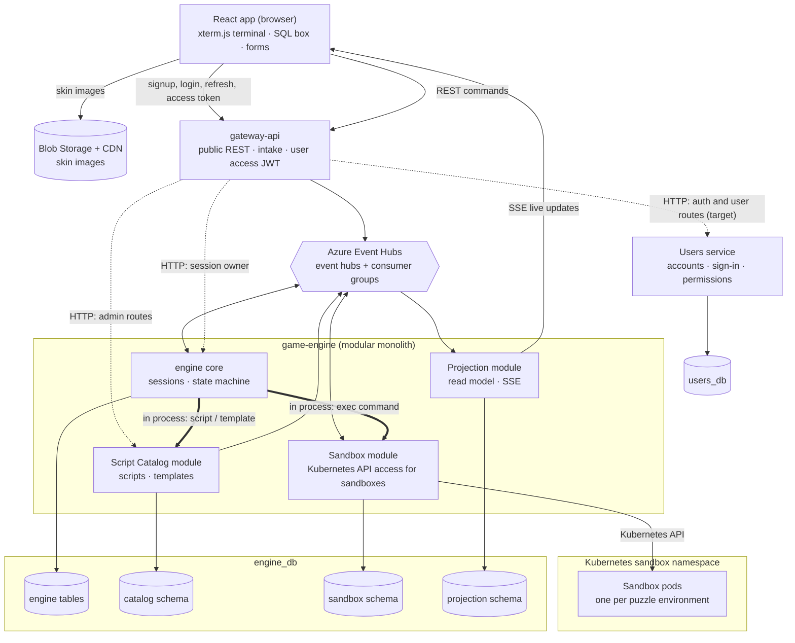

- Solid arrows are REST, SSE, Event Hubs, Kubernetes API and database traffic. Dotted arrows are the direct HTTP calls between services (section 5). Thick arrows are in-process calls between game-engine modules, through each module's interface.
- What travels on each Event Hubs arrow is shown in section 5.
- The target Users service issues the user access JWT. **Implemented now:** gateway-api issues it and owns the auth database. Session REST calls use that same access JWT; gateway-api checks the requested session's owner before publishing.
- All services run in Kubernetes pods. Sandbox pods run in their own namespace, apart from the application (section 7).

## 5. Messaging: Events and Direct Calls

### Event Hubs

The target uses Event Hubs for external player commands that the gateway publishes for asynchronous game-engine handling, and for completed domain/integration events that need independent asynchronous consumers, history/replay, Projection, logging or analytics. Every message is partitioned by sessionId (or an appropriate entity key for non-session events) and carries a `messageId`; session events also carry `{eventId, sessionId, sessionVersion, occurredAt}`.

| Event hub | Carries | Producer | Consumer group | Message types |
| --- | --- | --- | --- | --- |
| player-commands | commands | gateway-api (`messageId` = client commandId) | `engine` (game-engine) | StartSession, SubmitInput, OpenDoor, EnterRoom, RequestHint, PlayerReconnected, AbandonSession |
| game-events | events | game-engine (outbox) | `projection` (game-engine, projection module) (later: one consumer group per new feature) | SessionStarted, PuzzleOpened, CommandEvaluated, PuzzleSolved, HintRevealed, DoorOpened, RoomEntered, PuzzleReset, SessionEscaped, SessionExpired, SessionAbandoned |

> **Status:** future work — Event Hubs integration is not built yet. The code currently persists game-events through an outbox and consumes them in Projection, but its transport is `InMemoryTransport`; there is no Event Hubs adapter. StartSession also bypasses the stream through a synchronous call, a temporary demo workaround (flow F1). Event Hubs remains the target for player-commands, StartSession and game-events consumed by Projection.

- Do not route every interaction through Event Hubs. Within game-engine, a command/query whose caller needs its result uses a direct in-process module interface. A completed domain/integration event goes to Event Hubs only when independent asynchronous consumption, history/replay, Projection, logging or analytics requires it. This is the target criterion; it does not prescribe an unreviewed per-message transport for every internal interaction.
- **Partitions:** 4 per event hub to start. The partition count is fixed when the event hub is created (Standard tier), so it is sized up front.
- **Retention:** 7 days. A consumer that is down picks up from its checkpoint when it comes back; nothing is lost inside the retention window.
- **Delivery is at-least-once.** Event Hubs has no duplicate detection and no per-message acknowledgement. The consumer's inbox (section 8) drops duplicates.

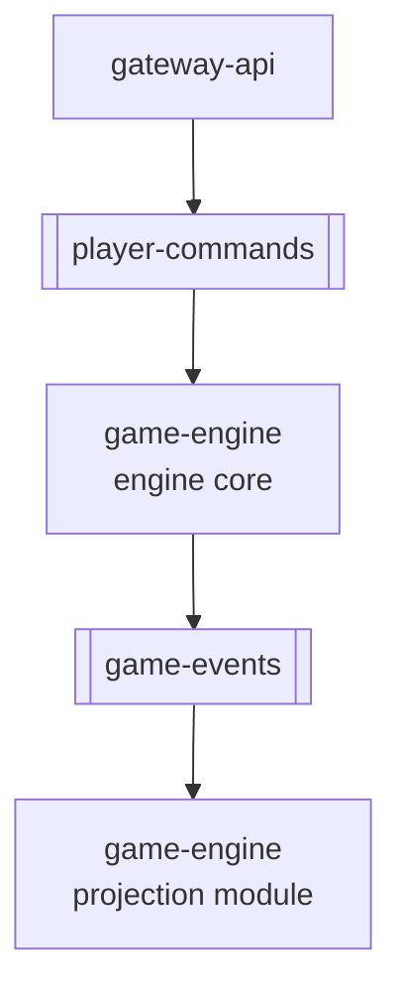

How a consumer processes events:

- **Ownership.** Each partition is owned by one consumer instance at a time (the processor client balances partitions across instances).
- **Order.** Inside a partition, events for the same sessionId are handled one at a time, in order. Events for different sessionIds in the same partition are handled in parallel, so one slow player (for example a 5 s sandbox exec) does not hold up the others.
- **Checkpoint.** The consumer moves its checkpoint forward only past events that are fully handled (committed, or dead-lettered).
- **Retry.** Handling failures use bounded retries. Retry state is tracked per consumer/message and persisted, so a process restart does not reset it; retry state is cleared after successful handling. Exact retry counts, timing and tuning are implementation details unless needed for correctness.
- **Dead letters.** Once the configured retry bound is exhausted, the consumer stores payload-free failure metadata in a `dead_letters` table in its own database, raises an alert and moves on. A replay source must be defined, but none is selected here (Q15).
- **Independent event streams.** Events on separate hubs have no cross-hub ordering guarantee. The session version column serializes conflicting updates (section 8).

Why these target Event Hubs flows:

- **player-commands:** the gateway acknowledges accepted commands while the engine handles them asynchronously; the partition keeps one player's commands in order.
- **game-events:** Projection consumes completed game events, and later independent consumers can add their own consumer groups without coupling to the command handler.

### Direct Internal Calls

These HTTP calls are the direct service-to-service calls in the target design. Checking a JWT signature is local. For a protected request, gateway-api obtains current account/family/version/role state directly from the target Users service, which remains authoritative (section 8). **Implemented now:** the gateway guard performs the lookup against its own database.

| From | To | Route | When and why |
| --- | --- | --- | --- |
| gateway-api | Users service | `/auth/*`, user routes and live authorization-state lookup (forwarded in target) | The Users service owns accounts, refresh tokens, roles and authoritative authorization state. Current Gateway handles auth directly in its own database; moving it and its data is future work (Q12). |
| gateway-api | game-engine | `GET /internal/sessions/:id/owner` | Every current operation that names a session checks its owner before publishing. Session owners live in engine_db; a mismatch is 403. |
| gateway-api | game-engine (Script Catalog module) | `/admin/*` routes | Current admin authorization is checked at the gateway. Publishing is rare and needs an immediate valid/invalid answer, so it is synchronous. |

Calls between game-engine modules are in-process calls through the module's interface, not HTTP:

| From | To | Call | When and why |
| --- | --- | --- | --- |
| engine core | Sandbox module | execute and validate a command, including SQL | Synchronous when the caller needs command output or validation. |
| engine core | Script Catalog module | get a Script version, template or session-related catalog data | Direct read from the catalog module. |
| engine core | engine-owned session interfaces | read session state, check ownership/access, apply a state transition | In process when the caller needs an immediate authoritative result. |

### Public Routes

| Route | Service | Use |
| --- | --- | --- |
| `POST /auth/signup`, `/auth/login`, `/auth/refresh`, `/auth/logout`, `/auth/logout-all` | gateway-api → Users service (target); gateway-api directly (implemented now) | Public signup/login/refresh/logout; logout-all requires a user access JWT. Exact success/error statuses and token behavior are in section 3. |
| `POST /auth/browser/login`, `/auth/browser/refresh`, `/auth/browser/logout` | gateway-api → Users service (target); gateway-api directly (implemented now) | Browser-specific cookie routes; see section 3. |
| `GET /me`, `PATCH /me`, `PATCH /me/password` | gateway-api → Users service (target); gateway-api directly (implemented now) | Current user's profile and password operations; require player/admin access JWT. |
| `/admin/users` (list/get/create/role/disable/enable/delete) | gateway-api → Users service (target); gateway-api directly (implemented now) | Admin user management; requires current admin authorization, not merely a signed, unexpired access JWT. |
| `GET /health` | gateway-api | Health of gateway-api. |
| `GET /sessions/resume` | gateway-api | Resume the current user's session. Requires user access JWT. |
| `POST /sessions` `{scriptSlug, requestId}` | gateway-api | Start a game. Returns 202 `{sessionId}`. Requires user access JWT; engine associates the session with that user. |
| `POST /sessions/:sid/puzzles/:key/inputs` `{commandId, input}` | gateway-api | Send one command or answer. Returns 202. Requires user access JWT and session-owner check. |
| `POST /sessions/:sid/rooms/:key/open-door` `{commandId}` | gateway-api | Open the door of a completed room. Requires the user access JWT and owner check. Sends OpenDoor; returns 202. |
| `POST /sessions/:sid/rooms/:key/enter` `{commandId}` | gateway-api | Walk through the open door into the next room. Requires the user access JWT and owner check. Sends EnterRoom; returns 202. |
| `POST /sessions/:sid/hints` `{commandId}` | gateway-api | Ask for the hint of the current stage (the Hint button). Requires the user access JWT and owner check. Sends RequestHint; returns 202. |
| `POST /sessions/:sid/reconnect` `{commandId}` | gateway-api | Tell the engine the player is back; requires the user access JWT and owner check. |
| `POST /sessions/:sid/abandon` | gateway-api | Give up the game. Requires user access JWT and session-owner check; sends AbandonSession. |
| `POST /admin/scripts/:id/versions/:v/publish` | gateway-api → game-engine (Script Catalog module) | Publish a Script version; enforce current admin authorization. |
| `GET /sessions/:sid/stream` | game-engine (projection module) | SSE live updates; enforce current user authorization and session ownership/access, not merely JWT signature or expiry. Authorization changes must be able to invalidate an active stream (section 12). |
| `GET /admin/overview` | game-engine (projection module) | Admin overview; enforce current user authorization and current admin role, not merely JWT signature or expiry (section 12). Served by the projection module directly, not through gateway-api, so it adds no direct service-to-service call. |

## 6. Scripts and Components

### Script = State Machine

A Script version is data. Once published it never changes.

| Part | Fields |
| --- | --- |
| ScriptVersion | scriptId, version, durationMinutes, initialState, states, finalStates |
| State (= a room) | key, puzzles, transitions, files |
| Puzzle | key, templateRef (`key@version`), optional opensAfter prerequisites, onRuin (`resetPuzzle` or `resetRoom`), hint (text, optional) |
| Transition | on (`PuzzleSolved` or `Timeout`), guard, to (state key). Solving puzzles never moves the player to another room; that takes OpenDoor then EnterRoom (Rooms and Doors, below). |
| File | name, content (shown in the room, for example a capture on a computer), revealedBy (optional puzzle key whose solve output replaces the content) |

- A session's position is its current state key plus its puzzle rows for that state.
- A session is pinned to the Script version it started with. Publishing a new version never changes running sessions.
- The engine core is one pure function: `transition(sessionSnapshot, event, scriptVersion) -> {nextSnapshot, effects[]}`. Effects are the outbox messages (ProvisionSandbox, DestroySandbox, domain events). It does no I/O, so it is easy to unit-test.

Checks on publish (Script Catalog module):

- every state is reachable (through transitions, or through a room's door);
- a final state is reachable from every state;
- every templateRef exists and is published;
- no opensAfter cycles;
- the winning path replays in CI with each template's solution, including the OpenDoor and EnterRoom steps.

### Rooms and Doors

Solving a room's catalog-defined unlock condition never moves the player to the next room by itself. The destination and unlock condition are Script Catalog data, not hardcoded engine room rules. The move is always two explicit player actions:

1. The room's configured unlock condition is met. Now the door can be opened.
2. **OpenDoor:** the player opens the door (`POST /sessions/:sid/rooms/:key/open-door`). The engine emits DoorOpened.
3. **EnterRoom:** the player walks through (`POST /sessions/:sid/rooms/:key/enter`). The engine moves the session to the next room, emits RoomEntered and opens that room's first puzzles.

- OpenDoor is rejected unless the session is Active, it is before the deadline, the player is in that room and its catalog-defined unlock condition is met. EnterRoom is rejected unless that room's door is open. A rejection is CommandEvaluated with verdict `rejected`.
- Both are commands on the player-commands event hub, handled like any other command (flow F10).
- The catalog must declare the room's door destination and unlock condition; the engine evaluates that data rather than embedding room-specific rules. Room 1's target unlock condition is successful entry of Dana's correct username and password on her computer, which unlocks the computer/screen and makes OpenDoor available.

### Hints

A hint is part of the Script: one optional text on a puzzle. It helps the player through one **stage**: from the end of the previous stage until that puzzle is solved. A puzzle without a hint is covered by the next hint in its room.

- **Current hint:** in the current room, the first puzzle (in Script order) that is not solved and has a hint. If every puzzle with a hint is solved, there is no current hint.
- **Asking:** the player presses the Hint button (bottom right). The browser sends `POST /sessions/:sid/hints`; gateway-api sends RequestHint; the engine finds the current hint, stamps `hintRevealedAt` on that puzzle row (only the first time) and emits HintRevealed `{puzzleKey, text, firstTime}`. The projection module adds it to the session view and pushes it over SSE (flow F9).
- **Asking again** in the same stage shows the same hint again; it is not counted twice. If there is no current hint, the request is rejected with reason `noHint` and the screen says "No hint for this step".
- **Cost:** none. The clock is not changed. Hint use is recorded (`hintRevealedAt`) and shown in the admin overview as hints used per puzzle.
- Revealed hints stay in the session view, so they come back after a reconnect.
- Hints are plain text and do not contain answers. A hint text change is a new Script version.

### Room Files

A State can list files that the player sees in the room, for example a capture on a computer. Their content is public puzzle material; it is sent to the browser in RoomEntered (SessionStarted for the first room).

- A file with `revealedBy` changes when that puzzle is solved: the solve output (for example the decrypted capture from the `tls` engine) replaces the file content in the PuzzleSolved event, and the screen shows "The file has been decrypted".
- Secret content (such as the decrypted records) is produced only by the engine on a correct solve, so the browser never holds it early.

### Component Factory

- A **Component Template** (in the catalog, versioned, never changed once published) has: key, version, family (`sandbox` or `input`), engine, inputSchema, policy, goal, invariants, solutionRef.
- Sandbox engines `terminal-git` and `sql` add: imageDigest, seedScript, checks (probe commands run inside the sandbox pod).
- Input engines `hash`, `rsa`, `tls` and `answer` add a seed: the expected hash, N/e, the encrypted PMS, client random, server random, records.
- `ComponentFactory.create(puzzleDef, template)` looks up the engine in a registry and returns the matching class: TerminalGitComponent, SqlComponent, HashComponent, RsaComponent, TlsComponent or AnswerComponent.
- Components are built per message from cached template data and keep no state. Nothing is generated or stored per Script.
- A new Script or new puzzle order is new data. New template content is a new template version. Only a new engine needs code (a new class and, for a sandbox engine, an image).

How the input engines judge an answer (inside game-engine, on a worker_threads pool, 2 s limit; hex input up to 8 KB, RSA key up to 4096 bits):

| Engine | Check |
| --- | --- |
| answer | Plain field compare against the seed (login form, door code). The fields come from the seed. |
| hash | `sha256(input)` compared in constant time (`timingSafeEqual`). Never reversed. |
| rsa | The key must match N; then decrypt the PMS (PKCS#1 v1.5). |
| tls | TLS 1.2 PRF(PMS, client random, server random) → keys → decrypt the records. |

### Class Diagram: Script and Session

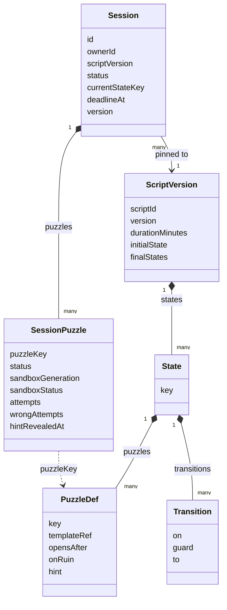

### Class Diagram: Component Contract

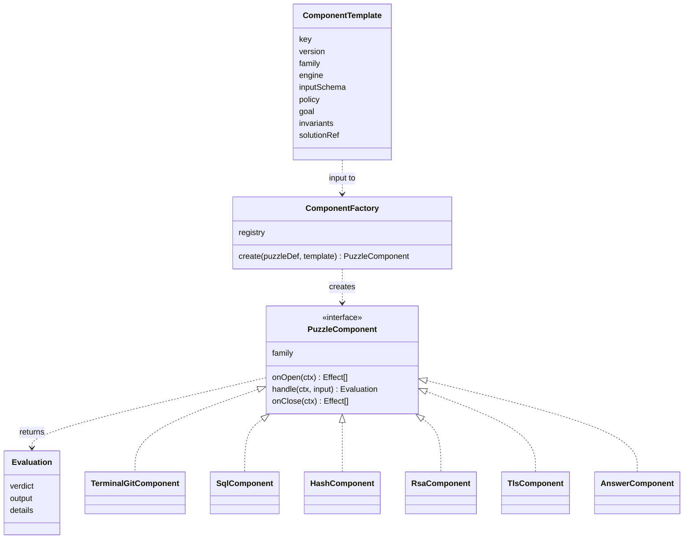

The contract (`<<interface>>` PuzzleComponent):

| Method | Sandbox family | Input family |
| --- | --- | --- |
| `onOpen(ctx)` | returns ProvisionSandbox | returns nothing |
| `handle(ctx, input)` | runs the command in the sandbox, then the checks | compares the answer on the worker pool |
| `onClose(ctx)` | returns DestroySandbox | returns nothing |

`handle` returns an Evaluation whose verdict is one of `progress`, `solved`, `rejected`, `ruined`.

| Verdict | Meaning |
| --- | --- |
| progress | The command ran; the goal is not met yet. |
| solved | The goal is met. The engine may open the next puzzles. Solving a room's unlock puzzle makes its door openable; it does not enter the next room or end the game (Rooms and Doors). |
| rejected | Not run or not accepted (blocked by policy, wrong answer, sandbox restarting, time is up, no hint for this step, door not openable yet). |
| ruined | An invariant broke (for example an extra git commit or DROP TABLE). The puzzle or room resets. |

Only sandbox kinds (`sql`, `terminal-git`) can be ruined. A wrong answer on an input kind is rejected, never a ruin.

## 7. Sandboxes

> **Implementation note (ADR 0001):** the runtime is chosen by `SANDBOX_DRIVER`. `kubernetes` follows this section (one pod per sandbox). `embedded`, the default, runs the same provision/exec/destroy flow inside the engine process (PGlite for SQL) where sandbox pods are not available, with weaker isolation; see `docs/adr/0001-embedded-sandbox-driver.md`.

Sandboxes run on Kubernetes. When a puzzle needs an executable environment, the Sandbox module in game-engine provisions an isolated pod for that puzzle environment (one session, one puzzle, one generation). The pod is separated from the application, from other sandbox pods and from other puzzle environments. Isolation is a fundamental requirement.

- **Identity.** `sandboxId = hash(sessionId, puzzleKey, generation)`. The pod name is derived from it (`sbx-` + the hash) and is deterministic, so the Kubernetes API rejects a duplicate create.
- **Provision** (ProvisionSandbox): upsert the row (if it is already ready, send SandboxReady again); claim provisioning with a PostgreSQL advisory lock keyed by sandboxId; create the pod in the sandbox namespace from the pinned image digest, with labels for sandbox, session, puzzle and generation; wait until it runs; run the seed script; health-check it (the template's ready probe, 3 tries, 10 s total); send SandboxReady, or SandboxFailed and delete it. If a pod with that name already exists, the module checks it matches the expected spec before using it.
- **Exec** (in-process call from the engine core, carries the commandId): if a stored result exists for that commandId, return it, so a redelivery never runs a command twice. Otherwise run the command in the pod (Kubernetes exec) with a 5 s timeout and a 64 KB output cap, run the checks, store and return the result. Each exec extends the idle lease by `SANDBOX_IDLE_MINUTES` (15).
- **Destroy:** delete the pod, mark it destroyed, send SandboxDestroyed. A missing pod counts as success.
- **Reconnect rule:** a sandbox never keeps state across a reconnect. A reconnect gives every open sandbox puzzle generation+1 and a fresh pod.
- **Terminal:** line by line. Each Enter is one SubmitInput. No interactive terminal (no vim, no less) and no WebSocket. The sandbox image sets `GIT_PAGER=cat` and `PAGER=cat`, so `git log` and `git show` print straight through. The xterm.js view keeps a prompt, local line editing and up-arrow history.
- **Copy and paste in the terminal:** the player selects output with the mouse and copies it (Cmd+C on macOS, Ctrl+Shift+C elsewhere, or right-click → Copy; plain Ctrl+C stays "cancel line"). Paste (Cmd+V / Ctrl+Shift+V) goes into the current prompt line; a pasted line break is not sent as Enter, so one paste can never run several commands.

Isolation for every sandbox pod (requirement, then the Kubernetes control):

| Area | Requirement | Kubernetes control |
| --- | --- | --- |
| Placement | Sandboxes never run next to the application or share its rights. | A dedicated sandbox namespace (`team5-sandboxes`), apart from the application's namespace. The namespace enforces Pod Security `restricted`. Whether sandbox pods also need dedicated nodes is open (section 17). |
| Runtime | Stronger isolation from the host kernel than a plain container. | `runtimeClassName` on every pod, set by `SANDBOX_RUNTIME_CLASS`. `runc` is for local development only. Which runtime class production must use is open (section 17). |
| Network | No network: not to other sandboxes, the application, the node or the internet. | Default-deny NetworkPolicy for ingress and egress in the sandbox namespace. No host network, PID or IPC; no service links. The only exception is the preflight check's own probe traffic. |
| Disk | Nothing persistent and nothing from the host; small writable space only. | Read-only root filesystem. Writable space only in memory-backed `emptyDir` volumes with a size limit (64 MB in total per pod). No hostPath or other host mounts. |
| User and rights | Never root, no extra rights. | `runAsNonRoot` with a fixed non-root UID/GID per image, not privileged, `allowPrivilegeEscalation: false`, all capabilities dropped, `RuntimeDefault` seccomp. |
| Limits | A player cannot exhaust the node. | Resource limits per pod: 0.5 CPU and 256 MB memory (requests 0.1 CPU, 128 MB); 64 processes per pod (kubelet pod PID limit); no swap. Open-file limit: no pod-level control, open (section 17). |
| Secrets | Nothing to steal inside a sandbox. | No service-account token mounted, no env or envFrom, no secrets or credentials, no image pull secrets. |
| Images | Only known images run. | Pinned by digest (`image@sha256:…`) from an allowlisted repository (`SANDBOX_IMAGE_ALLOWLIST`), built in CI. |
| Kubernetes API | Only the sandbox controller can create or reach sandboxes. | RBAC: only the Sandbox module's service account may create, get, list and delete pods and exec into them, and only in the sandbox namespace. Sandbox pods get no API access. |
| Verification | The controls are checked, not assumed. | A preflight in a separate probe namespace checks user, read-only root, capabilities, PID limit, memory, CPU, volumes and that the pod reaches nothing. If it fails, the sandbox runtime is reported not ready. |

## 8. Data Consistency

### One Transition, One Transaction

`sessions.version` is a version column. Puzzle rows belong to the session, so any change to them also bumps the session version. Writes always read the database.

1. Begin a transaction.
2. Insert the message id into the inbox. A duplicate fails the unique key, so the message is marked handled with no effect.
3. Read the session and its puzzles (version = v).
4. Run the guards, the component and `transition()`.
5. Update the session to version v+1, only where the version is still v. Zero rows updated means another writer won.
6. Save the puzzles, the command log row and the outbox rows.
7. Commit, then mark the event as handled so the checkpoint can move past it.

If another writer won: roll back, re-read and re-evaluate using the consumer's persisted, bounded retry policy (section 5). Once the configured bound is exhausted, record payload-free failure metadata in the consumer's `dead_letters` table. The three writers this protects against each other are the command handler, the sandbox-event handler and the janitor. Correctness comes from the version column and unique keys.

### Outbox and Inbox

- **Outbox:** a module that publishes a completed event to an independent consumer writes that event to its own-schema outbox in the same transaction as the state change, so there are no lost or phantom events. The outbox relay sends eligible events in order with the `messageId` property = the row's messageId. A crash between send and mark-sent causes a resend, which the consumer's inbox drops. Sent rows are deleted after 7 days. Synchronous in-process commands and queries do not become outbox messages merely because they cross a module boundary.
- **Inbox:** `(consumer, messageId)` is unique. Inserted in the consumer's transaction. Kept 14 days.
- **Separate tables in game-engine:** each asynchronous consumer owns its retry-state, inbox and dead-letter tables in its module schema. Retry state is keyed by consumer and message and persists across process restarts. Projection's event consumer uses `projection.consumer_retry_state`, `projection.inbox` and `projection.dead_letters`; synchronous module interfaces do not need these tables.

Layers that stop duplicates:

1. The client's commandId is the `messageId`, so a retried request (or a resent event) has the same id.
2. The inbox unique key.
3. Natural keys: sandboxId, pod name, the stored exec result per commandId.
4. Each event's sessionVersion: the projection module ignores a version it already has.

### Authoritative Reads and Coordination

- Session reads go through the owning module's read interface and use its database as the source of truth.
- After validating the user access JWT, gateway-api obtains current account, family, version and role state directly from Users. If Users is unavailable, protected requests fail closed. The current gateway implementation performs this lookup against its own database until the Users service migration is complete.
- Projection routes check current authorization directly with Users. Authorization changes must be able to invalidate an active SSE stream; the propagation/check mechanism is an implementation detail (section 17, Q14).
- The Script Catalog reads published versions from its own schema. Publishing updates the pointer and outbox row in the same transaction; consumers read the committed pointer.
- The admin overview is computed from projection data when requested. Live session updates continue through Postgres LISTEN/NOTIFY.
- PostgreSQL advisory locks coordinate work that must have a single active worker, such as sandbox provisioning and scheduled maintenance. Session version checks, unique keys, and idempotent operations remain the correctness safeguards.

## 9. Data Model

Each service owns its own database. There are no foreign keys between databases. Inside engine_db each game-engine module owns its own schema (engine tables, `catalog`, `sandbox`, `projection`); there are no foreign keys or joins between these schemas.

The column types in these diagrams are illustrative; the TypeORM entities and migrations are authoritative.

### engine_db (game-engine core)

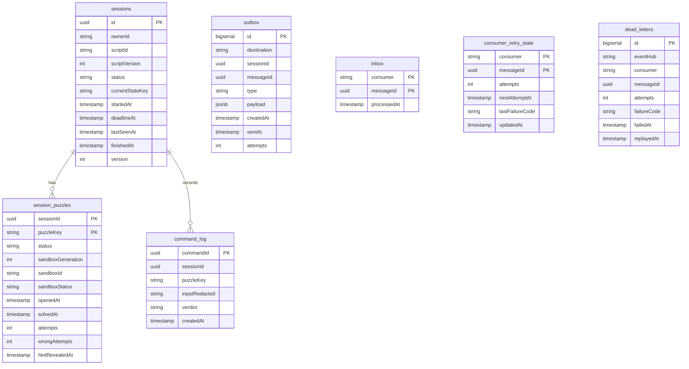

- `sessions.status`: Active, Escaped, Expired, Abandoned.
- `session_puzzles.status`: locked, open, solved. `sandboxStatus`: none, provisioning, ready, failed.
- Solve time, tries, wrong answers and hint use per puzzle per player come from `session_puzzles` (openedAt → solvedAt, attempts, wrongAttempts, hintRevealedAt).
- `consumer_retry_state` persists bounded retry progress per consumer/message across process restarts; the `sandbox` and `projection` schemas each have their own table of the same shape.
- `dead_letters` contains payload-free failure metadata only. The `sandbox` and `projection` schemas each have their own table of the same shape; the replay source remains open (Q15).
- The session also records which room doors are open (Rooms and Doors, section 6). Where this is stored is not fixed yet (section 17).

### projection schema (projection module in game-engine)

The projection module's tables live in their own `projection` schema inside engine_db. They are not joined with the engine tables above.

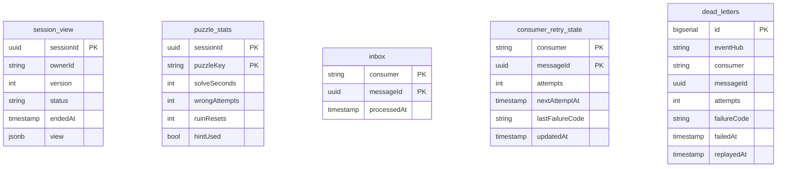

- The projection module writes `session_view` only when an event's sessionVersion is newer than the stored version.
- `puzzle_stats` has one row per session and puzzle. `solveSeconds` is null until the puzzle is solved. It is updated from CommandEvaluated (verdict `rejected`, reason `wrongAnswer`), PuzzleSolved, PuzzleReset and HintRevealed (`firstTime` = true), with the same newer-version rule, through the inbox.
- `inbox`, `consumer_retry_state` and `dead_letters` here are the projection module's own tables (`projection.inbox`, `projection.consumer_retry_state`, `projection.dead_letters`). Retry state persists per consumer/message; dead letters contain payload-free failure metadata only. The engine's corresponding tables are separate.

### catalog schema (Script Catalog module in game-engine)

The Script Catalog module's tables live in their own `catalog` schema inside engine_db. Other modules read Scripts and templates only through the module's interface.

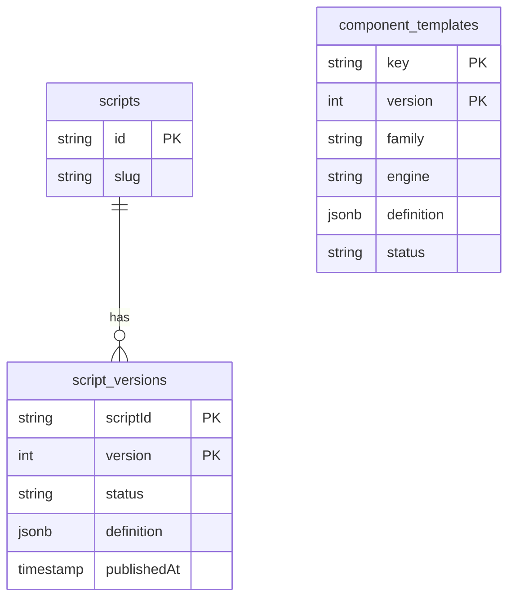

- `script_versions.status`: draft, published, retired.
- The `catalog` schema also has its own outbox (same shape as in engine_db).

### sandbox schema (Sandbox module in game-engine)

The Sandbox module's tables live in their own `sandbox` schema inside engine_db. No other module reads or writes them.

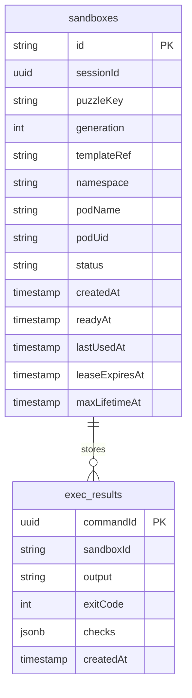

- `sandboxes.status`: creating, ready, failed, destroying, destroyed. The `sandbox` schema also has its own outbox, inbox, consumer_retry_state and dead_letters.

> **Status:** future work — the code keeps the sandbox tables (`sandbox_instances`, `sandbox_executions`, `sandbox_outcomes`) outside a dedicated `sandbox` schema. Moving them into it is not built yet.

### users_db (Users service)

**Target schema:** `users_db` belongs to the Users service. **Implemented now:** the same tables are in the gateway-api database; the service/data move is future work.

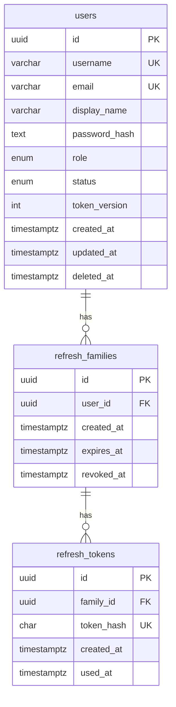

- `users.username` is unique, 3–32 characters matching `^[a-z0-9_.-]{3,32}$`; `email` is unique and stored trimmed/lowercase (maximum 254). `display_name` is 1–64 characters. `password_hash` is selected only when needed and is an Argon2id hash; plaintext passwords are never stored.
- `users.role`: `player`, `admin`; `users.status`: `active`, `disabled`, `deleted`. `token_version` is nonnegative. `deleted_at` is set exactly when status is `deleted`; soft-deleted identity fields remain reserved.
- `refresh_families` has a user FK (`ON DELETE RESTRICT`), fixed-at-creation expiry (seven days by default) and nullable revocation timestamp. `refresh_tokens` has a family FK (`ON DELETE RESTRICT`), unique 64-character lowercase-hex SHA-256 hash, creation time and nullable used timestamp.
- UUID primary keys default to `gen_random_uuid()`; creation timestamps default to database `now()`. The user entity maintains `updated_at` on writes. All fields are required unless `deleted_at`, `revoked_at` or `used_at` is explicitly nullable.
- Unique indexes cover username, email and token hash. Additional indexes: `ix_refresh_families_user(user_id)`, `ix_refresh_tokens_family(family_id)`, and partial unique `uq_refresh_tokens_unused(family_id) WHERE used_at IS NULL`.
- Migration checks validate usernames, normalized email, display-name length, nonnegative token version, deleted-at/status consistency, family expiry ordering and token-hash format. PostgreSQL enums constrain role/status; foreign keys and partial uniqueness protect refresh-family integrity.
- The schema comes from the TypeORM migration `1740000000000-InitialSchema`, with `synchronize` off (false).
- Seed the admin with `npm run seed:admin` (safe to run twice). Local reset: `npm run db:reset -- --confirm-local-reset`.

> **Status:** authentication and these tables are implemented now in gateway-api. Moving them to the target Users service and its `users_db` is future work.

## 10. Session Lifecycle

### Session Status

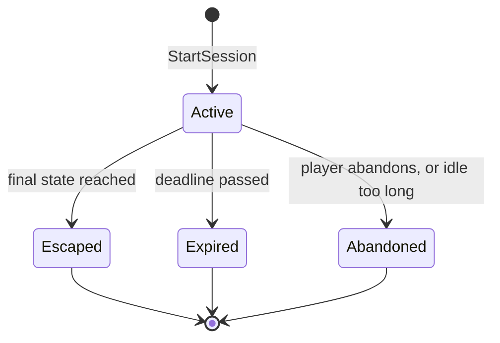

- Escaped, Expired and Abandoned are final; there is no way out of them.
- Escaped: reaching a final state ends the session with SessionEscaped. A final state is reached only through EnterRoom from the last room's open door (Q5, section 17); solving a puzzle never ends the game by itself.
- Abandoned: the player sends `POST /sessions/:sid/abandon` (owner only; gateway-api sends AbandonSession), or the janitor abandons a session idle for `ABANDON_MINUTES`.
- A ruin is not an ending. It resets the puzzle or the room and the clock keeps running. Ruins stay visible in stats through the PuzzleReset event and the command log verdict `ruined`.

> **Status:** future work — SessionEscaped and the final escape flow are not yet implemented; they are completed with Room 2.

### Puzzle Status

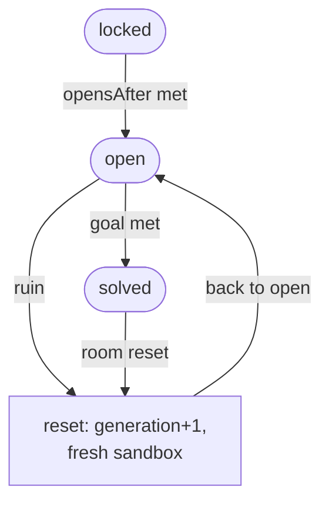

Rounded boxes are puzzle statuses; the square box is the reset step, not a status.

- `onRuin = resetPuzzle`: the ruined puzzle gets generation+1 and a fresh sandbox.
- `onRuin = resetRoom`: the same for every puzzle in the room, and solved puzzles in that room go back to open.

### Cleanup Jobs

game-engine janitor (every 60 s, one leader elected with a PostgreSQL advisory lock):

- Active and past the deadline → Expired, and destroy every live sandbox.
- Active and not seen for `ABANDON_MINUTES` (30) → Abandoned, and destroy.
- A puzzle waiting more than 3 min for its sandbox → provision again with generation+1 (at most 3 times, then mark the puzzle unavailable and alert).
- Outbox rows unsent for more than 5 min → alert.

Expiry is also checked on every command (`now < deadlineAt`), so the janitor's delay never lets a late answer count.

Sandbox module reaper in game-engine (every 60 s, one leader elected with a PostgreSQL advisory lock):

- Lease expired, or past the 2 h hard cap → delete the pod.
- Stuck in creating for more than 3 min → failed, delete the pod, SandboxFailed.
- A pod in the sandbox namespace with the sandbox labels and no row, or with a destroyed row → delete (orphan).
- A ready sandbox whose health probe fails 3 times in a row → delete the pod and SandboxFailed (the engine provisions again).

## 11. Key Flows

### F0 Signup/Login, Access and Refresh

The sequence shows the target ownership boundary: gateway-api routes auth/user requests to Users, which owns token issuance and authoritative authorization state in the target. **Implemented now:** the gateway-api app handles these operations directly against its own database and issues the access JWT. The target uses that same user access JWT on game requests; there is no separate per-game-session token. After JWT authentication, gateway-api checks current authorization state directly with Users (section 8).

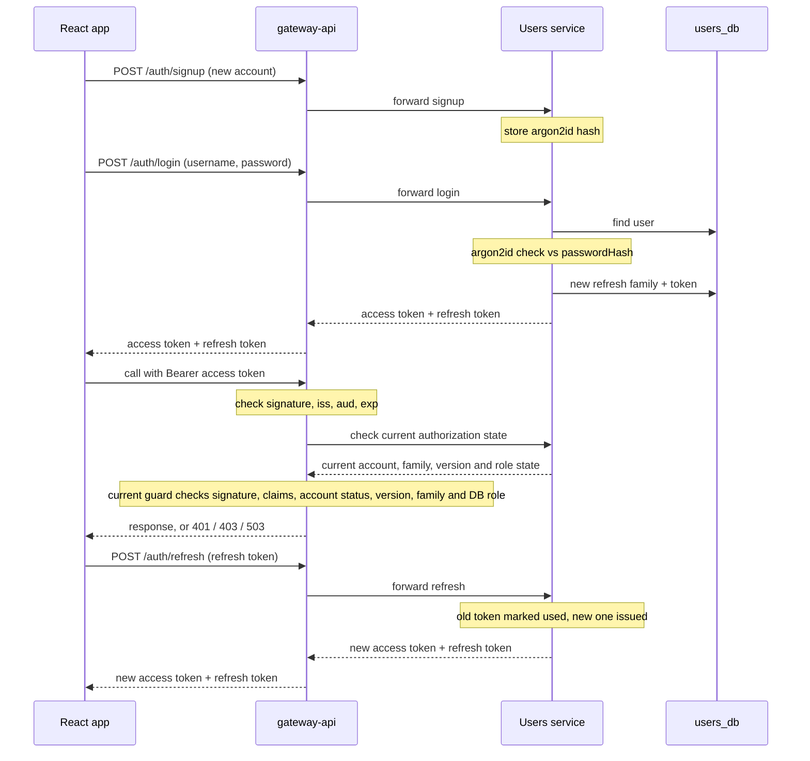

Reusing an already-used refresh token revokes its whole family; logout revokes one family; logout-all revokes all the user's families and increments `token_version`. Complete JWT, refresh-family, endpoint and failure semantics are specified in section 3. Projection routes enforce current authorization as specified in Q14.


### F1 Start a Game

```mermaid
sequenceDiagram
  participant UI as React app
  participant GW as gateway-api
  participant EH as Event Hubs
  participant ENG as game-engine
  participant CAT as game-engine (Script Catalog module)
  participant SBX as game-engine (Sandbox module)
  participant K8S as Kubernetes (sandbox namespace)
  participant PROJ as game-engine (projection module)
  UI->>GW: POST /sessions (Bearer user access JWT)
  GW->>EH: StartSession
  Note over GW: authenticate user; associate new session with that user
  GW-->>UI: 202 sessionId
  UI->>PROJ: open SSE stream
  EH->>ENG: StartSession
  ENG->>CAT: get script version (in process, cache miss only)
  Note over ENG: create session, enter first room, commit
  ENG->>EH: ProvisionSandbox, SessionStarted, PuzzleOpened
  EH->>SBX: ProvisionSandbox
  SBX->>K8S: create pod (deterministic name)
  Note over SBX: wait for pod, seed, health check
  SBX->>EH: SandboxReady
  EH->>ENG: SandboxReady
  Note over ENG: mark puzzle ready, commit
  ENG->>EH: game events
  EH->>PROJ: game events
  PROJ-->>UI: room 1, puzzles open, sandbox ready
```

- The response contains the `sessionId`; all later session operations use the same user access JWT and the gateway checks ownership for the requested session before publishing.

> **Status:** temporary demo workaround — the code sends StartSession as a synchronous call, gateway-api → `POST /internal/sessions/start` → game-engine, because Event Hubs integration was not yet available. The flow above stays the target. Event Hubs integration is planned future work.

### F2 Normal Sandbox Command

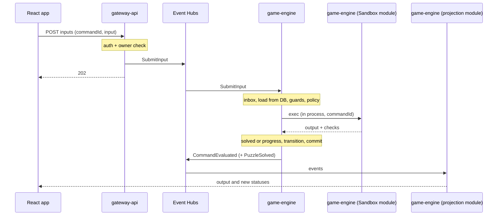

- Guards: session Active, before the deadline, puzzle open, sandbox ready, generation matches. Otherwise the verdict is `rejected` with a reason (for example "sandbox restarting").
- The policy deny-list runs on the parsed input first; a blocked command is rejected, not run.
- A solve may open the next puzzles or make the room's door openable. It never enters the next room or ends the game; that takes OpenDoor, then EnterRoom (flow F10). EnterRoom into a final state ends the session as Escaped.

### F3 Ruin, Then Reset

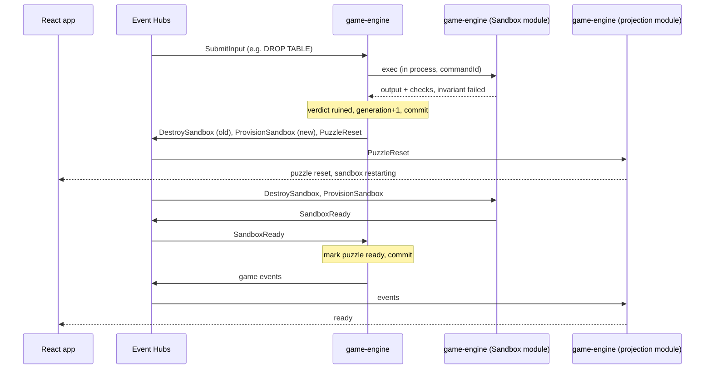

- Intake is the same as F2 (gateway-api, 202).
- With `resetRoom` the same happens for every puzzle in the room, and solved puzzles in that room go back to open.
- The session stays Active and the clock keeps running.

### F4 Crypto Answer (Hash, RSA, TLS)

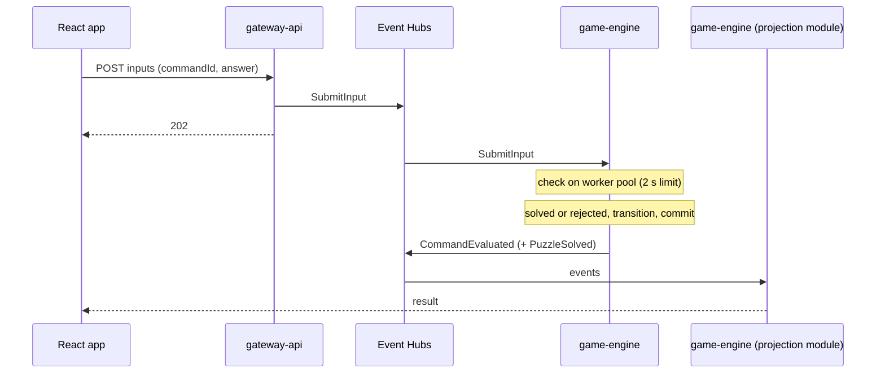

- No sandbox. A wrong answer counts as a wrong attempt.

### F5 Reconnect

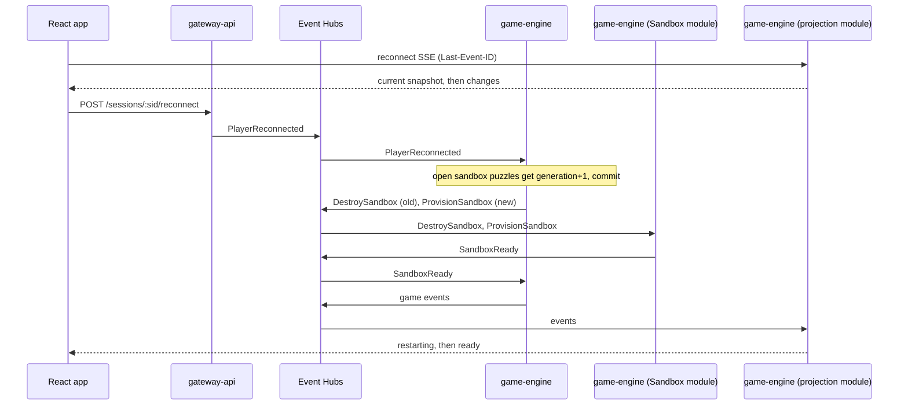

### F6 Time Runs Out

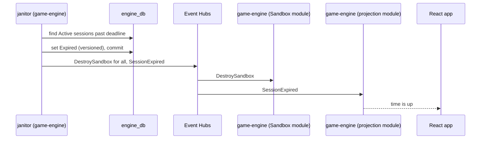

- If a player command commits first, the janitor's write loses on the version check; it re-reads and expires the session on its next pass.
- If the janitor commits first, the command's guard sees Expired and rejects it.

### F7 Admin Publishes a Script Version

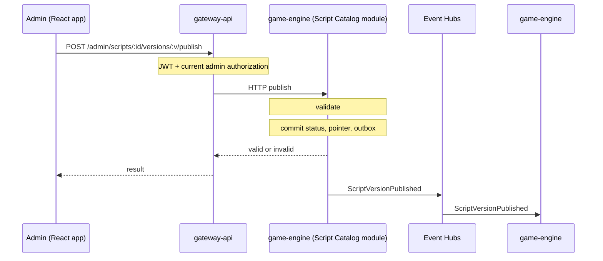

- New sessions use the new version; running sessions keep theirs.

### F8 Admin Overview

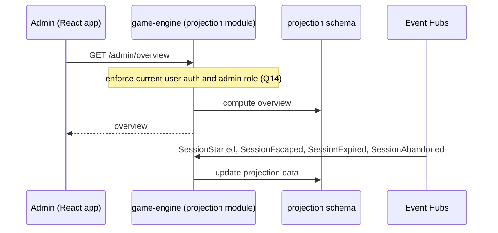

- Served by the projection module directly; no new service-to-service call.
- Computed from the projection schema for each request.

### F9 Hint

```mermaid
sequenceDiagram
  participant UI as React app
  participant GW as gateway-api
  participant EH as Event Hubs
  participant ENG as game-engine
  participant PROJ as game-engine (projection module)
  UI->>GW: POST /sessions/:sid/hints (commandId)
  Note over GW: auth + owner check
  GW->>EH: RequestHint
  GW-->>UI: 202
  EH->>ENG: RequestHint
  Note over ENG: guards, find current hint, stamp hintRevealedAt (first time), commit
  ENG->>EH: HintRevealed (puzzleKey, text, firstTime)
  EH->>PROJ: HintRevealed
  PROJ-->>UI: hint text
```

- Guards: session Active and before the deadline. No sandbox and no worker pool; the hint text comes from the pinned Script version.
- No current hint → CommandEvaluated with verdict `rejected` and reason `noHint`; the screen says "No hint for this step". It does not count as a wrong attempt.

### F10 Open the Door, Then Enter the Next Room

```mermaid
sequenceDiagram
  participant UI as React app
  participant GW as gateway-api
  participant EH as Event Hubs
  participant ENG as game-engine
  participant PROJ as game-engine (projection module)
  Note over UI: the room's catalog-defined unlock condition is met
  UI->>GW: POST /sessions/:sid/rooms/:key/open-door (commandId)
  Note over GW: auth + owner check
  GW->>EH: OpenDoor
  GW-->>UI: 202
  EH->>ENG: OpenDoor
  Note over ENG: guards, mark the door open, commit
  ENG->>EH: CommandEvaluated, DoorOpened
  EH->>PROJ: events
  PROJ-->>UI: door open
  UI->>GW: POST /sessions/:sid/rooms/:key/enter (commandId)
  Note over GW: auth + owner check
  GW->>EH: EnterRoom
  GW-->>UI: 202
  EH->>ENG: EnterRoom
  Note over ENG: guard door open, move to next room, open its first puzzles, commit
  ENG->>EH: CommandEvaluated, RoomEntered, PuzzleOpened (+ ProvisionSandbox)
  EH->>PROJ: events
  PROJ-->>UI: next room
```

- OpenDoor guards: session Active, before the deadline, the player is in that room, and its catalog-defined unlock condition is met. EnterRoom guard: that room's door is open. Otherwise the verdict is `rejected`.
- The last solve in a room only makes the door openable. The player always moves with these two commands.

## 12. Real-Time Updates (projection module in game-engine)

- The projection module is part of game-engine and follows the Service Rules in section 3: it gets game events only through its own consumer group, `projection`, and uses only its own `projection` schema.
- Live session updates go through Postgres LISTEN/NOTIFY.
- It reads game-events in order per session and updates `session_view` only if the event is newer than what it has. Then it sends a Postgres NOTIFY.
- Every game-engine instance LISTENs and pushes to its own SSE connections at `GET /sessions/:sid/stream`. Projection routes enforce current user authorization, not merely JWT signature or expiry; the session stream also enforces session ownership/access, and admin routes enforce current admin role/authorization. Users owns authoritative authorization state. Account disablement, token-version or refresh-family revocation, and other relevant authorization changes must be able to invalidate an active SSE stream. The propagation/check mechanism is an implementation detail.
- On connect or reconnect it sends the current snapshot first (id = version), then changes. Last-Event-ID lets the browser skip versions it already has.
- Why SSE and not WebSocket: commands already go over REST, the push is one-way, and SSE reconnects by itself and resumes from the last version.
- The browser shows only the view: puzzle statuses, command output, a countdown from `deadlineAt`, "sandbox restarting", the hints revealed so far and the room files (for example the capture, encrypted or decrypted).

### Admin Overview

The projection module serves `GET /admin/overview` directly. It enforces current user authorization and admin role, including relevant authorization changes, rather than relying only on JWT signature or expiry. Do not assume the API controller's role/owner guard applies to projection.

The projection module computes the admin overview from `session_view` and `puzzle_stats` when `GET /admin/overview` is requested:

| Field | Meaning |
| --- | --- |
| `gamesInProgress` | live count of Active sessions (`session_view.status` = Active) |
| `gamesFinishedToday` | `{escaped, expired, abandoned}`: sessions that ended today, by ending (`session_view.status` and `endedAt`) |
| `perPuzzle[]` | `{puzzleKey, avgSolveSeconds, wrongAttempts, ruinResets, hintsUsed}` per puzzle, from `puzzle_stats` |

- `wrongAttempts` counts CommandEvaluated events with verdict `rejected` and reason `wrongAnswer`. Policy blocks, sandbox restarting and time-up are not counted. `ruinResets` counts PuzzleReset events. `hintsUsed` counts HintRevealed events with `firstTime` = true.
- "Today" is the calendar day in the server's configured timezone.
- Postgres remains the source of truth; the current Projection persists its read model to PostgreSQL and listens to `NOTIFY`.

## 13. Demo Script: The Escape Room

The escape room from the story script is the demo content. It is data only; the engine runs it like any other Script. The experience is built from clickable images (the skin), and the server drives it.

```mermaid
flowchart TB
  S(["Start"])
  subgraph R1["room-1"]
    direction TB
    P1["idan-db (sql clue)"]
    P2["hash-cracker (independent clue/tool)"]
    P3["dana-login (credential validation; unlocks door action)"]
  end
  subgraph R2["room-2"]
    direction TB
    P4["nethanel-git (terminal-git)"]
    P5["rsa-decryptor (rsa)"]
    P6["tls-decryptor (tls)"]
    P7["door (answer)"]
    P4 -- "opens" --> P5
    P5 -- "opens" --> P6
    P6 -- "opens" --> P7
  end
  E(["escaped"])
  S --> R1
  R1 -- "OpenDoor, then EnterRoom" --> R2
  R2 -- "door puzzle solved, then OpenDoor, then EnterRoom" --> E
```

| Room | Puzzle | Engine | opensAfter | What the player does |
| --- | --- | --- | --- | --- |
| room-1 | idan-db | sql | none | Independently investigates Idan's company data and the distinct, uniquely identified log records. The clues include misleading entries (such as an old password change, a wrong password, and a missing character) as well as the relevant credential record; the player determines which record matters. No exact SQL schema, hash algorithm or values are prescribed here. |
| room-1 | hash-cracker | hash | none | An independent investigation clue/tool; the player may inspect it before or after the SQL evidence. The relevant credential must be derived by mapping the records, not by assuming every listed puzzle is an ordered prerequisite. |
| room-1 | dana-login | answer | none | Enters Dana's correct username and password on her computer. Successful validation unlocks the computer/screen and makes the explicit OpenDoor action available; the player then opens the door and enters room-2. |
| room-2 | nethanel-git | terminal-git | none | In the git terminal on Nathaniel's computer, finds the commit "Security fix: Removed private key from repository." and recovers the private key from the previous commit, then copies it from the terminal. |
| room-2 | rsa-decryptor | rsa | nethanel-git | Pastes the private key, and the encrypted PMS and the modulus N copied from the encrypted capture, and gets the decrypted PMS. |
| room-2 | tls-decryptor | tls | rsa-decryptor | Pastes the PMS and the client random copied from the capture. On success the machine shows "The file has been decrypted"; the capture on Nathaniel's computer is now the decrypted one. |
| room-2 | door | answer | tls-decryptor | Opens the decrypted capture on Nathaniel's computer, finds his credit card number in the Application Data payload, copies it and pastes it on the door lock. |

- Room moves: room-1 → room-2 only through the door. After Dana's correct credentials are validated, the player explicitly sends OpenDoor, then EnterRoom (section 6, Rooms and Doors). The SQL/hash investigation clues may be explored in any order; progression is not a conjunction of three puzzle-solved flags. room-2 → escaped also goes through the door (Q5, section 17): solving the `door` puzzle (the correct card number on the lock) is room-2's catalog-defined unlock condition; the player then sends OpenDoor, then EnterRoom, and entering the final state `escaped` ends the session as Escaped.
- `onRuin = resetPuzzle` for every puzzle; resetRoom is not used in the demo. Only idan-db (sql) and nethanel-git (terminal-git) can be ruined; a wrong answer on the other puzzles is rejected.
- Table names: `employees` and `logs` are correct (the story script's extra table names are not used).

> **Status:** future work — room-2 and the escape ending (SessionEscaped) are not yet implemented; they are completed with Room 2.

> **Room-1 implementation gap:** current catalog code has fixed room/puzzle transitions; catalog version 3 removes puzzle ordering but does not provide generalized catalog-driven door destination/unlock semantics. The SQL fixture already has multiple log rows, but current evaluation uses one configured SHA-256 target digest and reveals a fixed password; it has no `hash26` implementation or unique-record/decoy-selection workflow. These are content and implementation gaps, not open design questions. The frontend displays puzzle/door actions and visual affordances from the server-provided view; the backend remains authoritative for puzzle state, catalog rules and door authorization.

### Hints in the Demo

One hint per stage, four in total. Each hint sits on the puzzle that ends its stage (section 6).

| Stage | Hint on | Shown until | Hint text (draft) |
| --- | --- | --- | --- |
| room-1, until login | dana-login | Dana's login succeeds | "Dana's username and password are not written anywhere in the room. Idan's computer can look into the company tables: who is Dana, and what did she leave in the logs? A hash is not a password yet, but the Hash-Cracker can change that." |
| room-2, until the PMS is decrypted | rsa-decryptor | the RSA decryptor outputs the PMS | "Nathaniel says the private key was removed. Git remembers what came before. With the key, the RSA decryptor also needs two values from the capture: the encrypted PMS from the Client Key Exchange, and N from the certificate." |
| room-2, until the capture is decrypted | tls-decryptor | the TLS decryptor decrypts the capture | "The TLS decryptor needs the PMS you just got and the Client Random. The start of the capture, before the Client Key Exchange, is not encrypted." |
| room-2, until the door opens | door | the door opens | "Open the capture on Nathaniel's computer again: it is decrypted now. Look in the Application Data for his Cibus payment. What does the door code look like?" |

- idan-db, hash-cracker and nethanel-git have no hint of their own; they are covered by the next hint in their room.
- OpenDoor and EnterRoom in room-1 are player actions, not puzzles, so there is no separate hint for them.

### Nathaniel's Computer and the Capture

- room-2 has one file, `Cibus_payment_try.pcap`, with `revealedBy = tls-decryptor`. It stays on Nathaniel's computer; it is not an inventory item.
- To read it, the player clicks Nathaniel's computer, then the file. It opens large in the middle of the screen and scrolls. Clicking outside it goes back to the room.
- Before tls-decryptor is solved, the file shows the TLS handshake in clear up to the Client Key Exchange (Client Hello with the client random, the certificate with N, the Client Key Exchange with the encrypted PMS) and the rest as encrypted records.
- When tls-decryptor is solved, the TLS decryptor shows "The file has been decrypted". The next time the player opens the file it shows the decrypted capture, including the Application Data payload.

### Copy and Paste

All of it is in the browser (selection + the clipboard); the server only sees what the player finally submits.

| Copy from | What | Paste into |
| --- | --- | --- |
| SQL result grid (Idan's computer) | Dana's username, her password hash | Hash-Cracker, Dana's login window |
| Hash-Cracker output | Dana's password | Dana's login window |
| git terminal (Nathaniel's computer) | the private key | RSA decryptor |
| encrypted capture | the modulus N, the encrypted PMS, the client random | RSA decryptor, TLS decryptor |
| RSA decryptor output | the decrypted PMS | TLS decryptor |
| decrypted capture | Nathaniel's credit card number | the door lock |

- Every output view is plain selectable text, with a Copy button on single values (machine outputs, grid cells).
- Every input field accepts paste. Multi-line fields (the private key) keep line breaks; single-line fields trim spaces and line breaks.

- Winning: the correct card number unlocks the door; the player opens it (OpenDoor) and walks through (EnterRoom). The victory scene shows Dana, Nathanel and Idan under a "Congrats! Welcome to the team!" sign. The session ends as Escaped.

## 14. Failure Handling

| Risk | How it is handled |
| --- | --- |
| Sandbox escape | Isolated pod per puzzle environment in a dedicated sandbox namespace (Pod Security `restricted`), sandboxed runtime class, default-deny NetworkPolicy, non-root, read-only root, all capabilities dropped, no privilege escalation, `RuntimeDefault` seccomp, resource limits, no service-account token or secrets, pinned images, RBAC that lets only the Sandbox module create pods. A breakout lands in an isolated pod with nothing to steal (section 7). |
| Fork or disk bombs | Pod PID limit, size-limited `emptyDir`, memory limit without swap, 5 s exec kill, 64 KB output cap. |
| Duplicate messages | Inbox unique key, natural keys, stored exec results (Event Hubs has no duplicate detection). A redelivery never runs a sandbox command again. |
| Two writers at once | Version column; the loser retries from a fresh read. |
| Out of order | Partition key = sessionId, one session handled at a time per partition, one relay leader elected with a PostgreSQL advisory lock, sessionVersion in events. |
| Expiry vs solve | Whichever commit wins; the guard checks the deadline again on retry. |
| Double provision | Fixed sandboxId, deterministic pod name (the Kubernetes API rejects a duplicate), row upsert, PostgreSQL advisory lock keyed by sandboxId. |
| Stale sandbox | Generation check: commands and events for an old generation are rejected or ignored. |
| Leaked pods | Lease, max lifetime, labels, orphan reaper. The lease still expires if a destroy message is lost. |
| Concurrent reads and writes | Versioned database updates, unique keys and transactional publication pointers keep reads consistent with committed state. |
| Event Hubs down | The gateway returns 503; the client retries with the same commandId. Outbox rows wait and are sent later. |
| Consumer down | Events wait in the event hub (7-day retention); the consumer resumes from its checkpoint. |
| Poison message | Bounded retries with per-consumer/message retry state persisted across process restarts; after the configured bound, payload-free failure metadata is stored in the consumer's `dead_letters` table, an alert is raised and the checkpoint moves on. The replay source is open (Q15). |
| Sandbox runtime down (Kubernetes API or sandbox namespace unavailable) | Commands are rejected "sandbox unavailable" (5 s exec timeout); the Sandbox module retries provisioning according to its configured asynchronous work/recovery path. |
| Auth database unavailable (implemented now) | The gateway database filter returns 503 for TypeORM failures; protected requests fail closed. Once auth is moved, Users-service unavailability must likewise return 503. |
| projection module lagging | The browser shows the last snapshot; a reconnect resyncs. |

## 15. Later Features

A later feature adds its own module with its own consumer group on game-events; existing modules do not change. The later features are SkillSwapper teacher recommendations and the Clippy coach.

The admin overview is part of the projection module (section 12), not a later feature. Hints are part of the Script (section 6), not a later feature.

### SkillSwapper Teacher Recommendations (later)

After a game ends, the player sees teachers who can help with the skills they were slow on.

- **Who:** a recommendations module in game-engine, next to the projection module (which already pushes the end screen over SSE). It reads game-events in its own consumer group.
- **Which puzzles:** puzzles the player solved slower than that puzzle's target time. Unsolved puzzles do not count. Each puzzle in the Script gets two more fields for this: `skillTopic` (for example `SQL`, `git`, `RSA`, `TLS`) and `targetSeconds`. They travel in PuzzleOpened.
- **When:** on SessionEscaped, SessionExpired or SessionAbandoned. Solve time = PuzzleSolved.occurredAt − PuzzleOpened.occurredAt.
- **Call:** for each slow topic, one call to the SkillSwapper REST API with the topic and the number of teachers (`SKILLSWAP_TEACHERS_PER_TOPIC`), authenticated with the `skillSwapApiToken`.
- **Show:** the teachers in a pop-up on the end screen, so the player can contact them if they want to improve.
- SkillSwapper is an external API, not one of our services, so it does not add to the direct service-to-service calls in section 5. If SkillSwapper is down or slow (3 s timeout), the end screen shows no recommendations; the game result is not affected.

## 16. Environment Configuration

Each service has a `.env.example`. Every secret is a `REPLACE_...` placeholder there; no real values in git. Real values live in Azure Key Vault.

| Variable | Default | Meaning |
| --- | --- | --- |
| `EVENTHUBS_NAMESPACE` | | Azure Event Hubs namespace |
| `EVENTHUBS_CHECKPOINT_STORE_URL` | | Blob Storage container for consumer checkpoints (every service that consumes) |
| `DATABASE_URL` | | engine_db (game-engine; each module uses its own schema) |
| `DB_HOST` | | users_db host (Users service) |
| `DB_PORT` | 5432 | users_db port (Users service) |
| `DB_USER` | | users_db user (Users service) |
| `DB_PASSWORD` | | users_db password (Users service) |
| `DB_NAME` | | users_db name (Users service) |
| `DB_SSL` | false | use TLS to users_db (Users service) |
| `JWT_ACCESS_SECRET` | | target: secret that signs (Users service) and verifies (gateway-api, game-engine) access tokens; implemented now: gateway-api signs and verifies |
| `JWT_ACCESS_TTL` | 900 | access token lifetime in seconds (target Users service; gateway-api currently) |
| `JWT_ISSUER` | escape-room-api | token issuer, `iss` (Users service, gateway-api, game-engine) |
| `JWT_AUDIENCE` | escape-room-client | token audience, `aud` (Users service, gateway-api, game-engine) |
| `REFRESH_TOKEN_TTL_DAYS` | 7 | refresh token lifetime in days (Users service) |
| `CORS_ORIGINS` | | allowed browser origins (gateway-api, projection module in game-engine) |
| `SANDBOX_IDLE_MINUTES` | 15 | idle lease per sandbox |
| `SANDBOX_MAX_LIFETIME_MINUTES` | 120 | hard cap per sandbox |
| `SANDBOX_EXEC_TIMEOUT_MS` | 5000 | exec kill timeout |
| `SANDBOX_MAX_OUTPUT_BYTES` | 65536 | exec output cap |
| `SANDBOX_RUNTIME_CLASS` | | RuntimeClass set on every sandbox pod (`runc` for local development only; the production class is open, section 17) |
| `SANDBOX_IMAGE_ALLOWLIST` | | image repositories sandbox pods may use; images must also be pinned by digest |
| `ABANDON_MINUTES` | 30 | inactivity before Abandoned |
| `OUTBOX_RETENTION_DAYS` | 7 | keep sent outbox rows |
| `INBOX_RETENTION_DAYS` | 14 | keep inbox rows |
| `SWAGGER_ENABLED` | | turn the OpenAPI (Swagger) page on or off |
| `skillSwapApiToken` | | later: secret token for the SkillSwapper REST API (game-engine, recommendations module). Placeholder only in `.env.example`; the real value is in Key Vault. |
| `SKILLSWAP_API_URL` | | later: SkillSwapper REST API base URL (game-engine, recommendations module) |
| `SKILLSWAP_TEACHERS_PER_TOPIC` | 2 | later: how many teachers to ask for per slow topic (game-engine, recommendations module) |

Frontend: `VITE_API_BASE_URL`, `VITE_ASSETS_BASE_URL`.

gateway-api loads its config in `src/config/config.ts` via dotenv. Its `.env.example` uses `REPLACE_...` placeholders. No secrets in git.

Variables per service:

| Service | Variables |
| --- | --- |
| gateway-api | `HOST`, `PORT`, `ENGINE_INTERNAL_URL`, `INTERNAL_API_TOKEN`, `DB_HOST`, `DB_PORT`, `DB_USER`, `DB_PASSWORD`, `DB_NAME`, `DB_SSL`, `JWT_ACCESS_SECRET`, `JWT_ACCESS_TTL`, `JWT_ISSUER`, `JWT_AUDIENCE`, `REFRESH_TOKEN_TTL_DAYS`, `CORS_ORIGINS`, `SWAGGER_ENABLED` (current implementation); target also uses `EVENTHUBS_NAMESPACE` |
| Users service | `DB_HOST`, `DB_PORT`, `DB_USER`, `DB_PASSWORD`, `DB_NAME`, `DB_SSL` (users_db), `JWT_ACCESS_SECRET`, `JWT_ACCESS_TTL`, `JWT_ISSUER`, `JWT_AUDIENCE`, `REFRESH_TOKEN_TTL_DAYS`, `SWAGGER_ENABLED` |
| game-engine (all modules) | `EVENTHUBS_NAMESPACE`, `EVENTHUBS_CHECKPOINT_STORE_URL`, `DATABASE_URL`, `JWT_ACCESS_SECRET`, `JWT_ISSUER`, `JWT_AUDIENCE`, `CORS_ORIGINS`, `ABANDON_MINUTES`, `SANDBOX_*` (Sandbox module), `OUTBOX_RETENTION_DAYS`, `INBOX_RETENTION_DAYS`; later: `skillSwapApiToken`, `SKILLSWAP_API_URL`, `SKILLSWAP_TEACHERS_PER_TOPIC` |
| frontend | the `VITE_*` variables above |

## 17. Resolved and Open Questions

### Resolved Questions (Q1–Q5, Q14)

1. **Authentication and session authorization:** do not mint a separate per-game-session token. Authenticate game requests with the existing user access JWT, then authorize session ownership/access on the backend. Current gateway-api validates the JWT and calls the Engine owner endpoint for session-specific command routes; a mismatched owner gets 403. The frontend uses the access JWT and user-scoped resume but cannot prove backend ownership. A second token is not justified unless a distinct guest or scoped-sharing model is introduced.
2. **User authorization:** after JWT authentication, gateway-api checks current account status, role, token version and refresh-family state directly with Users, which is authoritative. If Users is unavailable, the request fails closed. The current gateway implementation performs this lookup against its own database until the Users service migration is complete.
3. **Engine communication:** use direct in-process module interfaces inside Game Engine for synchronous commands/queries where the caller needs a result (including SQL execution/validation, Script/template/session reads and ownership/access checks). Send completed domain/integration events to Event Hubs only when independent asynchronous consumption, history/replay, Projection, logging or analytics requires it. Preserve the external Gateway/player-command and StartSession target and the game-event → Projection → SSE target. The current transport is `InMemoryTransport`, with no Event Hubs adapter; in-process sandbox execution/catalog lookup already exist. Do not prescribe per-message routing beyond these criteria.
4. **Room-1 catalog and progression:** investigation clues are independently investigable in any order. The meaningful credential validation is entering Dana's correct username and password on her computer; success unlocks the computer/screen and makes OpenDoor available, followed by explicit OpenDoor and EnterRoom. Room/door destination and unlock requirement belong to Script Catalog data, not hardcoded engine room rules. SQL/hash content must support multiple distinct, uniquely identified log records, including misleading/decoy examples such as an old password change, wrong password, missing character and the relevant credential record. Do not prescribe exact schema, hash algorithm or values. Current static catalog/transitions and single digest/fixed-password evaluator leave implementation/content gaps; the fixture does contain multiple log rows, but not a generalized record-mapping/decoy-selection workflow.
5. **Final step** (approved 2026-11-07): the last room is left the same way as every other room. Solving the room's catalog-defined unlock condition (in the demo, the `door` puzzle: the correct card number on the lock) only makes its door openable; the player then sends OpenDoor, then EnterRoom. The catalog declares the room's door destination as a final state (`escaped`, listed in `finalStates`); EnterRoom into a final state sets the session to Escaped, destroys its live sandboxes and emits SessionEscaped instead of RoomEntered. No puzzle solve ends the game by itself. This applies the catalog-driven door rule of Q4 to every room, so the engine's hard-coded room-1 door rules must be replaced by catalog data.
14. **Authorization on projection routes:** projection endpoints enforce current user authorization and session ownership/access for session streams; admin routes enforce current admin role/authorization. Users owns authoritative authorization state. Account disablement, token-version/family revocation and other relevant authorization changes must be able to invalidate an active SSE stream. The propagation/check mechanism is an implementation detail.

### Open Questions (Q6–Q13, Q15)

These points are not decided yet. Details and code references are in `ORDER_PROJ/design-v2-changes.md`. Resolved questions Q1–Q5 and Q14 above are not open.

6. **Door state** (section 9): where the session stores which doors are open.
7. **Production runtime class** (section 7): which sandboxing RuntimeClass production must use.
8. **Dedicated sandbox nodes** (section 7): whether sandbox pods must also run on separate nodes.
9. **Open-file limit** (section 7): how to keep a per-sandbox open-file limit, since a pod has no setting for it.
10. **Sandbox capacity** (section 7): whether the sandbox namespace gets a ResourceQuota or LimitRange.
11. **Internal service addresses** (section 16): the deployed service/config names gateway-api uses to reach game-engine and the Users service.
12. **Authentication migration** (sections 3 and 9): how existing gateway-owned account data and live credentials are migrated to Users without breaking active users or weakening revocation.
13. **Access-signing key rotation** (sections 2, 3 and 16): how the target Users service, gateway-api and projection coordinate access-key rotation while HS256 verifiers share the signing secret.
15. **Dead-letter replay source** (sections 5, 8, 9 and 14): which source will provide the original event for replay when `dead_letters` stores payload-free failure metadata only? A replay source must be defined; none is selected here.
