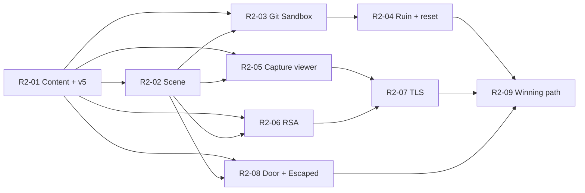

# Tasks 2 — Room 2 (Nathanel's Room) and the Escape Ending

Implementation plan for **"Implement Room 2 and the logic required for Room 2 to work."**
Tasks are **vertical features**: each one delivers a working player-facing capability end to end
(content, engine, sandbox, gateway, projection, frontend, validation, errors, logs) and can be
built and tested on its own branch.

This file replaces the layer-based "Feature 2: Room 2 and Escaping" section of the older
`escapeRoom-main/.../tasks.md` (sandbox-manager / script-catalog / projection / frontend split, written
against the pre-2026-11-07 topology). That section is superseded and must not be used.

---

## 0. Sources of Truth

| Priority | Source | Used for |
| --- | --- | --- |
| 1 | [DESIGN-v2.md](DESIGN-v2.md) (+ [constitution](.specify/memory/constitution.md)) | Architecture, contracts, game flow, sandbox, security, Room 2 content (§6, §7, §10, §11 F2–F4, §13) |
| 2 | `../escape-room-images-and-script /story-script.txt` (steps 10–22) | Storyline, player interactions, UI flow |
| 3 | Older task definitions | Superseded |

Constitution rule: the code is evidence, not authority. Where the code diverges from DESIGN-v2 a task
either closes the gap (if Room 2 needs it) or lists it as out of scope. Open design questions are
**surfaced, not guessed** (see §3).

---

## 1. What Already Exists (reuse, do not rebuild)

Backend — `apm0039582-projecthon-team5`:

| Capability | Where | Room 2 reuse |
| --- | --- | --- |
| Session lifecycle, pure `transition()` state machine, inbox/outbox, versioned commits | [apps/game-engine/src/modules/sessions](apps/game-engine/src/modules/sessions) | Extended, not replaced |
| OpenDoor / EnterRoom into `room-2` (adds room-2 puzzles, emits `RoomEntered`, opens eligible puzzles) | [transition.ts](apps/game-engine/src/modules/sessions/core/transition.ts) | Used as-is to get the player into Room 2 |
| Gateway session routes (`inputs`, `open-door`, `enter`, `abandon`, `resume`) with owner check and 8 KiB input bound | [src/sessions](src/sessions) | Used as-is; only the input validator grows |
| Shared contracts: `PuzzleFamily` already lists `terminal-git`, `rsa`, `tls`; events `PuzzleReset`, `SessionEscaped`, `HintRevealed` already typed | [packages/contracts](packages/contracts/src) | Extended (new `PuzzleInput` kinds) |
| Script Catalog repository, resolver cache, idempotent publication pattern (`publishGameplay`, script v1–v4) | [script-catalog](apps/game-engine/src/modules/script-catalog) | Same pattern for script **v5** |
| Kubernetes sandbox driver/executor/worker/repository (provision, exec 5 s / 64 KB, destroy, recovery, pod hardening) — **SQL-specific today** | [modules/sandbox](apps/game-engine/src/modules/sandbox) | Generalized for `terminal-git` |
| Local demo runtime: `LocalContainerExecutor` (`docker exec` into compose `sql-sandbox`, profile `demo-local`) | [apps/local-runtime](apps/local-runtime/src), [docker-compose.yml](docker-compose.yml) | Extended with a git sandbox container |
| `worker_threads` pool with 2 s limit (hash) | [hash-pool.ts](apps/game-engine/src/modules/components/hash-pool.ts) | Generalized into a crypto pool for RSA/TLS |
| `answer` engine (credentials compare, constant time) | [components.ts](apps/game-engine/src/modules/components/components.ts) | Extended with a single-field answer (door code) |
| Projection reducer + SSE stream, owner-authorized | [modules/projection](apps/game-engine/src/modules/projection) | Handles `RoomEntered`, `PuzzleSolved.files`, `DoorOpened`; `PuzzleReset`/`SessionEscaped` are **deferred** today |

Frontend — `apm0039582-projecthon-fe/src/teams/team5`:

| Capability | Where | Room 2 reuse |
| --- | --- | --- |
| Game shell: auth, resume, start, abandon, SSE (`useSessionStream`), countdown, ended screens (Expired/Abandoned) | `game/GameApp.tsx`, `game/useSessionStream.ts` | Reused; adds Escaped ending |
| Room stage, hotspots with alpha hit-testing, zoom panel, room toolbar | `game/RoomFrame.tsx`, `game/ZoomPanel.tsx` | Room 2 currently renders **"Coming soon"** — replaced |
| Device screen chrome, submit-error mapping, per-session drafts (`useDeviceDraft`) | `game/screens/shared/*`, `game/device-drafts.ts` | Reused by all Room 2 screens |
| Screen registry by puzzle key | `game/screens/index.ts` (`ROOM_1_SCREENS`) | Add `ROOM_2_SCREENS` |
| Room design JSON + asset map | `game/room-design/room-1.design.json`, `room-assets.ts` | Add `room-2.design.json` + assets |
| Dev fake views (includes a `room2` view) | `game/dev/fakeViews.ts` | Extend for UI work before the backend lands |
| API client (`postInput`, `door`, …) | `game/api.ts` | Reused unchanged |
| Room 2 artwork | `assets/room-2/room-background.png` only; full set in `../escape-room-images-and-script /second-room-images/` + `winning-room.png` | Import the rest |

## 2. Gaps Room 2 Must Close

| Gap (current code) | Closed by |
| --- | --- |
| Catalog `room-2` state has no puzzles/files; catalog types only know `sql`/`hash`/`answer` | R2-01 |
| No coherent Room 2 material (RSA key, git history, capture, PMS, randoms, records, card number) | R2-01 |
| `PuzzleInput` has no shape for RSA/TLS inputs; gateway validator rejects them | R2-01 |
| Room 2 UI is "Coming soon" | R2-02 |
| Sandbox provisioning, generation, eligibility, outcomes and `prepareSql` are hard-wired to `engine === 'sql'` / `idan-db-sql` / `room1-sql-v1` | R2-03 |
| No `terminal-git` image, helper, policy, component or terminal UI (xterm.js) | R2-03 |
| `ruined` verdict throws ("Ruin handling is not implemented in Feature 1"); `PuzzleReset` deferred in projection | R2-04 |
| Room files are static catalog copies; no per-session `revealedBy` replacement | R2-05 |
| No RSA / TLS components; hash pool is hash-only | R2-06, R2-07 |
| No final-state handling: `SessionEscaped` never emitted, deferred in projection, no victory screen | R2-08 |
| No winning-path replay covering Room 2 | R2-09 |

## 3. Design Conflicts and Open Questions (all resolved 2026-11-07)

| # | Item | Resolution in this plan |
| --- | --- | --- |
| C1 | **Q5 — RESOLVED 2026-11-07 (option B, recorded in DESIGN-v2 §17).** Solving `door` only makes room-2's door openable; the player sends OpenDoor, then EnterRoom into the final state `escaped`, which ends the session as Escaped. | R2-08 implements it. |
| C2 | **RESOLVED 2026-11-07 (follow DESIGN).** Script step 19 says the decrypted pcap "is added to the hints list"; DESIGN §13 says the file stays on Nathaniel's computer and is not an inventory item. | The decrypted content replaces the file on Nathanel's computer; no hints/inventory list (R2-05/R2-07). |
| C3 | **RESOLVED 2026-11-07.** Script step 22 adds Nathanel, Idan and an AT&T icon; DESIGN §13 had only Dana + sign. | Victory scene = `winning-room.png` as-is (Dana, Nathanel, Idan, "Congrats! Welcome to the team!"); no AT&T icon. DESIGN §13 updated to match (R2-08). |
| C4 | **RESOLVED by C1/Q5.** Door rules are hard-coded to `room-1`/`dana-login`. Room 2's exit also uses OpenDoor/EnterRoom, so door destination + unlock condition become catalog data (DESIGN §6, Q4, Q5). | In scope: R2-08. |
| C5 | **RESOLVED 2026-11-07 (follow DESIGN).** Script step 15 mentions "the git log file"; DESIGN §13 defines only the pcap file and the git terminal. | Terminal only (`git log` / `git show`); no git-log file on the desktop (R2-02/R2-03). |

## 4. Scope

**In scope:** Room 2 content (script v5), Room 2 scene, git sandbox + terminal, git ruin/reset,
capture viewer + decrypted reveal, RSA decryptor, TLS decryptor, door keypad, Escaped ending and
victory screen, Room 2 winning-path verification.

**Out of scope (existing platform gaps, not needed for Room 2 to work):** Event Hubs adapter (the
in-memory transport and synchronous StartSession stay), hint mechanism (RequestHint route,
HintRevealed handling, Hint button — the Room 2 hint *texts* are still stored in v5 so no republish is
needed later), reconnect sandbox regeneration (F5) and the gateway `/reconnect` route, janitor,
catalog publish validator (§6 publish checks), admin overview, Users service,
`sandbox` schema move, SQL ruin invariants, Room 1 catalog/decoy gaps.

---

## 5. Shared Conventions for All Tasks

- **Input contracts** (frozen by R2-01 so tasks can proceed in parallel), in
  `packages/contracts/src/messages/value-types.ts`, mirrored in the FE `contracts/outputs.ts` and accepted by
  the gateway `PuzzleInputValidator`:
  - git terminal: existing `{ kind: 'command', command }`
  - RSA decryptor: `{ kind: 'rsa', privateKey, encryptedPms, modulus }`
  - TLS decryptor: `{ kind: 'tls', pms, clientRandom }`
  - door keypad: existing `{ kind: 'answer', answer }`
- **Puzzle keys** (DESIGN §13): `nethanel-git`, `rsa-decryptor`, `tls-decryptor`, `door`. Room key `room-2`.
  Room file `Cibus_payment_try.pcap` (`revealedBy: tls-decryptor`).
- **Opening order** (DESIGN §13): `nethanel-git` (none) → `rsa-decryptor` → `tls-decryptor` → `door`.
  `onRuin = resetPuzzle` everywhere. Only `nethanel-git` can be ruined; wrong answers on the others are
  `rejected` / `wrongAnswer`.
- **Secrets never reach the browser early:** the private key exists only inside the git sandbox pod;
  the decrypted capture and card number exist only in server-side template seeds until the TLS solve.
  RSA/TLS/door inputs are redacted in `command_log.input_redacted` and in logs (follow the existing
  `GAMEPLAY_DEBUG_LOGS` non-production gate in `engine.service.ts`).
- **Copy and paste** (DESIGN §13): every output is selectable text; single values have a Copy button;
  multi-line fields (private key) keep line breaks; single-line fields trim spaces and line breaks.
- **Logging:** engine logs one structured line per evaluated command/transition (session id, room, puzzle,
  verdict, reason — never the input secret); sandbox module logs provision/exec/destroy/failure with the
  sandbox id and generation; the FE uses `game/logging/logger.ts` for submit/transport failures.
- **Merge hygiene (minimize overlap):**
  - One component per file under `apps/game-engine/src/modules/components/` (`terminal-git.component.ts`,
    `rsa.component.ts`, `tls.component.ts`, `answer…`); `ComponentFactory.evaluate` only dispatches by engine.
  - `transition.ts` changes go into small named helpers (`provisionSandbox`, `resetPuzzle`, `revealFiles`,
    `escape`) so parallel tasks touch different functions.
  - Each Room 2 FE screen lives in its own folder under `game/screens/` and is registered in `ROOM_2_SCREENS`.
- **Tests:** backend in `apps/game-engine/test` (jest; unit + DB integration with existing harnesses);
  gateway in `src/sessions/*.test.ts`; FE colocated vitest tests (`npm test` in the FE repo).

---

## 6. Task Index, Dependencies and Parallel Plan

| ID | Task | Size | Depends on | Suggested owner |
| --- | --- | --- | --- | --- |
| R2-01 | Publish Room 2 scenario content (key material, git history, capture, script v5) | M | Room 1 (done) | Dev A |
| R2-02 | Implement Room 2 entry and Nathanel's room scene | M | R2-01 (FE can start on fake views) | Dev B |
| R2-03 | Implement Git Sandbox (Nathanel's git terminal) | L | R2-01, R2-02 (desktop slot) | Dev A |
| R2-04 | Implement git puzzle ruin and reset | M | R2-03 | Dev A |
| R2-05 | Implement capture viewer and decrypted-file reveal | M | R2-01, R2-02 | Dev B |
| R2-06 | Implement RSA Decryptor machine | M | R2-01, R2-02 | Dev B |
| R2-07 | Implement TLS Decryptor machine | M | R2-05, R2-06 | Dev B |
| R2-08 | Implement door keypad, catalog-driven doors and Escaped ending (victory) | M | R2-01, R2-02 | Dev A |
| R2-09 | Room 2 winning-path verification and demo runbook | S | all above | Dev A + Dev B |

**Parallel plan (two developers):**
- Day 1: Dev A does R2-01. Dev B starts R2-02 against `fakeViews` (room-2 views) — no backend needed.
- Then Dev A: R2-03 → R2-04 → R2-08. Dev B: R2-02 (wire to real backend) → R2-05 → R2-06 → R2-07.
- Together: R2-09.
- Hot files and owners: `transition.ts` (A: sandbox/ruin/escape helpers; B: `revealFiles` helper),
  `components.ts` dispatch (each adds one line), `RoomFrame.tsx` (B owns; A only registers screens).

---

## R2-01 — Publish Room 2 Scenario Content (Cibus capture, key material, script v5)

### Goal
A new game pins **script v5**, whose `room-2` contains the four Room 2 puzzles, the encrypted
`Cibus_payment_try.pcap` file and server-side seeds that form one cryptographically consistent chain
(git key → RSA → PMS → TLS → card number → door). All shared Room 2 input contracts are frozen.

### Scope
- A reproducible, deterministic generator (committed script, no network) that produces:
  - RSA key pair (2048-bit; ≤ 4096 per DESIGN §6) and a self-signed server certificate (N, e).
  - A git repository bundle for Nathanel: an earlier commit contains the private key file; the latest
    commit is **"Security fix: Removed private key from repository."** (story step 15, DESIGN §13).
  - TLS 1.2 RSA-key-exchange session: client random, server random, a PMS, the PMS encrypted with
    PKCS#1 v1.5 under the certificate key, one fixed cipher suite recorded in the seed, and encrypted
    Application Data records containing Nathanel's Cibus payment with a **test** (non-real, Luhn-valid)
    credit card number.
  - Two text renderings of the capture: **encrypted** (ClientHello with client random, ServerHello,
    Certificate with N, ClientKeyExchange with encrypted PMS, then opaque encrypted records) and
    **decrypted** (same plus decrypted Application Data payload).
- Catalog types: `TerminalGitTemplateDefinition`, `RsaTemplateDefinition`, `TlsTemplateDefinition`,
  door answer seed; optional `hint` on `PuzzleDef`; `revealedBy` on catalog room files (catalog-only,
  not exposed in `RoomFile` view).
- Templates `nethanel-git@1` (sandbox/terminal-git: imageDigest, seedRef, policy, goal, invariants),
  `rsa-decryptor@1` (seed: N, e, encrypted PMS, expected PMS), `tls-decryptor@1` (seed: client random,
  server random, cipher suite, encrypted records, decrypted capture text),
  `nathanel-door@1` (answer seed: card number).
- Script **v5** = v4 + populated `room-2` (puzzles, `opensAfter` chain, `onRuin: resetPuzzle`, hint texts
  from DESIGN §13 on `rsa-decryptor`, `tls-decryptor`, `door`), file
  `Cibus_payment_try.pcap` with the encrypted text and `revealedBy: tls-decryptor`, a final state
  `escaped` (no puzzles, listed in `finalStates`), and per-room door data: `room-1` → `room-2` unlocked by
  `dana-login` solved, `room-2` → `escaped` unlocked by `door` solved (shape owned by R2-08, see C1).
  Published idempotently (same immutability checks as `publishGameplay`), pointer moves to 5.
- Contracts: new `PuzzleInput` kinds (§5) in `packages/contracts`, gateway `PuzzleInputValidator` +
  Swagger `oneOf`, FE `contracts/outputs.ts` mirror.

### Frontend
- Mirror the new `PuzzleInput` kinds in `contracts/outputs.ts`. No UI.

### Backend
- Generator script + committed generated artifacts (or CI-regenerated with a fixed seed) under
  `sandboxes/git/fixtures/` (repo bundle) and `apps/game-engine/src/modules/script-catalog/room2.ts`
  (template + script definitions, like `room1.ts`).
- Catalog publication command (pattern of `publish-gameplay.ts`) for templates + script v5.
- Gateway validator: accept `rsa` (`privateKey`, `encryptedPms`, `modulus`) and `tls` (`pms`,
  `clientRandom`) with non-empty strings; keep the 8 KiB bound.

### Integration / Logic
- Running sessions stay pinned to their version; only new sessions get v5.
- Engine guards keyed on `scriptVersion >= 3` must apply to v5.
- Until the engine tasks land, Room 2 puzzles exist but their inputs are rejected (`policyBlocked`) — that is expected.

### Dependencies
Room 1 implementation (script v4, catalog publication pattern).

### Acceptance Criteria
- A crypto self-test (jest) using only the generated seeds: the private key matches N; it decrypts the
  encrypted PMS to the expected PMS; TLS 1.2 PRF(PMS, client random, server random) derives keys that
  decrypt the records into text containing the card number; the git bundle's `HEAD~1` contains the key
  and `HEAD`'s message is exactly the security-fix message.
- Running the generator twice yields identical seeds (deterministic) or a CI check verifies consistency.
- Publishing twice is a no-op; conflicting content fails loudly; `catalog.scripts.current_version = 5`.
- A new session's snapshot, after OpenDoor + EnterRoom, contains `room-2` with `nethanel-git` open and
  the other three locked, and the projected `RoomEntered` carries only the **encrypted** file content.
- The encrypted file text contains no PMS, no private key, no decrypted record and no card number.
- Gateway accepts the new input shapes and still rejects unknown kinds/extra fields (400).

---

## R2-02 — Implement Room 2 Entry and Nathanel's Room Scene

### Goal
After walking through Room 1's door, the player sees Nathanel's room (not "Coming soon") with clickable
Nathanel's computer, RSA decryptor, TLS decryptor and the door keypad, each reflecting its server state.

### Scope
- Room 2 stage, hotspots, decorations and toolbar; Nathanel's computer desktop with the
  `Cibus_payment_try.pcap` icon and the git terminal shortcut (story steps 10–14).
- Screen registry and slots that later tasks plug into; locked/unavailable states until then.

### Frontend
- `game/room-design/room-2.design.json` (+ design test like `room-1.design.test.ts`) with hotspots for
  `nethanel-git` (computer), `rsa-decryptor`, `tls-decryptor`, `door` (keypad) and backgrounds closed/open.
- Import Room 2 assets from `second-room-images/` into `assets/room-2/` and a `ROOM_2_ASSETS` map
  (`room-assets.ts`).
- Generalize `RoomFrame.tsx` to render by `view.currentRoom.key` from the room design (keep Room 1's
  current behavior and door animation intact); toolbar shows Nathanel's room, `02 / 03`.
- `NathanelDesktop` screen (vacation note, two icons): the pcap icon opens the capture viewer slot (R2-05),
  the terminal icon opens the terminal slot (R2-03); show "Unavailable" until registered.
- `ROOM_2_SCREENS` registry exported next to `ROOM_1_SCREENS`; status footer shows git sandbox status
  (`Sandbox starting` / `Ready` / `Sandbox restarting` / `Sandbox failed`) and solved count for Room 2.
- Extend `dev/fakeViews.ts` with room-2 states (entered, git ready, rsa open, tls open, door open, escaped).

### Backend
- None new beyond R2-01. Verify `EnterRoom` on v5 emits `RoomEntered` with all four puzzles and the
  file, and `PuzzleOpened` for `nethanel-git`.

### Integration / Logic
- The scene is driven only by `SessionView` (DESIGN §1 "headless"): locked/open/solved per puzzle, files from
  `currentRoom.files`. No client-side progression state for Room 2.
- Reload/resume restores Room 2 from the SSE snapshot.

### Dependencies
R2-01 for real data (UI can be built first on fake views). Existing RoomFrame/ZoomPanel/DeviceScreen.

### Acceptance Criteria
- Entering Room 2 shows the Room 2 background and four hotspots; Room 1 tests stay green.
- Locked machines open a "Locked" panel; clicking outside or Esc returns to the room.
- Reloading the page in Room 2 returns to Room 2 with the same puzzle states.
- Hotspot alpha hit-testing and keyboard activation work as in Room 1.

---

## R2-03 — Implement Git Sandbox (Nathanel's Git Terminal)

### Goal
The player opens the git terminal on Nathanel's computer, runs git commands in an isolated sandbox
pod seeded with Nathanel's repository, finds the security-fix commit, prints the previous commit's
private key and copies it. Printing the key solves `nethanel-git` and unlocks the RSA decryptor.

### Scope
- `terminal-git` sandbox image, provisioning, exec, policy, goal check, component, terminal UI, local runtime.

### Frontend
- `game/screens/nethanel-git/` terminal screen using **xterm.js** (DESIGN §2/§7; add the dependency):
  prompt, local line editing, up-arrow history; each Enter sends one `{ kind: 'command', command }`
  via `submit`; renders `latestResult.output` (stdout/stderr) for the matching `commandId`.
- Copy: mouse selection + Cmd+C (macOS) / Ctrl+Shift+C / right-click → Copy; plain Ctrl+C cancels the line.
  Paste (Cmd+V / Ctrl+Shift+V) goes into the current line; pasted line breaks are **not** Enter.
- States: `Sandbox starting`, `Ready`, `Sandbox restarting`, `Sandbox failed`, rejection messages
  (`policyBlocked` → "Command not allowed", `sandboxRestarting`, `timeUp`, `sessionEnded`).
- Register as the terminal slot of `NathanelDesktop` (R2-02).

### Backend
- **Image** `sandboxes/git/` (pinned base by digest, git only, non-root fixed UID/GID, read-only root,
  writable `emptyDir` working copy, `GIT_PAGER=cat`, `PAGER=cat`, no network) with an entrypoint that
  restores the R2-01 bundle into the working copy and a helper (like `query-helper.mjs`) that runs one
  command line with the 5 s timeout / 64 KB cap and runs the template probe checks.
- **Sandbox module generalization:** pod spec per engine (`gitPod` next to `sqlPod`, same isolation controls
  from DESIGN §7), allowlisted seedRef/policyRef per template instead of hard-coded `room1-sql-v1` /
  `idan-db-sql` (driver, worker recovery, preflight), image allowlist entry.
- **Engine generalization (sandbox family, not `engine === 'sql'`):** initial generation, provision on open,
  destroy on end, `commandRejection` sandbox-ready guard, `SandboxOutcome` acceptance, and the
  out-of-transaction pre-evaluation in `EngineService.prepareSql` (rename/generalize to sandbox exec).
- **`TerminalGitComponent`:** validate input; policy deny-list on the parsed line (allow `git` sub-commands
  and basic read-only shell like `ls`/`cat`; block interactive programs, network tools, pipes/redirection
  to other programs as defined in the template policy) → `rejected/policyBlocked` without executing;
  exec via `SandboxExecutor` with the commandId (idempotent replay); `solved` when the output contains
  the template goal (the private key material), else `progress`.
- **Local runtime:** compose service `git-sandbox` (profile `demo-local`) and `LocalContainerExecutor`
  routing by puzzle/engine.
- Logs: provision/ready/failed/destroy with sandbox id + generation; per-command verdict, never the output body.

### Integration / Logic
- Flow F2: input → gateway (owner check, 202) → engine guards (Active, deadline, puzzle open, sandbox ready,
  generation) → sandbox exec in process → evaluation → `CommandEvaluated` (+ `PuzzleSolved`) → projection → SSE.
- Solving opens `rsa-decryptor` via `opensAfter`. Entering Room 2 provisions the git pod; session end
  (Expired/Abandoned/Escaped) destroys it.

### Dependencies
R2-01 (template, bundle), R2-02 (desktop slot). Existing sandbox module, SQL sandbox as the reference.

### Acceptance Criteria
- `git log` shows the security-fix commit; `git show HEAD~1` (or equivalent) prints the key and the
  puzzle becomes `solved`; `rsa-decryptor` becomes `open`.
- `vim`, `less`, `curl` (and other denied commands) are rejected without running.
- A command running > 5 s returns a timeout message; output > 64 KB is capped; the same commandId
  redelivered returns the stored result without re-running.
- The pod satisfies the DESIGN §7 controls (non-root, read-only root, no SA token, no env, default-deny
  network) — covered by the existing preflight extended to the git image.
- Works in the local `demo-local` runtime and in the Kubernetes runtime.
- The key can be selected and copied from xterm and pasted elsewhere; pasted multi-line text never runs.

---

## R2-04 — Implement Git Puzzle Ruin and Reset

### Goal
If the player breaks Nathanel's repository (for example an extra commit or rewritten history), the
puzzle resets to a fresh sandbox and the player keeps playing while the clock keeps running.

### Scope
- Invariant checks for `nethanel-git`, the `ruined` verdict, `resetPuzzle`, `PuzzleReset` projection and UI.

### Frontend
- Terminal shows "Puzzle reset – sandbox restarting", clears the scrollback, disables input until the
  sandbox is `ready` again, then shows a fresh prompt.

### Backend
- Template invariants (probe commands after each exec): HEAD commit id unchanged, no new commits,
  history not rewritten, key-removal commit present.
- `transition()`: replace the "Ruin handling is not implemented" throw with `onRuin = resetPuzzle`:
  generation+1, destroy old pod, provision new pod, puzzle back to `open`, `PuzzleReset { scope: 'puzzle' }`,
  `command_log.verdict = 'ruined'`; session stays Active, deadline unchanged.
- Stale generation: commands and sandbox outcomes for the old generation are rejected/ignored (existing checks).
- Projection: handle `PuzzleReset` (remove from the deferred set) — update the puzzle view, newer-version rule.
- Logs: ruin detected (session, puzzle, old/new generation, failed invariant name).

### Integration / Logic
- Flow F3. Only sandbox families can be ruined; input families never return `ruined`.

### Dependencies
R2-03.

### Acceptance Criteria
- `git commit --allow-empty -m x` (or any invariant break) → verdict `ruined`, `PuzzleReset` on SSE,
  new generation pod becomes ready, history is pristine again.
- The countdown continues unchanged; the session remains Active.
- A command sent against the old generation is rejected with `sandboxRestarting`.
- Redelivery of the ruining command does not reset twice.

---

## R2-05 — Implement Capture Viewer and Decrypted-File Reveal

### Goal
Clicking `Cibus_payment_try.pcap` on Nathanel's computer opens the capture large and scrollable so the
player can copy the client random, N and the encrypted PMS; once the TLS decryptor is solved, the same
file shows the decrypted capture with the Application Data payload.

### Scope
- Viewer UI; per-session room file state with `revealedBy` replacement in the engine.

### Frontend
- `game/screens/capture-viewer/`: opens from the desktop pcap icon (R2-02 slot), large centered panel,
  scrollable, monospace, fully selectable text; clicking outside / Esc returns to the room.
- Shows "The file has been decrypted" banner when the file content changed after the TLS solve.

### Backend
- Snapshot holds the current room file contents per session (initialized from catalog on RoomEntered).
- `transition()` helper `revealFiles`: on `PuzzleSolved` of puzzle P, every room file with
  `revealedBy === P` gets the solve's reveal content (provided by the component evaluation; R2-07 supplies
  it for TLS); `PuzzleSolved.files` and later `roomView()` use the per-session contents.
- Projection already applies `PuzzleSolved.files`; add a reducer test for the encrypted → decrypted swap.

### Integration / Logic
- DESIGN §6 Room Files: secret content is produced only by the engine on a correct solve and travels in
  `PuzzleSolved`; it persists across reload/SSE reconnect via `session_view`.

### Dependencies
R2-01 (file + `revealedBy`), R2-02 (desktop slot).

### Acceptance Criteria
- Before the TLS solve the viewer shows the cleartext handshake through ClientKeyExchange and opaque records;
  the client random, N and encrypted PMS can be selected and copied exactly.
- An engine unit test with a stub reveal shows the file switching on the `revealedBy` puzzle only.
- After a reload the decrypted content is still shown; another session still sees the encrypted file.

---

## R2-06 — Implement RSA Decryptor Machine

### Goal
The player pastes the private key, the encrypted PMS and N into the RSA decryptor, clicks Decrypt and
gets the decrypted PMS to copy (story steps 17–18). Solving unlocks the TLS decryptor.

### Scope
- RSA machine UI, `RsaComponent`, crypto worker pool.

### Frontend
- `game/screens/rsa-decryptor/` (art: `rsa-decryptor-streight.png`): multi-line Private key field (keeps
  line breaks), single-line Encrypted PMS and Modulus N fields (trimmed), Decrypt button, output field
  with the PMS and a Copy button; drafts via `useDeviceDraft`; error text for `wrongAnswer`,
  `policyBlocked` (malformed), `timeUp`, `sessionEnded`.

### Backend
- Generalize `HashPool` into a crypto worker pool (2 s limit, bounded queue) with hash, rsa and tls tasks.
- `RsaComponent` (input `{ kind: 'rsa', privateKey, encryptedPms, modulus }`): size limits (key ≤ 4096 bits,
  hex ≤ 8 KB); malformed PEM/hex → `rejected/policyBlocked`; key modulus must equal seed N and the pasted
  N; pasted encrypted PMS must equal the seed; decrypt with PKCS#1 v1.5; result compared in constant time
  to the seed PMS → `solved` with output = PMS hex; otherwise `rejected/wrongAnswer` (counts as wrong attempt).
- Redact the private key in `command_log` and logs.

### Integration / Logic
- Flow F4 (no sandbox). `opensAfter`: open only after `nethanel-git`; solving opens `tls-decryptor`.

### Dependencies
R2-01, R2-02. Uses the key from R2-03 in play, but is testable with seeds alone.

### Acceptance Criteria
- Correct key + PMS + N → `solved`, PMS shown and copyable; TLS decryptor becomes open.
- Wrong key, wrong N or wrong PMS → `wrongAnswer`; malformed key → `policyBlocked`; > 4096-bit key rejected.
- A pathological input cannot block the event loop (> 2 s → worker replaced, `sandboxRestarting`-style
  unavailable result, no crash).
- Input with line breaks in the key field round-trips intact.

---

## R2-07 — Implement TLS Decryptor Machine

### Goal
The player pastes the decrypted PMS and the client random into the TLS decryptor and clicks Decrypt; the
machine shows "The file has been decrypted" and the capture on Nathanel's computer becomes decrypted
(story step 19, DESIGN §13). Solving unlocks the door keypad.

### Scope
- TLS machine UI and `TlsComponent`, supplying the reveal content for R2-05.

### Frontend
- `game/screens/tls-decryptor/` (art: `tld-decryptor-streight.png`): single-line PMS and Client Random fields
  (trimmed), Decrypt button, success message "The file has been decrypted", errors as in R2-06.

### Backend
- `TlsComponent` (input `{ kind: 'tls', pms, clientRandom }`) on the crypto pool: hex validation and size
  limits; TLS 1.2 PRF(PMS, client random, server random from seed) → master secret → key block →
  decrypt the seed records with the seed cipher suite; success iff decryption/MAC verification succeeds →
  `solved`, output "The file has been decrypted", reveal content = decrypted capture text (seed);
  otherwise `wrongAnswer`.
- The decrypted capture is never placed in `CommandEvaluated.output`; it only travels via the R2-05 file reveal.

### Integration / Logic
- `opensAfter`: after `rsa-decryptor`; solving opens `door` and triggers `revealFiles` for `Cibus_payment_try.pcap`.

### Dependencies
R2-05 (reveal mechanism), R2-06 (crypto pool).

### Acceptance Criteria
- Correct PMS + client random → `solved`, success message, viewer shows the decrypted Application Data with
  the card number; door keypad becomes open.
- Wrong PMS or wrong client random → `wrongAnswer`, file stays encrypted.
- Before this solve no SSE payload contains decrypted records or the card number (asserted in a projection test).

---

## R2-08 — Implement Door Keypad, Catalog-Driven Doors and Escaped Ending (Victory)

### Goal
The player types/pastes Nathanel's card number on the door lock, which unlocks the door; the player
then opens it (OpenDoor) and walks through (EnterRoom); the session ends as **Escaped** and the victory
screen appears (story steps 21–22, DESIGN §6 Rooms and Doors, §10, §13, Q5).

### Scope
- Keypad UI, single-field answer engine, catalog-driven door rules for **every** room (replacing the
  hard-coded `room-1`/`dana-login`/`room-2` logic), EnterRoom into a final state → Escaped,
  `SessionEscaped` projection, victory screen.

### Frontend
- `game/screens/door-keypad/` (art: `door-keypad.png`, `streight-kepad.png`): digit entry + paste field,
  Enter button, "Wrong code" on `wrongAnswer`.
- When `door` is solved and `doorOpenedAt` is null: an "Open door" action on the keypad/door (calls the
  existing `api.door(sessionId, 'room-2', 'open-door')`).
- On `DoorOpened` for room-2: switch to the open-door background (`second-room-background-with-door-open.png`)
  and show the door hotspot "Walk through" (calls `api.door(..., 'enter')`), mirroring Room 1's door hotspot.
- On `status === 'Escaped'`: victory screen showing `winning-room.png` as-is (Dana, Nathanel, Idan,
  "Congrats! Welcome to the team!"; no extra AT&T icon) instead of the
  generic "Game Over"; drafts cleared; return to start.

### Backend
- `answer` engine: support a single-field seed (`{ kind: 'answer', answer }`): trim, strip spaces between
  digit groups, digits only, constant-time compare to seed → `solved` / `wrongAnswer`.
- Catalog door data per room (type in `catalog.types.ts`, values published in v5 by R2-01):
  `door: { to: <state key>, unlockedBy: <puzzle key> }`.
- `transition()` door helpers driven by that data (no room keys or puzzle keys in engine code):
  - OpenDoor guards: session Active, before deadline, player in that room, room's `unlockedBy` puzzle
    solved → mark door open (`doors[roomKey]`), emit `DoorOpened`; otherwise `rejected`.
  - EnterRoom guard: that room's door is open. If `to` is a normal room → existing move + `RoomEntered`.
    If `to` is in `finalStates` → helper `escape`: status `Escaped`, `endedAt`, destroy all live sandboxes,
    emit `SessionEscaped` (no `RoomEntered`); later commands → `sessionEnded`.
  - Room 1 behavior on v3/v4 sessions must stay identical (regression tests); version-gated legacy paths
    for v1/v2 remain.
- Projection: handle `SessionEscaped` (remove from the deferred set); `DoorOpened` for room-2 already works.
- Logs: `Door opened roomKey=…`, `Game escaped sessionId=… elapsedSeconds=…`.

### Integration / Logic
- Flow F10 for both rooms; the gateway routes `open-door`/`enter` and owner checks are reused unchanged.
- Expiry still wins if the deadline passed first (whichever commit wins).

### Dependencies
R2-01 (door data + `escaped` final state in v5), R2-02 (scene). Testable with seeds before R2-07 lands.

### Acceptance Criteria
- Correct code → `door` solved, no ending yet; OpenDoor → `DoorOpened`, open-door background;
  EnterRoom → `SessionEscaped`, SSE view `Escaped`, victory screen; git pod destroyed.
- OpenDoor before the code is solved, or EnterRoom before OpenDoor → `rejected`.
- Wrong code → `wrongAnswer`, counted in `wrongAttempts`; door stays locked.
- Room 1 OpenDoor/EnterRoom tests pass unchanged; `transition.ts` contains no hard-coded room/puzzle keys
  for door handling.
- After Escaped, any input/door command is rejected `sessionEnded`; reload shows the victory screen.
- A command after the deadline yields `timeUp`/Expired, not Escaped.

---

## R2-09 — Room 2 Winning-Path Verification and Demo Runbook

### Goal
Prove the whole game is playable from Start to Escaped and document how to run the demo.

### Scope
- Engine integration test that replays the winning path with each template's solution, including Room 1,
  OpenDoor, EnterRoom, git key recovery, RSA, TLS, door code, OpenDoor, EnterRoom → Escaped (DESIGN §6 "winning path replays in CI"),
  plus one git ruin-and-reset case.
- FE flow test (vitest with fake views) for Room 2 screens in order.
- `docs/acceptance/room2-quickstart.md`: build the git sandbox image, publish v5, run `demo-local`, walk-through.

### Frontend
- Room 2 flow test across the registered screens using fake views.

### Backend
- Integration test using existing harnesses (`test/helpers/*`) and the real catalog v5.

### Integration / Logic
- Uses only public routes and SSE for the manual runbook; secrets stay redacted in logs throughout.

### Dependencies
R2-01 … R2-08.

### Acceptance Criteria
- The integration test is green in CI and ends with `status = Escaped`.
- The ruin case ends with a fresh generation and the game still winnable.
- A teammate following the runbook completes the game locally without extra instructions.

---

## Execution Audit (2026-11-10)

All nine tasks are implemented, one branch per task, each cut from the previous one:
`embedded-sql-sandbox` → `room2/R2-01-content` → `R2-05-capture` → `R2-06-rsa` → `R2-08-door-escape` →
`R2-07-tls` → `R2-03-git` → `R2-04-ruin-reset` → `R2-09-e2e` (frontend: `team5/sync-nov9` →
`team5/room2/R2-02-scene` → the same order). The order differs from the task numbers because tasks were
landed as they were approved; every link passed the full suites after its rebase.

Verified on `R2-09-e2e`: game-engine jest 349 passed (141 DB-gated skipped), tsc clean; team5 vitest 219
passed; team5-only guard clean; the gated `room2-git.integration.test.ts` passes against Postgres; a manual
browser playthrough Room 1 → Room 2 (including a git ruin and reset) → victory on the embedded runtime
succeeded, every `sandbox_instances` row ended `destroyed`, and no private key or card number reached the
logs. Every Room 2 screen was compared side by side with the HTML reference at 1280×800.

### Deviations from this file and DESIGN-v2 (all intentional)

| # | Where | Planned | Done | Why |
| --- | --- | --- | --- | --- |
| D1 | R2-03 | `terminal-git` sandbox image, pod, `git-sandbox` compose service | Embedded sandbox: isomorphic-git on an in-memory file system in a worker thread; Kubernetes driver returns `unsupportedSandbox` for git | Decision 2026-11-10 (embedded, writable), extends ADR 0001; no pods available |
| D2 | R2-03 | xterm.js as an npm dependency | Vendored under `src/teams/team5/vendor/xterm/` from the HTML reference | Decision: team5-only frontend changes; license notice only from the reference (see F5) |
| D3 | R2-01/R2-08 | Door code from the HTML (`4729384090176621`, fails Luhn) | Generated Luhn-valid test card `4000000131941181` | Decision: follow the design (a valid test card) |
| D4 | R2-03 | `git show HEAD~1` prints the key | The key is printed by `git show HEAD~1:server.key` (or `git checkout HEAD~1` + `cat server.key`); `git show HEAD~1` shows that commit's diff | Matches real git on this fixture |
| D5 | R2-04 | Invariant "HEAD commit id unchanged" | Judged on the branch tip and history; a detached checkout of an older commit (a solve path) is not a ruin; a ruin after the solve keeps the puzzle solved; `onRuin: resetRoom` not implemented | F3 only re-opens solved puzzles for resetRoom |
| D6 | R2-08 | No room/puzzle keys in door code | `transition.ts` has none; `doors.ts` keeps one legacy entry (room-1 → room-2, `dana-login`) for catalog v3/v4, which predate door data | Published catalogs are not changed |
| D7 | R2-02…R2-08 | Hebrew UI text of the HTML | English text, same meaning and placement | As in Room 1 |
| D8 | R2-05 | — | Time column is synthetic (the capture text has no timestamps); "The file has been decrypted" strip added to the viewer | Design asks for the message; HTML has none |
| D9 | R2-06/R2-07/R2-08 | — | RSA output Copy button, keypad paste field (both required by this file); TLS art's third "Ciphertext" box has no input (contract has only `pms`, `clientRandom`) | Frozen contracts |
| D10 | R2-04 | — | Terminal reads the session-level `latestResult` so engine rejections reach it (no backend change) | v≥3 does not store rejections on the puzzle |

### Behaviour that matches the HTML but may surprise players

- Esc does not close the git terminal window (xterm consumes the key), although the footer says "press Esc".
- The keypad hotspot sits over the middle of the open Room 2 door; the door's "To the victory room" pill works.

### Follow-up Tasks

| ID | Task | Size |
| --- | --- | --- |
| R2-10 | Make Esc leave the git terminal (xterm `attachCustomKeyEventHandler` returns false for Escape and the window steps back); keep Ctrl+C behaviour | S, FE |
| R2-11 | Repair the stale DB-gated suites (`catalog.integration`, `projection.integration`, `engine.integration`, `sandbox-*` with `RUN_SANDBOX_DB_TESTS`): they query the old `catalog.*`/`projection.*` schemas or expect schema `team5` to exist; create the schema in the harness and use `team5.*` | M, BE (pre-existing) |
| R2-12 | Fix the pre-existing team5 type error in `game/ZoomPanel.tsx` (`useRef<EventTarget \| null>` assigned an object; came with the 9 Nov snapshot) | XS, FE |
| R2-13 | Allowlist the synthetic Room 2 key and certificate (`scripts/room2/rsa-private-key.pem`, the git fixture, generated scenario) for secret scanners, or generate them at publish time | S, BE |
| R2-14 | Restore an "AbandonSession destroys the git sandbox" case in the gated DB test (R2-09 changed that test to end as Escaped; the unit tests still cover `end()`) | XS, BE |
| R2-15 | Kubernetes git sandbox (image, `gitPod`, preflight) — only if sandbox pods become available | L, BE (optional) |
| R2-16 | Hint mechanism (RequestHint route, HintRevealed, Hint button); the v5 hint texts are already published | M, BE+FE (was out of scope) |
| R2-17 | Local-run note: the public-registry lockfile copy used where the corporate npm registry is unreachable must be regenerated from this branch's `package-lock.json` (R2-03 added isomorphic-git, memfs and 37 transitive packages) | XS, docs |
